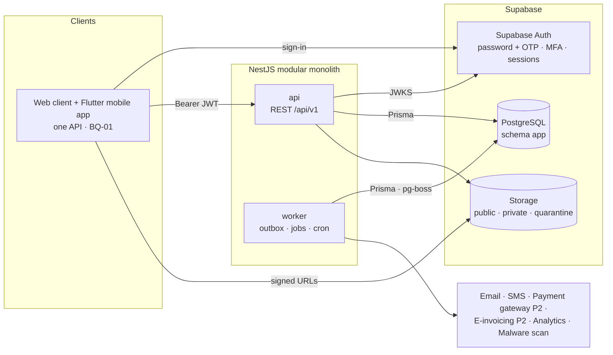
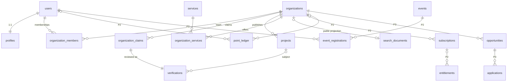

# Back Of House Backend: Master Architecture Map

> **Start here.** This is the entry point to the backend architecture. Each section summarises one area and links to the detailed document.
>
> ⚠️ **Mandatory business rules** — [`business-rules.md`](business-rules.md) (2026-09-17) — override PRD text and apply to every implementation. Read them first.
>
> | | |
> |---|---|
> | **Source of truth** | *Back Of House Product Requirements & Technical Delivery Specification*, v1.0, 27 Aug 2026 (Arabic), cited as **PRD §x** |
> | **Stack** | NestJS · TypeScript · PostgreSQL on Supabase · Prisma · REST |
> | **Style** | Modular monolith (`api` + `worker` from one codebase) |
> | **Status** | Architecture documented · **no code yet** · created 2026-09-14 · business decisions applied 2026-09-15 · mandatory business rules applied 2026-09-17 |
> | **Visual viewer** | [`index.html`](index.html) (open in a browser; renders all documents and diagrams) |

## At a glance

| Metric | Value |
|---|---|
| Business domains | 12 (§2) |
| NestJS domain modules | 24 (16 in Phase 1) + 9 platform modules |
| Database tables | **96** designed (Phase 1: 46 · Phase 2: 27 · Phase 3: 12 · Phase 4: 11); 11 of them ⏸ deferred (9 monetization, 2 messaging/surveys) |
| Enums | 68 (5 rule-defined · 19 PRD-defined · 12 PRD-derived · 32 proposed) |
| Domain events | ~100 |
| Atomic transactions catalogued | 32 (T-01 … T-32; 4 deferred with monetization) |
| Questions | 13 business decisions + mandatory rules resolved BQ-02 (scope), BQ-25, BQ-29 · BQ-59…66 resolved, BQ-67 partly · open raised questions BQ-51…58, 67 (rest), 68…74 · 27 technical · 27 requirement gaps |
| Architecture decisions | 30 (9 accepted, ADR-008 partly accepted, 17 proposed, 1 superseded, 2 open) |

## Document index

| # | Area | Document |
|---|---|---|
| 0 | **Mandatory business rules** | [business-rules.md](business-rules.md) |
| 1 | Architecture overview | this file |
| 2 | Domain map & relationship map | [domain-map.md](domain-map.md) |
| 3 | NestJS module map | [nest-module-map.md](nest-module-map.md) |
| 4 | Module dependency graph | [module-dependency-map.md](module-dependency-map.md) |
| 5 | Database ERD | [database-erd.md](database-erd.md) |
| 6 | Entity catalog | [database-entities.md](database-entities.md) |
| 7 | Enums & status machines | [enums-and-statuses.md](enums-and-statuses.md) |
| 8 | Authentication / authorization / trust | [auth-architecture.md](auth-architecture.md) |
| 9 | Company context (multi-organization) | [company-context.md](company-context.md) |
| 10 | Business workflows | [business-workflows.md](business-workflows.md) |
| 11 | REST API map | [api-map.md](api-map.md) |
| 12 | Points, levels, visibility | [points-architecture.md](points-architecture.md) |
| 13 | Domain events | [domain-events.md](domain-events.md) |
| 14 | Security & audit | [security-and-audit.md](security-and-audit.md) |
| 15 | Supabase architecture | [supabase-architecture.md](supabase-architecture.md) |
| 16 | Database design rules | [database-design-rules.md](database-design-rules.md) |
| 17 | Transaction boundaries | [transaction-boundaries.md](transaction-boundaries.md) |
| 18 | Development order | [backend-development-order.md](backend-development-order.md) |
| 19 | Implementation status | [backend-implementation-status.md](backend-implementation-status.md) |
| 20 | Open questions | [open-questions.md](open-questions.md) |
| 21 | Architecture decisions | [architecture-decisions.md](architecture-decisions.md) |

---

## 1. Architecture overview

Back Of House is a **national professional platform for Saudi Arabia's events sector** (PRD §1). The first product is a **verified, claimable company directory**. Memberships, points, events, a professional directory, opportunities, benchmarking reports and (on hold, BQ-51) buyer features are built on top of it, **phase by phase behind measurable gates** (§6, §21).



**Guiding principles**

1. Domain modules with clear table ownership. Writes never cross boundaries.
2. An acyclic module graph (layered; events and ports for reverse flows).
3. **Identity ≠ authorization ≠ verification/trust ≠ visibility ≠ points ≠ membership.**
4. Authorization is enforced in the server **and** in queries (§4). Frontend hiding is never a control.
5. Important mutations are audited in the same transaction.
6. No infrastructure without need: no microservices, Kafka, Redis or CQRS.
7. Phase-gated delivery: Phase 1 first (§30).
8. **Simple MVP** (business rules §14): reusable models and components, no premature payment or messaging infrastructure, classify every feature with the 11 questions in `business-rules.md` §16.

---

## 2. Domain map

```text
BACK OF HOUSE BACKEND
├── 1. Identity & Access ........... users · consents · profiles · roles · memberships · invitations      P1
├── 2. Directory ................... taxonomy · companies (company type) · approvals · claims · merges · company projects · search · imports P1
├── 3. Trust ....................... verification cases · independent company signals · evidence documents  P1
├── 4. Community ................... content (P1) · events, tickets, attendance (P2)
├── 5. Membership .................. plans · subscriptions · payments · entitlements — ⏸ DEFERRED (rules §11)
├── 6. Engagement .................. point rules · ledger · balances · levels · badges · visibility        P2
├── 7. Talent ...................... experiences (confirmed employment) · education · certifications       P3
├── 8. Opportunities ............... JOB · CO_OP · VOLUNTEERING · SUPPLIER_REQUEST · applications · supplier responses        P3
├── 9. Intelligence ................ analytics events (P1) · metrics · benchmarks · reports · exports (P4)
├── 10. Institutional .............. supplier lists · saved searches · RFIs — ON HOLD (BQ-51)             P4
├── 11. Operations & Governance .... admin · moderation · audit · notifications                           P1
└── 12. Observatory & Partners ..... not designed                                                         P5
```

**Not modelled:** comments/social interactions (not in the PRD), a points rewards catalog or redemption (excluded by decision BQ-08), courses (the frontend has a Courses screen, BQ-02), organization types (every organization is a company, BQ-06).
→ Full map, PRD evidence per domain and diagrams: [domain-map.md](domain-map.md)

---

## 3. Module map

```text
src/
├── main.ts · worker.ts · app.module.ts
├── config/          env validation
├── common/          decorators · guards · filters · interceptors · pipes · errors · pagination · i18n · Arabic text
├── platform/        database · supabase · storage · messaging · outbox · jobs · idempotency · observability · rate-limit
└── modules/
    ├── P1: identity · access · profiles · taxonomy · media · organizations · projects · verification
    │       search · content · moderation · notifications · audit · analytics · imports · admin
    ├── P2: engagement · events   (entitlements · billing ⏸ deferred)
    ├── P3: talent · opportunities
    └── P4: intelligence · institutional
```

**Layers (acyclic):**

| Layer | Modules |
|---|---|
| L0 | audit |
| L1 | identity, taxonomy, media, entitlements |
| L2 | access |
| L3 | profiles, verification, content, analytics, notifications |
| L4 | organizations |
| L5 | projects, imports, billing, talent |
| L6 | search, engagement, moderation, intelligence, opportunities |
| L7 | events, admin, institutional |

Reverse interactions go through **domain events** (outbox) or **ports** defined by the lower module (verification subject handlers, merge participants, document access policies).
→ [nest-module-map.md](nest-module-map.md) · [module-dependency-map.md](module-dependency-map.md)

---

## 4. Database ERD (core)



- 91 tables. All 38 table names from PRD §14 are kept, plus `organization_approvals` (BQ-05).
- UUID v7 keys · `timestamptz` UTC · paired `_ar`/`_en` columns · money in halalas.
- "Exactly one subject" relationships use one FK column per target + `CHECK (num_nonnulls(...) = 1)`. There are no untyped polymorphic ids.
- Append-only tables: `audit_logs`, `point_ledger`, `consents`, `verification_decisions`, `data_exports`, `analytics_events`.

→ [database-erd.md](database-erd.md) (10 focused diagrams) · [database-entities.md](database-entities.md) · [database-design-rules.md](database-design-rules.md)

---

## 5. Entity relationships (the ones that matter most)

| Relationship | Type | Why it matters |
|---|---|---|
| User (`account_type` INDIVIDUAL / COMPANY) ⟷ Company via `organization_members` | MANY-TO-MANY | The only source of company permissions; account type and company type grant nothing (rules §1, §2) |
| Company → exactly one Company Account | 1:1 | `organizations.account_user_id`; one company per Company Account; members are Individual accounts without permissions (BQ-68) |
| Company → Approval requests | 1:N | Admin publishes the listing; approval is **not** verification (BQ-05, BQ-46) |
| Organization → Claim → Verification | 1:N → 1:1 | Ownership only after a reviewer's decision (§5.2, §20.2, BQ-48) |
| Company → Verification signals | 1:N | Registration, domain, each credential, each contact — independent (BQ-47) |
| Organization → Projects → Verifications | 1:N → 1:N | Case studies, trust and project points |
| Verification → `verified_at` facts → TRUST points | derived | Trust is derived from evidence and can never be bought |
| Company → Company projects | 1:N | Past work / portfolio; **not** opportunities (rules §4) |
| Opportunity → Applications (individuals) | 1:N | One status model; the company decides (rules §8) |
| Supplier request → Supplier responses (companies) | 1:N | B2B only; individuals never respond (rules §7) |
| Subscription → Entitlements ⏸ | 1:N | Deferred; paid features never touch trust or organic ranking (rules §11, §12) |
| Point ledger → balances → levels / badges / visibility | projections | Explainable, reversible, exactly-once |
| User ⟷ Event via `event_registrations` (+ `attended_at`) | MANY-TO-MANY | Points only after verified attendance |
| User ⟷ Organization via `experiences` (P3) | MANY-TO-MANY | Employment history; **grants no access** |
| Buyer company ⟷ Company via lists and RFIs (P4, on hold BQ-51) | MANY-TO-MANY | Private notes never visible to the company |

→ [domain-map.md §3](domain-map.md)

---

## 6. Authentication

**Decision BQ-30: OTP + password.** Recommendation (ADR-003, pending TQ-01/TQ-02): Supabase Auth authenticates; NestJS verifies the JWT through JWKS and authorizes. The same flow serves the **web** and **Flutter** clients through one API (BQ-01).

```text
Sign-up:  email or phone + password ──► Supabase Auth ──one-time code──► identifier confirmed
Sign-in:  identifier + password ──► Supabase Auth ──JWT (sub, session_id, aal)──► NestJS AuthGuard
   → session still valid? → users row (status, onboarding) → AssuranceGuard (aal2 for staff)
   → PermissionGuard (company from URL) → EntitlementGuard → service policy → company-scoped query
Recovery: one-time code to the confirmed identifier → new password → other sessions revoked
```

- The `users` row is created only after the identifier is confirmed (AUTH-01). Onboarding records terms and consents (§5.1).
- Global sign-out and admin revocation work immediately through the `session_id` check (AUTH-02).
- MFA (`aal2`) is enforced for staff (AUTH-03). "Entities" have no organization type → BQ-51.
- Social login is excluded (BQ-30). OTP-only sign-in → **BQ-58**. The Flutter app's `/auth/*` calls → **TQ-02**.

→ [auth-architecture.md](auth-architecture.md)

## 7. Authorization

- **RBAC scoped to a company** (§4). Roles and permissions are defined in code; assignments are data.
- Platform staff roles: `VERIFICATION_REVIEWER`, `CONTENT_MODERATOR`, `SYSTEM_ADMIN`, `AUDITOR` (all require MFA).
- `SYSTEM_ADMIN` approves new companies (BQ-05). Verification decisions are made only by `VERIFICATION_REVIEWER` or `SYSTEM_ADMIN`, never automatically, in Phase 1 (BQ-48).
- Company context: the company's single Company Account holds all company permissions; no roles, no delegation (BQ-68). Individual members hold none. Institution roles were removed (BQ-06).
- Eight enforcement layers, deny by default, 404 for other companies' resources, **negative authorization tests** for every role × endpoint (§20.1).

```text
Authentication  "Who are you?"                      Supabase Auth (password + OTP) + users
Authorization   "What may you do?"                  staff roles · memberships · grants · code catalog
Approval        "Is this listing published?"        organization_approvals (admin) — not verification
Verification    "Can we trust this information?"    independent signal cases → verified_at facts → TRUST points
Visibility      "How discoverable?"                 visibility_snapshots → search signal
Points          "What engagement value?"            point_ledger → balances → levels/badges (never spent)
Membership      "What has been paid for?"           subscriptions → entitlements
```

→ [auth-architecture.md §2](auth-architecture.md)

## 8. Account contexts & company context

- **Two account types, two security contexts** (BQ-60): the user chooses **Individual** or **Company** at registration, each with its own flow and data. An Individual token never reaches company routes, and a Company token never reaches individual routes.
- **A company has exactly one user — its Company Account** (`organizations.account_user_id`, BQ-68). Employees and members use **Individual accounts** and are company **members** with no company permissions.
- Companies have **one or more company types** (BQ-61) and **one or more industries** (BQ-63); classification ≠ verification ≠ permission.
- Team members are **shown on the public profile by default**; the company can hide specific members (`show_on_company_profile`, BQ-64).
- **Supplier requests** are visible only to Company Accounts, and any company may respond (BQ-65, BQ-66).
- Ownership changes only through company creation, an approved claim or the admin ownership flow (BQ-69). The student concept was removed (BQ-72). JOB has an employment type and needs a verified company to publish (BQ-73).
- The acting company is explicit in the URL (`/api/v1/organizations/:organizationId/...`) and must be the caller's company. **Companies to Watch** mixes admin picks, activity and verification/completeness; it is neutral and never paid (BQ-70).

→ [company-context.md](company-context.md)

---

## 9. Main workflows

| Workflow | Path | Phase |
|---|---|---|
| User | Sign up (password + OTP confirmation) → choose Individual or Company (separate flows and security contexts, BQ-60) → individual profile or company registration → optional verification → searchable (privacy) | 1 |
| Claim company | Find → claim → automated hints → reviewer decides → company linked to the claimant's Company Account + CLAIMED → members join | 1 |
| New company | Duplicate check → DRAFT (creator = owner) → admin approval → CLAIMED, public (not verified) → verification signals one by one → plan features | 1 |
| Project | DRAFT → IN_REVIEW → PUBLISHED / NEEDS_CHANGES / REJECTED → ARCHIVED | 1 |
| Import | Upload → preview → commit in chunks (UNCLAIMED) → quality report → rollback | 1 |
| Event | Create → publish → register / waitlist → check-in → **attendance verified → points** → survey / certificate | 2 |
| Subscription | ⏸ Deferred (rules §11) | — |
| Points | Verified fact → rule version → ledger → balance → level / badge / visibility | 2 |
| Opportunity | Company creates any type → publish → individuals apply (JOB, CO_OP, VOLUNTEERING) **or** any company responds (SUPPLIER_REQUEST, Company Accounts only) → close | 3 |
| Application | SUBMITTED, then any company-chosen status: REVIEWED · SHORTLISTED · CONTACT · ACCEPTED · REJECTED (flexible, BQ-67); applicant may withdraw — the company decides | 3 |
| Buyer | On hold — every organization is a company (BQ-06 → BQ-51) | 4 |

→ [business-workflows.md](business-workflows.md) · [enums-and-statuses.md](enums-and-statuses.md)

---

## 10. API structure

```text
/api/v1
├── /me/...                            own account, onboarding, consents, profile, notifications, registrations
├── /companies · /projects             public directory & search (P1)
├── /categories · /services · /locations · /skills
├── /news · /pages                     content
├── /organizations/:organizationId/... organization management: profile, team, invitations, projects,
│                                      approval requests, verification signals, subscription (P2), opportunities (P3), reports (P4)
├── /verifications/:id/...             applicant evidence & submission
├── /uploads · /documents/:id/access-url
├── /events · /levels · /badges                            (P2; /membership-plans ⏸ deferred)
├── /opportunities (individual audience) · /supplier-requests (company audience) · /professionals (P3)
├── /market-reports                                        (P4)
├── /admin/...                         staff back office (MFA)
└── /webhooks/payments/:provider       ⏸ deferred (rules §11)
```

Errors `{code, message, trace_id, errors}` · 422 for validation · cursor pagination · `Idempotency-Key` for payments, check-ins and point adjustments.
→ [api-map.md](api-map.md)

## 11. Points architecture

- The **ledger is the source of truth** (append-only). Corrections are made by `REVERSAL` entries. Rule versions are kept (§8.1).
- Member categories (§8.2), and company components with caps 100 / 300 / 100 / 100 / 100 (§8.3). Computed components write deltas.
- Visibility: company 30/25/20/15/10 and professional 30/25/20/15/10 weights (§8.4), with activity decay 100/70/40/20% (§8.5).
- Anti-abuse: caps, idempotency keys, fingerprints, human review of upper levels, anomaly alerts, appeals (§8.6).
- Points are **never spent or redeemed**; they drive levels and benefits only (decision BQ-08). Levels never require verification (BQ-07).
- Company trust points come from each approved verification signal; company approval earns nothing (BQ-46, BQ-47).
- Points **unlock** Levels, Rewards and Benefits and are **never deducted** (BQ-59). Profile Highlight is a reward, separate from Verification and from Featured / Promoted. *Featured Companies* is now **Companies to Watch**.

→ [points-architecture.md](points-architecture.md)

## 12. Events

- Transactional **outbox** → worker → idempotent handlers (at-least-once). About 100 named events.
- Main consumers: notifications, search indexer, engagement (points), analytics funnel.
- These always happen **synchronously in the same transaction**, never through events: audit, verification subject handlers, merge participants, entitlements recalculation, balance projection.

→ [domain-events.md](domain-events.md)

## 13. Notifications

- In-app + email + SMS (§15.2). The Flutter app is confirmed (BQ-01), so push notifications are part of the RG-14 catalog decision.
- Leaf consumer of domain events; bilingual templates; user preferences (security and transactional types are mandatory); masked destinations.

→ [nest-module-map.md §4.12](nest-module-map.md) · [domain-events.md](domain-events.md)

## 14. Audit & security

- Same-transaction, append-only `audit_logs` for: roles and permissions, ownership, verification decisions, document access, admin actions, points, billing, exports.
- Uploads: quarantine → type check + hash + malware scan → public or private bucket. Private files through ≤ 5-minute signed URLs, audited.
- PDPL data classification (§18.1), consent-based analytics linking, no bulk personal-data export, PII redaction in logs.
- Rate limits per surface; negative authorization tests; penetration test before any buyer-feature launch (BQ-51).

→ [security-and-audit.md](security-and-audit.md) · [transaction-boundaries.md](transaction-boundaries.md)

## 15. Supabase architecture

| Area | Approach |
|---|---|
| Schema | Dedicated `app` schema, **not exposed** by the Data API |
| RLS | Enabled with no policies (deny-all backstop); authorization in NestJS |
| Connections | Direct or session pooler for api and worker (pg-boss needs session features); direct for migrations |
| Roles | `postgres` (migrations), `boh_app` (runtime, no UPDATE/DELETE on append-only tables) |
| Migrations | **Prisma Migrate only** for `app` (+ hand-written SQL); Supabase settings as code |
| Environments | local (Supabase CLI) · CI (ephemeral Postgres + test JWKS) · staging · production, each a separate Supabase project |
| Storage | `quarantine`, `public-media`, `private-documents`, `reports` |
| Backups | Daily + PITR decision (BQ-32); storage objects need their own backup |
| Extensions | `citext`, `pg_trgm`, `unaccent`, `btree_gist` |

→ [supabase-architecture.md](supabase-architecture.md)

---

## 16. Development order

```text
Stage 0  Decisions & data dictionary (blocking questions)
Stage 1  Project foundation      → Stage 2 Database foundation → Stage 3 Audit · Outbox · Jobs
Stage 4  Identity                ‖ Stage 5 Taxonomy · Media        ‖ Stage 13 Notifications
Stage 6  Access core             → Stage 7 Profiles & onboarding
Stage 8  Organizations + memberships
Stage 9  Verification engine     → Stage 10 Claims & company verification → Stage 11 Projects
Stage 12 Search & public directory ‖ Stage 14 Imports & merges ‖ Stage 15 Content · Moderation · Analytics
Stage 16 Admin · hardening · Phase 1 gate (§20.2 critical journeys, §21)
Phase 2  engagement → levels / rewards → visibility ‖ events   (billing, entitlements ⏸ deferred)
Phase 3  talent ‖ unified opportunities → applications + supplier responses   (messaging, matching ⏸ deferred)
Phase 4  metrics → reports/exports → benchmarks ‖ buyer features (after BQ-51)
```

→ [backend-development-order.md](backend-development-order.md)

## 17. Implementation status

Everything is **NOT STARTED**. → [backend-implementation-status.md](backend-implementation-status.md)

---

## 18. Open questions

**Resolved on 2026-09-15:** BQ-01 web + mobile · BQ-30 OTP + password · BQ-03 several companies per user · BQ-04 one owner · BQ-05 owner creates, admin approves · BQ-06 companies only · BQ-07 verification independent of levels · BQ-08 points not a currency · BQ-46 approval ≠ verification · BQ-47 independent signals · BQ-48 human reviewers only · BQ-49 several companies per owner.

**Top remaining blockers**

| ID | Question | Blocks |
|---|---|---|
| **TQ-01 / TQ-02** | Supabase Auth from the clients directly, or through an API `/auth/*` facade for both web and Flutter? | Stage 4 |
| **TQ-05 / 06 / 07** | API casing, pagination and envelope contract with both clients | Stage 1 |
| **BQ-53** | Which verification signals make a company VERIFIED? | Stage 10 |
| **BQ-56** | How is the single owner replaced or transferred? | Stage 10 |
| **BQ-57** | Approval criteria, resubmission after rejection, do imports need approval? | Stage 10, 14 |
| **BQ-58** | Password-only sign-in, or also OTP sign-in / OTP as a second step? | Stage 4 |
| **BQ-51** | Buyer and government entities now that every organization is a company (incl. Phase 1 pilot buyers) | Pilot scope, Phase 4 |
| **BQ-52** | Name of the 500–799 level without a verification gate | Phase 2 |
| **BQ-68 (rest)** | Same email or phone for Individual and Company accounts? Account type change? Staff account type? | Stage 4 |
| **BQ-75** | How individuals become company members (invite / request / confirm); member self-hiding | Stage 8 |
| **BQ-70 (rest) / BQ-71** | Companies to Watch weights and slots; Profile Highlight (not decided) | Phases 1–2 |
| **RG-28** | Review the draft industries list (`business-rules.md` §20) | Stage 5 seeds |
| **BQ-67 (rest)** | Withdrawal rule; changing a final decision | Phase 3 |
| **BQ-02** | Courses are in the ecosystem (rules §13); model and phase open | Before courses work |
| **BQ-31** | Data residency (PDPL) for the Supabase region | Production |

Full register: [open-questions.md](open-questions.md)

## 19. Architecture decisions

| ADR | Decision | Status |
|---|---|---|
| 001 | Modular monolith (NestJS) | Accepted |
| 002 | Prisma (+ SQL in migrations for advanced constraints) | Accepted |
| 003 | Supabase Auth authenticates, NestJS authorizes | Proposed |
| 004 | Permissions in code; organization context in URL, not token | Proposed |
| 005 | UUID v7 | Proposed |
| 006 | Targeted soft delete; status-based archival | Proposed |
| 007 | `app` schema + RLS deny-all backstop | Proposed |
| 008 | REST `/api/v1`, error body, cursor pagination, idempotency | Accepted / Proposed |
| 009 | Supabase Storage with quarantine + private buckets | Proposed |
| 010 | pg-boss jobs (no Redis) | Proposed |
| 011 | Transactional outbox (no broker) | Proposed |
| 012 | Postgres FTS + trigram over public-only projection | Proposed |
| 013 | No shared cache initially | Proposed |
| 014 | Points ledger + balance projection | Proposed |
| 015 | Single `organizations` table | Superseded by 024 |
| 016 | Same-transaction append-only audit | Proposed |
| 017 | First-party analytics table + provider | Proposed |
| 018 | Organization status derived from facts | Proposed |
| 019 | JSON casing | **Open** |
| 020 | Money in minor units | Proposed |
| 021 | Paired `_ar`/`_en` columns | Proposed |
| 022 | `api` + `worker` processes | Proposed |
| 023 | Hosting platform | **Open** |
| 024 | Every organization is a company (no types) | Accepted (BQ-06) |
| 025 | Approval, ownership and verification signals are separate | Accepted (BQ-04/05/46/47/48) |
| 026 | Two account types; company type as classification; `company_projects` | Accepted (rules §1–§4) |
| 027 | Unified opportunities; individual applications; B2B supplier responses | Accepted (rules §5–§9) |
| 028 | Monetization deferred; paid visibility separate from verification | Accepted (rules §10–§12) |
| 029 | Individual and Company accounts are separate security contexts | Accepted (BQ-60) |
| 030 | One Company Account per company; Individual members without permissions | Accepted (BQ-68, BQ-69, BQ-74) |

→ [architecture-decisions.md](architecture-decisions.md)

---

## Recommended first implementation step

1. **Close the remaining Stage 0 blockers**: the auth integration and API contract with the web and Flutter leads (TQ-01/02, TQ-05/06/07) and hosting (TQ-09). BQ-53, BQ-56, BQ-57 and BQ-58 can follow before Stages 4 and 10.
2. Then build **Stage 1 + Stage 2** together: the NestJS scaffold with config validation, the error format agreed with the frontend, logging with redaction, health and OpenAPI, CI with dependency-cruiser; plus Prisma on a local Supabase stack with the `app` schema, `boh_app` role, extensions, `TransactionRunner` and the test DB harness.

These don't depend on any open business rule, and everything else builds on them.
