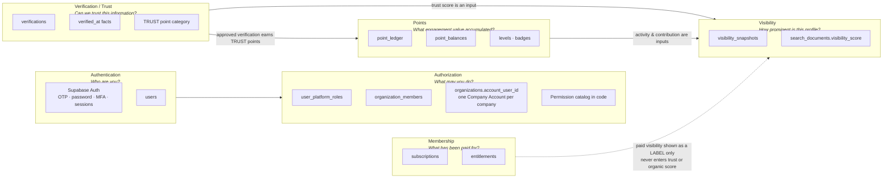
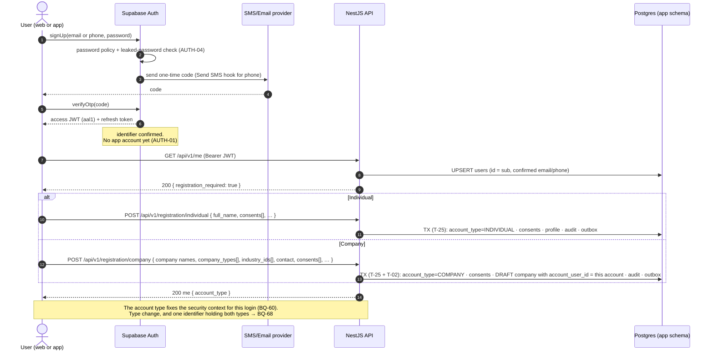
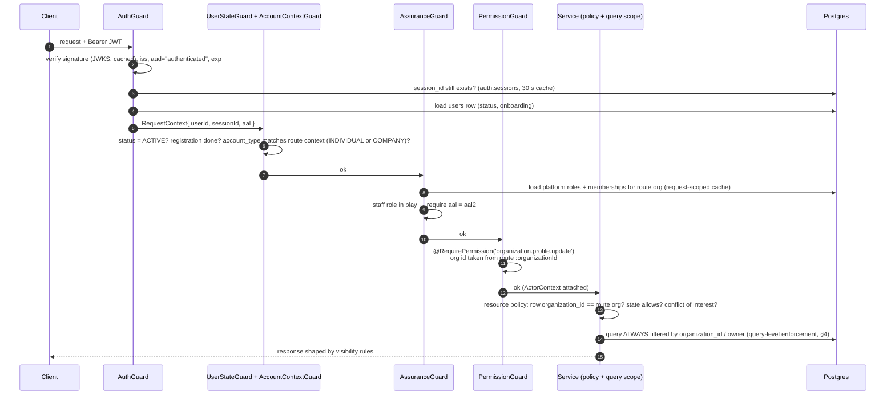
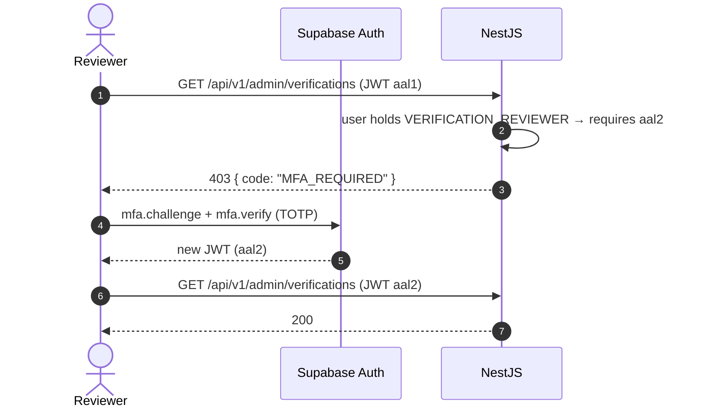

# Authentication, Authorization & Trust Architecture

> PRD sources: §3 (user types), §4 (permission model), §5 (journeys), §7.1 AUTH-01..06, §12.3, §18.
> Decisions: ADR-003 (Supabase Auth), ADR-004 (authorization model). Resolved 2026-09-15: BQ-01 (web + mobile), BQ-03, BQ-04 (one owner), BQ-05, BQ-06 (companies only), BQ-30 (OTP + password), BQ-48 (human verification), BQ-49. Open: TQ-01..04, BQ-29, BQ-51, BQ-56, BQ-58.

---

## 0. Six concerns that must never be mixed

This is the most important rule in the backend. Each concern has its **own tables, its own module and its own question**. None of them can stand in for another.



| Concern | Question | Source of truth | Owning module | Must NOT |
|---|---|---|---|---|
| **Authentication** | Who are you, and in which **account context** (INDIVIDUAL or COMPANY, separate security contexts, BQ-60)? | Supabase Auth + `users` | `identity` | Carry roles, organization or plan in the token |
| **Authorization** | What are you allowed to do? | `user_platform_roles` (staff) and **the company's single Company Account** (`organizations.account_user_id`, BQ-68), code permission catalog. Memberships, ownership claims and classification never grant anything | `access` | Depend on verification level, points or plan to *grant roles* |
| **Verification / Trust** | Can we trust this information? | `verifications` (+ `verified_at` facts on subjects) | `verification` | Be purchasable (§7.5, §8.1). Be granted by activity |
| **Visibility** | How discoverable is this profile? | `visibility_snapshots` → `search_documents` | `engagement` (calculation), `search` (use) | Guarantee rank ("a higher score does not guarantee first place", §8.4) |
| **Points** | What engagement value has accumulated? | `point_ledger` (append-only) | `engagement` | Stand in for trust (§8.1 "activity ≠ trust"). Be a mutable column |
| **Membership** | What subscription and entitlements exist? | `subscriptions` → `entitlements` | `billing`, `entitlements` | Affect trust or organic ranking (§7.5) |

### 0.1 Account contexts (BQ-60, BQ-68)

```text
INDIVIDUAL account ── own login ── individual profile · applications · events · points · rewards · company memberships (no permissions)
COMPANY account    ── own login ── exactly ONE company (organizations.account_user_id) ── all company actions
                         ✗ no permission ever flows from one context to the other
                         ✗ an individual member or employee of a company holds no company permission
```

- Every non-public route declares its context with `@AccountContext('INDIVIDUAL' | 'COMPANY')`; `AccountContextGuard` rejects the other type with 403 `WRONG_ACCOUNT_CONTEXT`.
- Company routes additionally require `CompanyAccountGuard`: `:organizationId` must be the caller's company (`account_user_id = caller`), otherwise 404.
- Profile Highlight (a reward), Companies to Watch (neutral discovery) and future Featured / Promoted (paid) never touch verification or authorization.

**Where they meet.** Some checks combine several concerns, but each is evaluated independently:

- *Publish a job* = **authorization** (`opportunity.manage` in the company). Whether it also requires **trust** (verified company) → BQ-62. Plan limits are future monetization (rules §11).
- *Respond to a supplier request* = **authorization** (`supplier_response.submit` in the responding company). Company type is **not** a permission (rules §2).
- *Read market reports* (§4) = **authorization** (member of the organization) **AND** **membership** (`reports.market` entitlement).

---

## 1. Authentication: "Who are you?"

### 1.1 Recommendation (ADR-003, pending confirmation of TQ-01/TQ-02)

**Supabase Auth authenticates. NestJS authorizes.**

| PRD requirement | How Supabase Auth covers it | Backend responsibility |
|---|---|---|
| AUTH-01 register with email **or** phone + one-time code; no active account without verification. **Decision BQ-30: OTP + password** | `signUp` with email or phone **and a password**; identifier confirmed by a one-time code (`verifyOtp`) | Create the `users` row **only** from a confirmed identifier's token |
| Sign-in (BQ-30) | `signInWithPassword` (email or phone). OTP-only sign-in → BQ-58 | — |
| Password recovery (BQ-30) | `resetPasswordForEmail` / phone OTP → `updateUser({ password })` | Revoke all other sessions after a reset (security-and-audit §2) |
| AUTH-02 secure login, session refresh, terminate all sessions | Short-lived access JWT + rotating refresh tokens; `signOut({ scope: 'global' })` | Reject tokens whose `session_id` no longer exists (§1.4); admin revocation endpoint |
| AUTH-03 MFA mandatory for admin, reviewer, entities | TOTP MFA; the JWT carries `aal` (`aal1` / `aal2`) | **Enforce `aal2`** for staff roles (the roles live in *our* DB). "Entities" have no organization type any more → BQ-51 |
| AUTH-04 password policy (passwords **are** used, BQ-30); block leaked passwords; attempt limits | Password strength settings, leaked-password protection, built-in rate limits | API rate limits (§5 of `security-and-audit.md`) |
| AUTH-05 team invitations with role, duration, organization | — (not an auth concern) | `invitations` table in the `access` module |
| AUTH-06 suspend, delete, export (later) | Admin API: ban user, delete user | Orchestrated by NestJS: anonymise app data, then ban or delete the auth user |
| §18 log sign-ins | Auth audit log + auth hooks | Mirror important auth events into `audit_logs` |
| Saudi SMS delivery | *Send SMS* auth hook | Hook → Saudi SMS provider (TQ-04) |

**Why not custom NestJS auth?** Custom auth means building and securing OTP generation, rate limits, refresh-token rotation and reuse detection, TOTP enrolment and recovery, and leaked-password checks. This is security-critical code that adds nothing to Back Of House as a product. The main costs of Supabase Auth are vendor coupling and the need to confirm data residency (BQ-31). Both are recorded in ADR-003.

**When custom auth would be the right call instead:** if BQ-31 requires personal data to stay in a region Supabase cannot serve, or if the chosen Saudi SMS provider cannot be integrated through the SMS hook.

### 1.2 Identity model

```text
auth.users  (Supabase-managed, schema "auth")
   │  id  ═══════════════ same UUID ═══════════════╗
   │                                                ▼
   │                                          app.users            (identity module)
   │                                             │ 1:1
   │                                             ▼
   │                                          app.profiles          (profiles module)
   │
   ├── auth.sessions      ← session_id claim checked by NestJS
   ├── auth.mfa_factors   ← aal claim
   └── auth.identities    ← email / phone identities
```

- `app.users.id` **=** `auth.users.id`. No cross-schema FK (it would break Prisma shadow databases; ADR-007).
- `app.users` copies only **verified** identifiers (`email`, `phone`, `*_verified_at`) from token claims on each sign-in. **Supabase remains the source of truth for credentials.**
- Changing email or phone goes through Supabase (re-verification). NestJS updates its copy the next time it sees the token.

### 1.3 Registration, sign-in and onboarding (§5.1, BQ-30, BQ-60)

The same flow serves the **web** and **Flutter** clients through one API (BQ-01). The user chooses **Individual** or **Company** at registration; each type has its own flow and data.



**Returning users** sign in with identifier + password (`signInWithPassword`). **Forgotten password:** a one-time code to the confirmed email or phone, then a new password; all other sessions are revoked. Whether a one-time code may also be used to sign in, or is required as a second step, is open → **BQ-58**. Social login is excluded (BQ-30).

⚠️ The current Flutter app calls `/auth/register`, `/auth/login`, `/auth/forgot-password` and `/auth/reset-password` on the API, and `/auth/social` (TQ-02). With Supabase Auth, both clients call Supabase for credentials and NestJS for everything else; `/auth/social` is removed. If one API contract for both clients is preferred, NestJS can expose a thin `/auth/*` facade over Supabase (alternative in ADR-003).

### 1.4 Authenticated request pipeline



| Token claim used | Purpose |
|---|---|
| `sub` | User id |
| `session_id` | Session revocation check (AUTH-02 "terminate all sessions"; admin suspend) |
| `aal` | MFA assurance (AUTH-03) |
| `email`, `phone`, `email_confirmed_at`/`phone_confirmed_at` | Refresh the verified identifier copy |
| `exp`, `iss`, `aud` | Standard validation |

**Deliberately not in the token:** platform roles, organization memberships, active organization, plan and entitlements. They change often, and **revocation must take effect on the next request**, not when the token expires (§12.3 automatic expiry, §18 periodic review). ADR-004.

### 1.5 Sessions, refresh, revocation

| Operation | Mechanism |
|---|---|
| Refresh | Client SDK refreshes against Supabase; NestJS is not involved |
| "Log out everywhere" (AUTH-02) | Client `signOut({scope:'global'})`, or `DELETE /api/v1/me/sessions` → NestJS calls the Supabase admin API. Access tokens die on the next request because of the `session_id` check |
| Admin suspends user | NestJS: `users.status = SUSPENDED` (immediate effect through `UserStateGuard`) + Supabase ban + session revocation + audit |
| Access token lifetime | Short (recommend 10 minutes, set in the Supabase project) |

### 1.6 MFA enforcement (AUTH-03)



Rules:
- **Staff roles** (all four `PlatformRole` values): `aal2` is required on every `/admin/*` route.
- **Entities** (AUTH-03): there are no entity organizations since every organization is a company (BQ-06). MFA for buyer features is decided with **BQ-51**.
- Granting a staff role to a user **without** an enrolled MFA factor is allowed, but the role cannot be used until enrolment is done.
- Whether **company owners** also need MFA is not stated (AUTH-03 names only admins, reviewers and entities). Not enforced; passwords are always required (BQ-30).

---

## 2. Authorization: "What are you allowed to do?"

### 2.1 Model (§4 "RBAC with the ability to scope a permission to a specific organization or entity")

```text
                        ┌──────────────────────────────┐
                        │  PERMISSION CATALOG (code)   │  permissions.ts — versioned in git,
                        │  'organization.profile.update'│  covered by positive & negative tests (§20.1)
                        └──────────────┬───────────────┘
                     role → permissions│mapping (code)
            ┌──────────────────────────┴──────────────────────────┐
            ▼                                                     ▼
   PLATFORM SCOPE (staff)                              COMPANY CONTEXT (company context only)
   user_platform_roles                                 organizations.account_user_id — one Company Account per company
   VERIFICATION_REVIEWER · CONTENT_MODERATOR           the company's single Company Account
   SYSTEM_ADMIN · AUDITOR                              no roles, no delegation (BQ-68)
            │                                                     │
            ▼                                                     ▼
   applies platform-wide                               applies ONLY inside organization_id
```

Roles and their permission sets are **defined in code**, not in database tables (ADR-004). The PRD does not require administrators to define roles at runtime. Keeping them in code makes the matrix reviewable, type-checked and testable. Staff role **assignments** are data; company access is the `account_user_id` link (BQ-68).

### 2.2 Permission catalog

Legend: ✅ granted by role · 💳 also requires an entitlement (deferred) · 🔐 requires `aal2` · ❓ not defined in PRD (proposed default, question ID)

#### Company context permissions (BQ-60, BQ-68)

A company has **one user — its Company Account** — which holds **every** company permission below for **its own company** only. There are no OWNER / EDITOR / ANALYST roles and no delegation. Individual members and employees hold **none** of these. Company type and industries never add or remove a permission (BQ-61, BQ-63).

| Permission (held by the Company Account for its own company) | Source | Phase |
|---|---|---|
| `organization.profile.read_private` / `organization.profile.update` | §4 "Edit company profile" | 1 |
| `organization.approval.submit` | BQ-05 | 1 |
| `organization.verification.submit` (registration, domain, credential, contact signals) | §5.3, BQ-47 | 1 |
| `organization.corrections.resolve` | §4 | 1 |
| `organization.members.manage` (view all members, hide / show on public profile, remove) — no permission effect | BQ-64, BQ-68 | 1 |
| `project.manage` (company projects / portfolio) | §7.3, rules §4 | 1 |
| `opportunity.manage` (create, edit, publish, pause, close) | rules §9 | 3 |
| `opportunity.applications.read` / `opportunity.applications.manage` (flexible statuses, BQ-67) | rules §8, §9 | 3 |
| `supplier_response.submit` (any supplier request, no type restriction) | rules §7, BQ-66 | 3 |
| Read supplier requests (any Company Account) | BQ-65 | 3 |
| `organization.employment.confirm` | §10.1 | 3 |
| `organization.reports.read`, `organization.benchmark.manage`, `organization.data.export` | §4, §11 | 4 |
| `organization.billing.*`, `market.reports.read` (plan-based) | ⏸ deferred monetization | — |
| Ownership change | Admin ownership flow only (T-30, BQ-56) | 1 |

PRD §4 role columns (owner, editor, analyst, delegation) are superseded (inconsistency I-10).

#### ~~Organization-scoped: institution roles~~ — removed (BQ-06)

Every organization is a company, so the §12.1 institution roles (BUYER, READER, AUDITOR) and the `institution.*` permissions are **not in the catalog**. How buyer features (§5.4, §12) will be granted — for example to company roles or through a plan entitlement — is decided with **BQ-51**.

#### Platform-scoped: staff roles (§3, §4, §13) · 🔐 all

| Permission | REVIEWER | MODERATOR | ADMIN | AUDITOR | Source |
|---|---|---|---|---|---|
| `verification.review` (decide cases — always a person in Phase 1) | ✅ | — | ✅ | — | §4 "Approve profiles", BQ-48 |
| `organization.approval.decide` (approve, request changes, reject new companies) | — | — | ✅ | — | BQ-05 |
| `documents.access` (signed URL; audited) | ✅ (own queue) | — | ✅ | — | §18 |
| `organization.correction.suggest` | ✅ | — | ✅ | — | §4 "suggest correction" |
| `project.review` | ✅ ❓ | ✅ ❓ | ✅ | — | §13, §23 (BQ-39) |
| `market.reports.read` | ✅ (read) | — | ✅ | — | §4 |
| `content.manage` | — | ✅ | ✅ | — | §3 |
| `taxonomy.manage` | — | ✅ | ✅ | — | §3 "classifications" |
| `moderation.reports.handle` | — | ✅ | ✅ | — | §3 "reports/flags" |
| `admin.users.manage` (suspend, revoke sessions) | — | — | ✅ | — | §13 |
| `admin.organizations.manage` (suspend, archive, merge, replace owner) | — | — | ✅ | — | §13, BQ-56 |
| `admin.staff_roles.manage` | — | — | ✅ | — | §3 "permissions" |
| `admin.imports.manage` | — | — | ✅ | — | §22 |
| `admin.billing.manage` (plans, coupons, exemptions) | — | — | ✅ | — | §13 · P2 |
| `admin.points.manage` (rules, reversals, freezes) | — | — | ✅ | — | §13 · P2 |
| `admin.events.manage` (incl. check-in) | — | — | ✅ ❓ | — | §13 · P2 (BQ-17) |
| `admin.opportunities.moderate` | — | ✅ ❓ | ✅ | — | §13 · P3 |
| `admin.reports.manage` | — | — | ✅ | — | §13 · P4 |
| `admin.data.export` (monitored) | — | — | ✅ | — | §4 "admin: monitored" |
| `audit.read` | — | — | ✅ | ✅ | §3 auditor |

Unless marked ❓, `SYSTEM_ADMIN` holds every platform permission. `AUDITOR` is **read-only**: it holds no mutation permission at all.

### 2.3 Enforcement layers

| # | Layer | Where | Example |
|---|---|---|---|
| 1 | Authentication | `AuthGuard` (global) | Invalid or expired JWT → 401 |
| 2 | Account state | `UserStateGuard` (global) | Suspended → 403 `ACCOUNT_SUSPENDED`; registration not completed → 403 `REGISTRATION_REQUIRED` |
| 2b | Account context | `AccountContextGuard` + `@AccountContext()` (BQ-60); `CompanyAccountGuard` checks `account_user_id` on company routes (BQ-68) | Individual token on `/organizations/:id/*` → 403 `WRONG_ACCOUNT_CONTEXT`; Company token applying to a job → 403 `WRONG_ACCOUNT_CONTEXT` |
| 3 | Assurance | `AssuranceGuard` (global) | Staff route with `aal1` → 403 `MFA_REQUIRED` |
| 4 | Permission | `PermissionGuard` + `@RequirePermission()` | Staff permission checks; Individual member calling a company route → 403 `WRONG_ACCOUNT_CONTEXT` |
| 5 | Entitlement | `@RequireEntitlement('reports.market')` or service check | No plan → 402-style `ENTITLEMENT_REQUIRED` (sent as 403) |
| 6 | Resource policy | Domain service (`*Policy` classes) | Project belongs to another organization → 404; edit while IN_REVIEW → 409; reviewer deciding their own claim → 403 |
| 7 | Query scoping | Repository signatures require `organizationId` / `ownerUserId` | `projectsRepo.findForOrganization(orgId, projectId)`, never `findById(projectId)` on tenant routes |
| 8 | Response shaping | Serializers + `search_documents` | Private fields, internal notes and undisclosed client names are never serialised to public DTOs |

**Rules**
- **Deny by default.** A controller route with no `@Public()` and no `@RequirePermission()` fails a startup check.
- **404 rather than 403** when a resource exists in *another* organization, so ids cannot be probed.
- **Frontend hiding is not a control** (§4). Every rule above is covered by negative tests (§20.1 "negative permission tests").

### 2.4 Resource-level ownership rules

| Resource | Owner concept | Rule |
|---|---|---|
| users / profiles / consents / experiences | `user_id` | Only the user (+ admin through dedicated admin routes) |
| organizations and child tables | `organization_id` | Only the company's Company Account (`account_user_id`); members never |
| projects | `projects.organization_id` | Must equal the route `:organizationId` |
| verifications | `requested_by_user_id` / `on_behalf_of_organization_id` | Applicant reads their own case; reviewers read the queue; a reviewer cannot decide a case about themselves or an organization they belong to |
| documents | `uploaded_by`, `organization_id`, linked verification | Signed URL only for the uploader, members of the owning organization with `organization.profile.read_private`, or reviewers of a linked case; every access audited |
| applications | individual applicant / publishing company | Applicant, or the publishing company's Company Account |
| supplier_responses | responding company / buyer company | The responding or the buyer company's Company Account; never other suppliers or individuals |
| saved lists and notes (P4, BQ-51) | buyer company `organization_id` | **Never** exposed to the listed company |
| rfi_recipients | recipient organization | The recipient company sees only its own row, never the other recipients |

### 2.5 Admin authorization

- All admin endpoints live under `/api/v1/admin/*` in **the owning module's** admin controller (e.g. `organizations/controllers/admin-organizations.controller.ts`).
- Admin routes require a platform permission + `aal2`. **Every admin mutation requires a `reason`** and writes `audit_logs` in the same transaction.
- Admins act **as themselves**. There is no impersonation feature (not in the PRD).

---

## 3. Verification / Trust: "Can we trust this information?"

- A verification is **evidence-specific**: "reviewing specific evidence without guaranteeing overall performance" (§29.2 glossary).
- **Company approval is not verification** (BQ-46). An admin approving a listing (BQ-05) publishes it; it checks no signal.
- **Company verification is several independent signals** (BQ-47): commercial registration, website domain, each license/certification, each contact channel. Which signals make a company show as VERIFIED → BQ-53.
- **Verified professional** = identity + experience verifications approved (§3). It is independent of points and levels (BQ-07).
- In Phase 1 every verification decision is made by a `VERIFICATION_REVIEWER` or `SYSTEM_ADMIN` (BQ-48). Automated checks are hints only.
- Trust is **derived** from approved verifications. It is represented as `verified_at` facts on subjects and as `TRUST` point entries (§8.2 identity 20, employer 25, organization confirmation 20; §8.3 organization trust ≤ 100, one rule per signal).
- **Nothing in billing, points or events may create a verification or a TRUST ledger entry.** This is enforced by module boundaries: only the `verification` module emits `verification.approved`, and the TRUST point rules listen only to that event.
- Details of cases, states and handlers: `enums-and-statuses.md` §3 and `domain-events.md`.

## 4. Visibility: "How discoverable is this profile?"

- The score comes from the formulas in §8.4. It is stored in `visibility_snapshots` and copied to `search_documents.visibility_score`.
- It is **one ranking signal among several**. The search engine also applies relevance to specialty, city, language and availability (§8.4).
- A **sponsored** or paid partner label is shown next to the result. It **does not** change `visibility_score` (§7.5, §8.3 "separate").

## 5. Points: "What engagement value has accumulated?"

- The ledger is the source of truth, and `point_balances` is a projection. Full design: `points-architecture.md`.
- Points **never** grant authorization or verification (rules §10) and are **never spent** (BQ-08; "Rewards" meaning → BQ-59). Levels depend on points only, never on verification (BQ-07). A level may unlock *benefits* (§9.1). If a benefit needs a capability, it is modelled as an entitlement or eligibility rule (e.g. `event_ticket_types.min_level_id`), never as a role.

## 6. Membership: "What has been paid for?" — ⏸ deferred (business rules §11)

- No monetization is built now. When it is: `Featured` / `Sponsored` / `Promoted` stay separate from `Verified`, in data, API fields and UI (rules §12).

- `subscriptions` hold the commercial relationship. `entitlements` hold the effective features and limits.
- Feature checks call `EntitlementsService.check(subject, featureKey)`, which reads `entitlements` only.
- Membership **never** grants a role (the plan's `team.max_members` *limits* invitations; it does not grant permissions).

---

## 7. Company context

See **`company-context.md`**: multi-organization membership, how the active organization is selected, owner vs member rules, and why the organization is never stored in the token.

---

## 8. What is explicitly out of scope

| Item | Reason |
|---|---|
| Social login | Excluded by decision BQ-30 (OTP + password). Remove `/auth/social` from the app |
| Admin impersonation | Not in the PRD. It would complicate auditing |
| Custom runtime roles | Not in the PRD (ADR-004) |
| API keys / partner OAuth | Phase 5 partner API (RG-19) |
| Row Level Security as the authorization mechanism | App-layer authorization. RLS is a deny-all backstop only (ADR-007) |
