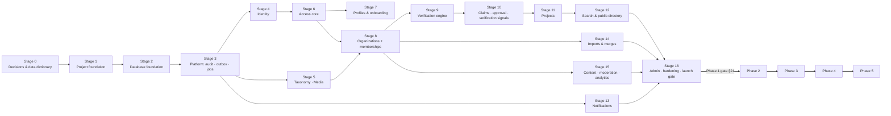
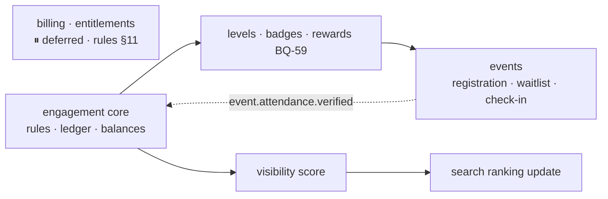

# Backend Development Order

> The build order follows **module dependencies** (`module-dependency-map.md`) and **PRD phase gates** (§6, §21, §26).
> **Mandatory business rules** (`business-rules.md`) apply to every stage: simple MVP, no premature payment or messaging infrastructure.
> PRD product decision (§1, §30): *do not build all modules at once.* Complete Phase 0, then launch a trustworthy, claimable, searchable company directory within 90 days before expanding into points, reports or opportunities.

---

## 0. Overview

### Parallel lanes for Phase 1

```mermaid
gantt
    title Phase 1 lanes (relative, not a schedule)
    dateFormat  X
    axisFormat  %s
    section Foundation
    Stage 1-3 foundation            :f1, 0, 3
    section Lane A identity & directory core
    Identity                        :a1, after f1, 1
    Access core                     :a2, after a1, 1
    Organizations + memberships     :a3, after a2, 2
    Verification engine             :a4, after a3, 1
    Claims & company verification   :a5, after a4, 1
    Projects                        :a6, after a5, 1
    section Lane B reference & files
    Taxonomy                        :b1, after f1, 1
    Media & documents               :b2, after b1, 1
    Profiles & onboarding           :b3, after a2, 1
    section Lane C read side & comms
    Notifications                   :c1, after f1, 2
    Search & public directory       :c2, after a6, 2
    section Lane D data & ops
    Imports & merges                :d1, after a3, 2
    Content, moderation, analytics  :d2, after a3, 2
    section Gate
    Admin, hardening, launch        :g1, after c2, 2
```

---

## Stage 0 · Decisions & data dictionary (PRD Phase 0, §6)

| | |
|---|---|
| **Must exist first** | This architecture documentation |
| **Deliverables** | Answers to the blocking questions below; data dictionary; taxonomy seed (categories, services, regions and cities, skills, §26 P0); permission matrix sign-off (§6 Phase 0 "permissions matrix"); Supabase projects (staging) |
| **Resolved 2026-09-15** | BQ-01 (web + mobile), BQ-30 (OTP + password), BQ-03/04/05 (memberships, one owner, owner creates + admin approves), BQ-06 (companies only), BQ-07, BQ-08, BQ-46/47/48/49 — see `open-questions.md` §0 |
| **Still blocking** | **TQ-01/TQ-02** (Supabase Auth client-direct vs API facade), **TQ-05/06/07** (API contract with both clients), **BQ-53** (company VERIFIED rule), **BQ-56** (ownership transfer), **BQ-57** (approval criteria), **BQ-58** (sign-in options), **BQ-68** (remaining: same identifier for both account types, type change, staff account type), **BQ-75** (membership flow), **RG-28** (industries list review), **BQ-63/64** (industries, public team), **BQ-21** (value lists for Phase 1 fields), **BQ-31** (region), **BQ-51** (buyer pilot scope), **RG-09** (import format), **RG-14** (notification catalog, incl. push for Flutter), **TQ-09** (hosting) |
| **Parallel** | Taxonomy data preparation; company data cleaning (§22) |
| **Test before moving on** | Decisions recorded in `architecture-decisions.md` / `open-questions.md` |

## Stage 1 · Project foundation

| | |
|---|---|
| **Must exist first** | Stage 0 decisions on hosting and API contract |
| **Build** | NestJS app (TypeScript strict); `config` with env validation; pino logger with redaction; request-id / trace id; global error filter (`{code, message, trace_id, errors}`); ValidationPipe (422); response envelope; `/health` (liveness/readiness); OpenAPI (Swagger) generation; security headers; CORS; throttler; `api` + `worker` entrypoints; ESLint + Prettier + **dependency-cruiser**; Jest (unit/integration/e2e); GitHub Actions CI (lint, typecheck, test, audit, secret scan); Dockerfile; `.env.example`; README |
| **Parallel** | Stage 2 local database setup |
| **Depends on it** | Everything |
| **Test before moving on** | CI green; the error format matches the frontend parser; health check deployed to staging |

## Stage 2 · Database foundation

| | |
|---|---|
| **Must exist first** | Stage 1 |
| **Build** | Prisma (pinned version, multi-file schema); `app` schema; extensions migration (`citext`, `pg_trgm`, `unaccent`, `btree_gist`); `boh_app` role and grants; RLS enable helper; `raise_immutable()` trigger function; `app.normalize_ar()` function; `PrismaService`; `TransactionRunner` (AsyncLocalStorage, retry on `40001`/`40P01`); test DB harness (container per CI run, migrate + truncate between tests); factories; seed runner |
| **Parallel** | — |
| **Depends on it** | All modules |
| **Test before moving on** | Migrations apply on a clean DB and on staging Supabase; the transaction runner rolls back on error; the app role **cannot** UPDATE an immutable table (test) |

## Stage 3 · Platform cross-cutting: audit, outbox, jobs

| | |
|---|---|
| **Must exist first** | Stage 2 |
| **Build** | `audit` module (`audit_logs`, `AuditLogger.record(tx)`, redaction helper); `outbox` (`outbox_events`, writer, dispatcher with per-handler retries, `@OnDomainEvent`); `jobs` (pg-boss, cron registration); storage port skeleton |
| **Parallel** | Stage 4, Stage 5 |
| **Depends on it** | Every mutating module |
| **Test before moving on** | Event written only when the TX commits; handler retry and failure path; audit row atomic with a mutation |

## Stage 4 · Identity

| | |
|---|---|
| **Must exist first** | Stages 1–3; Supabase Auth configured (staging + local) |
| **Build** | Supabase Auth configured for password sign-up + code confirmation, password sign-in and code-based recovery (BQ-30); JWKS verifier; `AuthGuard` (incl. `session_id` check); `UserStateGuard`; `AccountContextGuard` + `@AccountContext()` (BQ-60); `users.account_type`; `users`, `consents`; `GET/PATCH /me`, consents endpoints, `DELETE /me/sessions`; admin suspend/reinstate; test JWT issuer for CI |
| **Parallel** | Stage 5 |
| **Depends on it** | Access, profiles, everything authenticated |
| **Test before moving on** | Expired/invalid/wrong-audience tokens → 401; revoked session → 401; suspended user → 403; Individual token on a company route and Company token on an individual route → 403 `WRONG_ACCOUNT_CONTEXT`; `users` row idempotent creation; no PII in logs |

## Stage 5 · Taxonomy & media

| | |
|---|---|
| **Must exist first** | Stages 2–3 (media needs storage buckets) |
| **Build** | `taxonomy` tables + seeds + public read endpoints + admin CRUD; `media`: `media_assets`, `documents`, signed upload flow, quarantine, scan job (TQ-10 stub → real scanner before launch), hashing, signed download URLs + audit, `DocumentAccessPolicy` registry |
| **Parallel** | Stage 4, Stage 13 |
| **Depends on it** | Profiles, organizations, projects, verification |
| **Test before moving on** | Seeds idempotent; type spoofing and oversize rejected; private URL access audited and denied without policy |

## Stage 6 · Access core

| | |
|---|---|
| **Must exist first** | Stage 4 |
| **Build** | Permission catalog (code); `user_platform_roles`; `AssuranceGuard` (aal2); `PermissionGuard` + `@RequirePermission`; startup "no unguarded routes" check; admin staff-role endpoints (T-23); **authz test harness** that generates the role × endpoint matrix |
| **Parallel** | Stage 5, Stage 7 |
| **Depends on it** | Organizations, verification, all admin routes |
| **Test before moving on** | Staff route with aal1 → `MFA_REQUIRED`; negative tests for every staff permission; last `SYSTEM_ADMIN` cannot be revoked |

## Stage 7 · Profiles & onboarding

| | |
|---|---|
| **Must exist first** | Stages 4, 5, 6 |
| **Build** | `profiles`, `profile_skills`, `profile_locations`; onboarding (T-25) with consent capture; `/me/profile`; completion score |
| **Parallel** | Stage 8 |
| **Depends on it** | Search (Phase 3 professionals), engagement (P2) |
| **Test before moving on** | Routes other than `/me`, `/registration/*` and public ones blocked until registration is done; each flow sets the account context (BQ-60); consent versions stored |

## Stage 8 · Organizations, Company Account link, members & invitations

| | |
|---|---|
| **Must exist first** | Stages 5, 6 |
| **Build** | `organizations` + child tables (contacts, services, coverage, credentials, media, company types, industries BQ-63); public team visibility `show_on_company_profile` (BQ-64); field visibility; completion score; status derivation (ADR-018); duplicate-check endpoint + T-02; organization management endpoints; **access:** `organizations.account_user_id` + `CompanyAccountGuard`, Individual `organization_members` (public team), `invitations` (BQ-75), T-04, T-05, `/me/company`, `/me/company-memberships`; company-context negative authz tests |
| **Parallel** | Stage 13 (notifications for invitations), Stage 14 (imports), Stage 15 |
| **Depends on it** | Verification handlers, claims, projects, search, imports |
| **Test before moving on** | Only the company's own Company Account can act on it; Individual members get 403 `WRONG_ACCOUNT_CONTEXT` on company routes; one company per Company Account; hiding a member changes public team only; access to another organization's resources → 404; exactly one owner per company and OWNER never granted by invitation (BQ-04); a user may own several companies (BQ-49); duplicate CR → 409; private fields never in any public DTO |

## Stage 9 · Verification engine

| | |
|---|---|
| **Must exist first** | Stages 5 (documents), 6, 8 |
| **Build** | `verifications`, `verification_documents`, `verification_decisions`; applicant endpoints; reviewer queue with SLA; decisions (T-06); subject handler registry; conflict-of-interest guard; expiry job |
| **Parallel** | Stage 14 |
| **Depends on it** | Claims, company verification, projects review (optional), talent (P3), trust points (P2) |
| **Test before moving on** | Invalid transitions rejected; reason required; handler failure rolls back the decision; reviewer cannot decide own-organization case |

## Stage 10 · Claims, company approval & verification signals

| | |
|---|---|
| **Must exist first** | Stage 9 |
| **Build** | `organization_claims` + automated checks (CR, name, domain, contact); `ClaimVerificationHandler` (T-01, ownership only); `organization_approvals` + admin approval queue (T-29, BQ-05); ownership transfer by admin (T-30); independent signal handlers for registration, domain, credential and contact (BQ-47) with expiry alerts; human-only decisions (BQ-48); correction suggestions; staleness job (ORG-08, BQ-20) |
| **Parallel** | Stage 11 |
| **Depends on it** | Launch (§22 claim invitations), projects publishing on verified profiles |
| **Test before moving on** | **Critical journey §20.2:** ownership cannot transfer without evidence and a correct review; concurrent approvals → one owner; unapproved DRAFT never public; approval sets no verification signal and no trust (BQ-46); analytics `profile_claim_started/completed` emitted |

## Stage 11 · Projects

| | |
|---|---|
| **Must exist first** | Stages 8, 9 |
| **Build** | `company_projects`, `company_project_services`, `company_project_media` (portfolio, rules §4; client name optional); mandatory and quality fields; client disclosure rules; review workflow (T-07); completion + points score (≤ 50); fingerprint |
| **Parallel** | Stage 12 skeleton |
| **Depends on it** | Search, company page, engagement PROJECTS component (P2) |
| **Test before moving on** | Undisclosed client name absent from every public response; mandatory fields enforced on submit; score cap 50 |

## Stage 12 · Search & public directory

| | |
|---|---|
| **Must exist first** | Stages 8, 10, 11 |
| **Build** | `search_documents` projection + indexer (event-driven + full rebuild command); Arabic normalisation (SQL + TS, shared fixtures); filters and sorts (§7.4); `GET /companies`, `/companies/:slug`, public projects; zero-result logging; SEO sitemap entries (if BQ-01 includes web); performance indexes |
| **Parallel** | Stage 16 prep |
| **Depends on it** | Phase 1 launch; institutional search (P4); visibility ranking (P2) |
| **Test before moving on** | **§20.2:** the correct version shows and restricted fields don't leak (projection contains only public fields, checked by test); alef/hamza variants match; p95 under 1 s on 2,000+ seeded companies (§17) |

## Stage 13 · Notifications

| | |
|---|---|
| **Must exist first** | Stage 3 (outbox), Stage 4 (recipients) |
| **Build** | `notifications`, `notification_deliveries`, `notification_preferences`; email and SMS adapters; bilingual templates; Phase 1 catalog (RG-14): invitations, claim and verification decisions, project review, credential expiry, needs-update, abuse report and appeal outcomes |
| **Parallel** | Stages 5–12 (add consumers as events appear) |
| **Test before moving on** | Duplicate event → one notification; mandatory types can't be disabled; destinations masked in logs |

## Stage 14 · Imports & merges

| | |
|---|---|
| **Must exist first** | Stage 8 (+ taxonomy seeds) |
| **Build** | `import_batches`, `import_rows`; parser (RG-09); preview with validation + duplicate detection; chunked commit (T-21); rollback; quality report; `organization_merges` with participants (T-03); admin duplicate review |
| **Parallel** | Stages 9–13 |
| **Depends on it** | §22 pilot import (50) → full import (500 UNCLAIMED) |
| **Test before moving on** | Preview writes nothing; rollback archives only untouched organizations; imported contacts not public; merge moves all children atomically |

## Stage 15 · Content, moderation, analytics

| | |
|---|---|
| **Must exist first** | Stages 5, 8 |
| **Build** | `content_items` (pages, news) + public endpoints (frontend `/news`); `abuse_reports` with SLA queue; `appeals`; `analytics_events` (partitioned) + ingestion endpoint + server-side funnel events + forwarding to provider; internal-traffic flag |
| **Parallel** | Stages 9–14 |
| **Test before moving on** | Analytics ingestion rate-limited; events unlinked from the user without consent; urgent abuse reports have a 24 h SLA |

## Stage 16 · Admin, hardening, Phase 1 launch gate

| | |
|---|---|
| **Must exist first** | Stages 1–15 |
| **Build** | Admin dashboard (queues, SLA breaches); rate-limit tuning; security tests (uploads, authz matrix, rate limits); performance tests (search, uploads); backups verified + restore test; monitoring and alerts; runbooks (incident P1–P4, §23.1); OpenAPI published for frontend |
| **Test before moving on** | **All §20.2 Phase 1 critical journeys** pass on staging: registration and verification, claim, edit and publish, no leakage. **§21 technical gate:** no critical defects, stable critical journeys. **Operational gate:** 500 companies, 150 claims, 50 verified (business-owned) |

---

## Phase 2 · Points and events (after the Phase 1 gate) — monetization deferred

| Order | Work | Must exist first | Parallel with | Test before moving on |
|---|---|---|---|---|
| 2.1 | ⏸ **Deferred** (rules §11): `entitlements` | — | — | — |
| 2.2 | ⏸ **Deferred** (rules §11): `billing` — no payment gateway, invoices, subscriptions, coupons | — | — | — |
| 2.3 | `engagement` core: rules and versions, ledger (T-08), balances, reversal (T-09), caps, reconciliation, admin | Phase 1 events available; BQ-09, BQ-10 | 2.6 | **§20.2:** once only, explainable, reversible; concurrency test |
| 2.4 | Levels (T-10), badges, upper-level review | 2.3; BQ-40, BQ-52 (no verification gate, BQ-07) | 2.5 | Gates enforced; ambassador only by admin |
| 2.5 | Visibility calculator + snapshots + search ranking + computed score sync (T-28) + decay | 2.3; BQ-11, BQ-12 | 2.6 | Reproducible score; paid status doesn't affect the score |
| 2.6 | `events` (no plan-based eligibility, rules §11): CRUD + ticket types → registration (T-11) → cancel/waitlist (T-12) → check-in (T-13) → feedback, certificates, reports | 2.4 (levels); BQ-16, BQ-17, BQ-18 | 2.5 | **§20.2:** no points for booking without attendance; capacity under concurrency |
| 2.7 | Phase 2 gate (§21): points and events auditable (billing deferred) | 2.3–2.6 | — | Business gate to be restated without paid members (rules §11) |

## Phase 3 · Professionals & opportunities

| Order | Work | Must exist first | Parallel with | Test before moving on |
|---|---|---|---|---|
| 3.1 | `talent`: experiences + company confirmation (T-24), education, certifications, profile projects, media, section privacy; `subject_experience_id` in verifications | Phase 2 (trust points); BQ-27 | 3.2 schema | Per-section privacy honoured in public profile and search |
| 3.2 | Professional search (`search_documents` PROFESSIONAL) + public profiles | 3.1 | 3.3 | Hidden sections never indexed |
| 3.3 | `opportunities` unified model: one type policy map, company management (create, edit, publish, pause, close), individual and company listings | Phase 1 companies; BQ-24, BQ-73 | 3.2 | Supplier requests never listed for individuals; one component contract (`type`, `audience`, `allowed_actions`) |
| 3.4 | Individual applications (T-17) with the rules §8 status model; supplier responses (T-31); close with outcome (T-18) | 3.3; BQ-67 (withdrawal rule) | — | Individuals cannot respond to supplier requests; companies cannot apply; company decides; **§21:** privacy in publish/apply/close |
| 3.5 | ⏸ **Deferred** (rules §9): messaging, interviews, offers, matching, surveys, recruitment analytics | — | — | — |

## Phase 4 · Intelligence & institutional

| Order | Work | Must exist first | Parallel with | Test before moving on |
|---|---|---|---|---|
| 4.1 | Metric definitions + rollup jobs from `analytics_events` and domain data → `metric_facts` | Analytics captured since Phase 1; RG-12 | 4.4 | Reproducible from `data_version` |
| 4.2 | Company performance report, direct comparison, anonymous benchmarks (sample ≥ 5), benchmark sets (T-19) | 4.1; BQ-37 | 4.4 | **§20.2:** no confidential data or small samples |
| 4.3 | Reports (status machine) + PDF/XLSX + exports with watermark and log (T-20) | 4.2; TQ-20, RG-27 | 4.5 | **§20.2 institution export:** permission, purpose, watermark, log correct |
| 4.4 | Buyer features — **on hold**: re-scope after BQ-51 (no organization types, BQ-06) | BQ-51 | 4.1 | Defined with BQ-51 |
| 4.5 | Supplier lists + notes, comparison, saved searches + alerts, RFIs, access log | 4.4; RG-04, RG-18 | 4.3 | Internal notes never visible to companies |
| 4.6 | Penetration test before institutional launch (§18) | 4.1–4.5 | — | Findings fixed |

## Phase 5 · Observatory & expansion

Not designed (RG-19). Prerequisites: stable metric store, published methodology, data-sharing contracts (§21).

---

## Cross-phase rules

1. **Schema changes are additive.** Phase 2+ tables and columns are added by new migrations; no Phase 1 rewrite is expected (the Phase 1 schema already reserves `search_documents.visibility_score`, `abuse_reports.target_opportunity_id`, etc.).
2. **Analytics from day one.** `analytics_events` must capture `profile_impression`, `profile_viewed`, `contact_clicked` and `search_performed` in Phase 1, or the Phase 4 company reports will have no history (§11.2).
3. **Every stage ends with docs updated:** `backend-implementation-status.md`, affected ADRs, API docs (OpenAPI).
4. **No module starts before its blocking questions are answered.** Build around a documented ASSUMPTION only when the assumption can be changed without a data migration.
