# Business Workflow Maps

> Visual maps of the major workflows **supported by the PRD**. Every step cites its PRD source.
> The state machines for each entity are in `enums-and-statuses.md`. The atomic operations (T-xx) are in `transaction-boundaries.md`.
>
> **Deliberately not drawn:** *points → rewards → redemption*. Points are never spent or redeemed, by decision BQ-08. The points workflow ends at levels, badges and visibility.

---

## 1. User lifecycle (§5.1, AUTH-01..06) · Phase 1

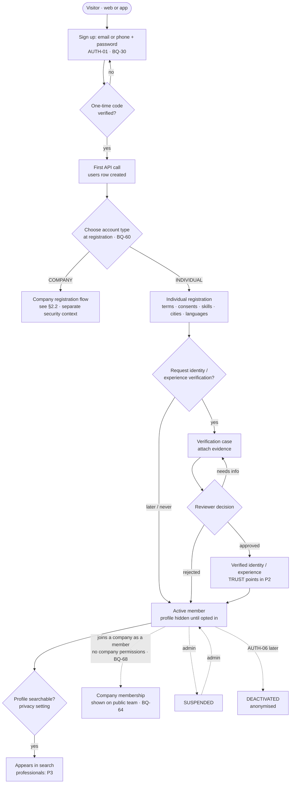

| Step | Module | Transaction |
|---|---|---|
| Password sign-up, code confirmation, sessions, password recovery | Supabase Auth | — |
| User row + individual or company registration | identity, profiles, organizations | T-25 (+ T-02 for companies) |
| Verification | verification | T-06 |
| Suspension | identity | T-26 |

---

## 2. Company lifecycle: overview (§5.2, §5.3, §7.2, §22, decisions BQ-04/05/46/47) · Phase 1 → 4

Three separate tracks — **ownership**, **approval** and **verification** — never stand in for one another.

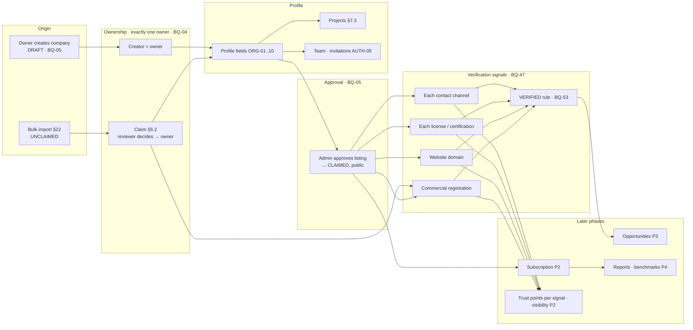

### 2.1 Claim an existing company (§5.2)

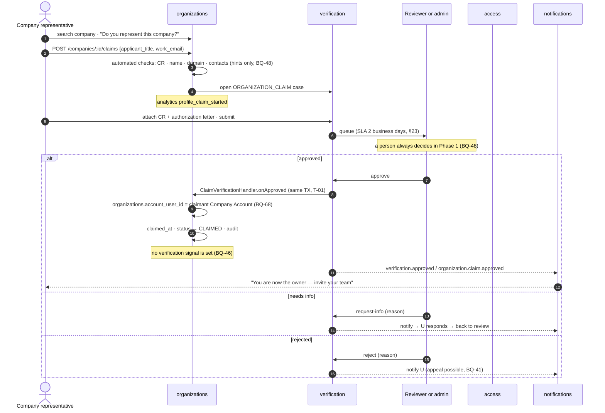

### 2.2 Add a new company: owner creates, admin approves (§5.3, BQ-05, BQ-46)

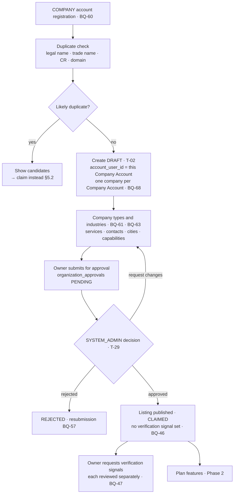

### 2.3 Keep company data fresh (ORG-05, ORG-08)

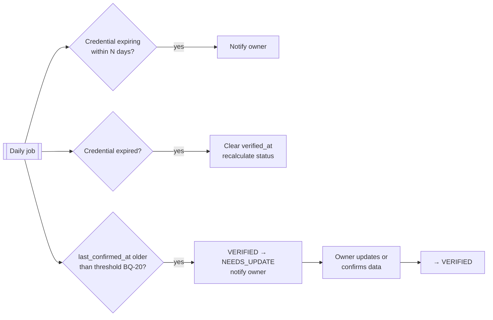

### 2.4 Duplicate merge (ORG-09, §22.1)

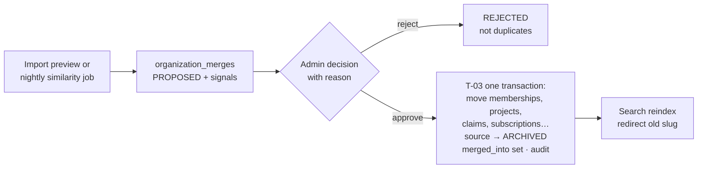

---

## 3. Project lifecycle (§7.3) · Phase 1

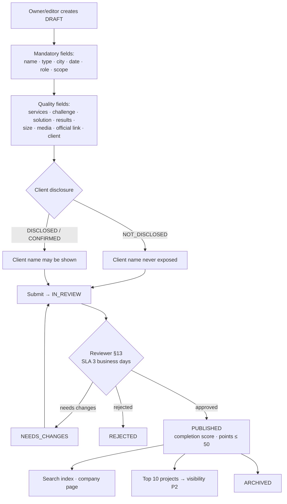

---

## 4. Verification lifecycle (generic) · Phase 1

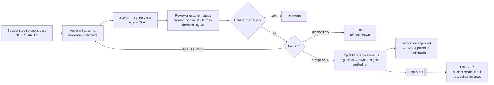

---

## 5. Buyer entity journey (§5.4, §12) · Phase 4 · ⚠️ on hold (BQ-51)

> Every organization is a company (BQ-06), so the separate institution workspace below cannot be built as drawn. Kept for reference until BQ-51 decides how buyers are handled.

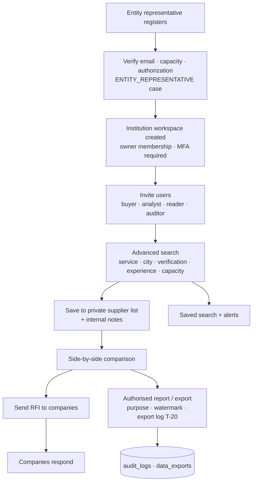

---

## 6. Event lifecycle (§9.2) · Phase 2

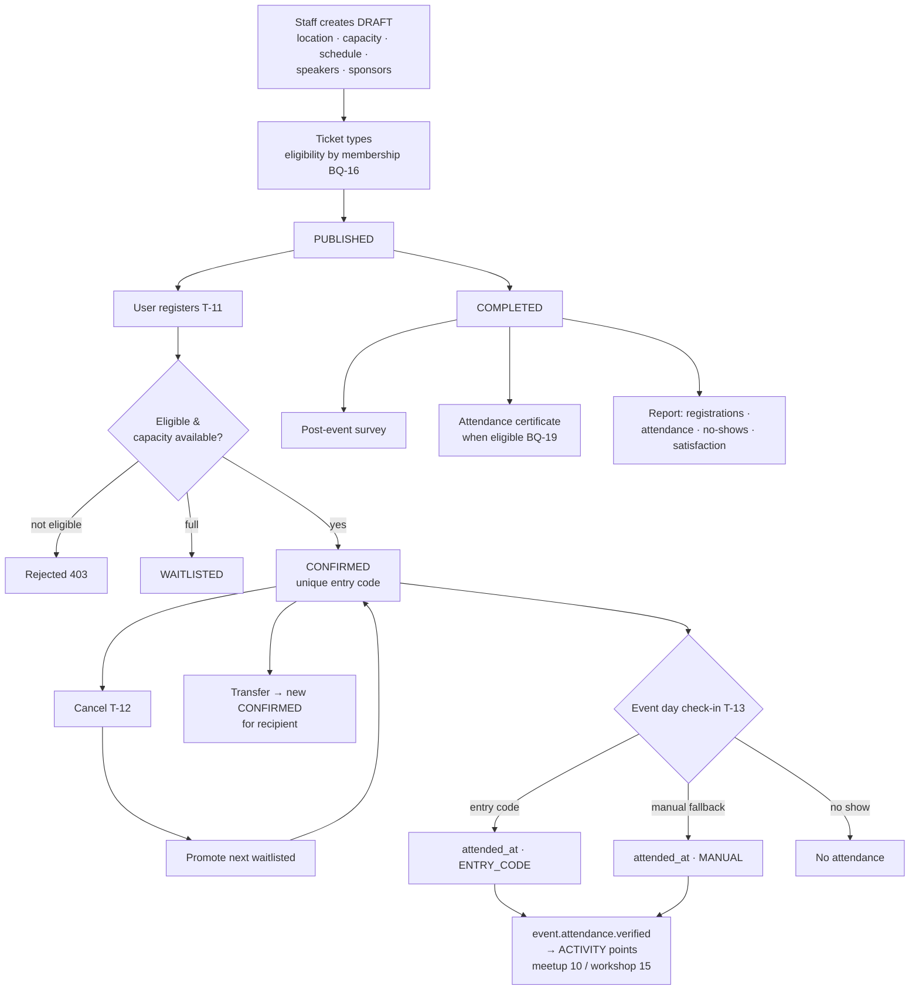

**Rule (§9.2, §20.2):** points are added **after attendance is verified, never after booking**. A registration with no `attended_at` never produces a ledger entry.

---

## 7. Opportunities, applications and supplier requests (business rules §5–§9) · Phase 3

### 7.1 One opportunity lifecycle for every type

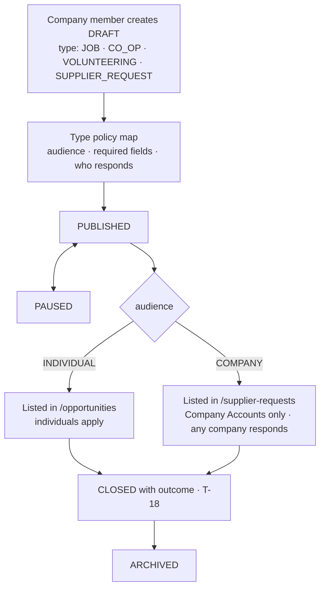

### 7.2 Individual application (rules §8, BQ-67)

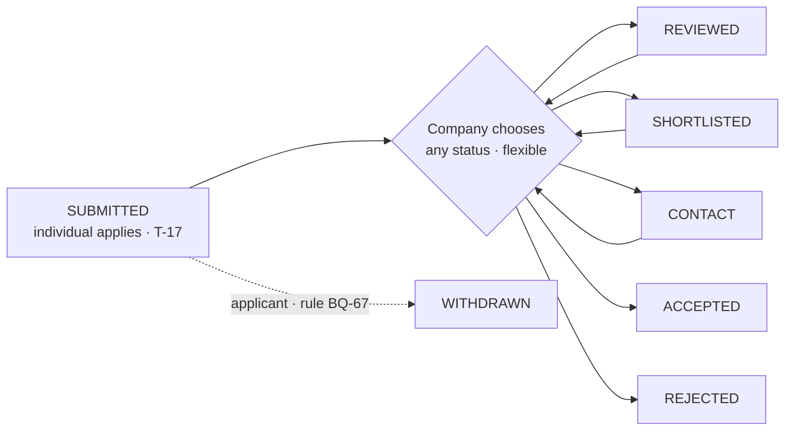

Examples: `SUBMITTED → ACCEPTED`, `SUBMITTED → SHORTLISTED → ACCEPTED`, `SUBMITTED → REJECTED`. The company decides; Back Of House only connects the parties. Company projects (portfolio) never receive applications (BQ-62).

### 7.3 Supplier request (B2B, rules §7)

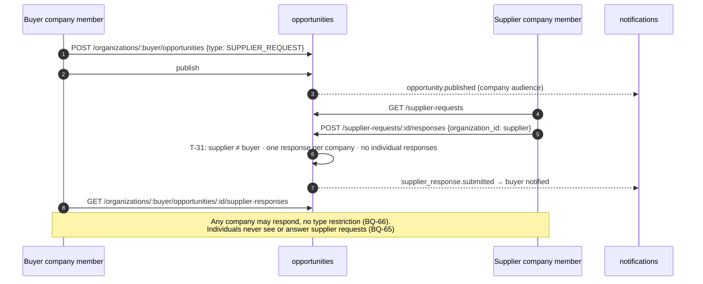

**Deferred (rules §9):** messaging, interviews, offers, matching, surveys, recruitment analytics.

**Legal constraint (§10.3):** Back Of House is a discovery and matching intermediary. It is not the employer and does not guarantee the contract or payment. The backend does **not** model contracts, payroll or escrow (§2.2).

---

## 8. Points & engagement lifecycle (§8, §9.1) · Phase 2

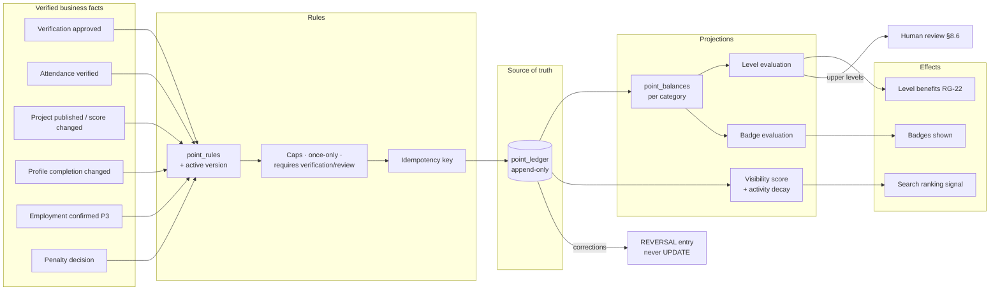

Levels depend on points only, never on verification (BQ-07). Points are never spent or redeemed (BQ-08). Full design: `points-architecture.md`.

---

## 9. Subscription lifecycle (§7.5) · ⏸ DEFERRED future monetization (business rules §11)

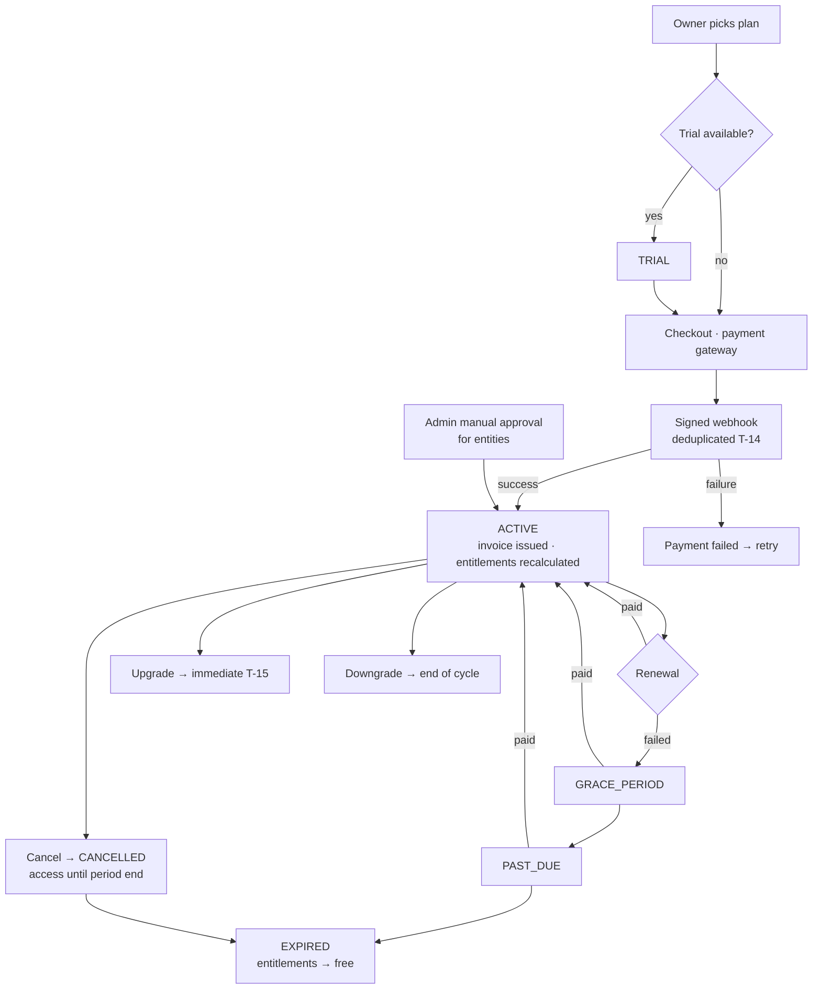

**Invariant (§7.5, §8.1):** subscription changes **never** touch trust, verification or organic visibility. Only entitlements (including the labelled paid partner badge) change.

---

## 10. Bulk import (§22, §22.1) · Phase 1

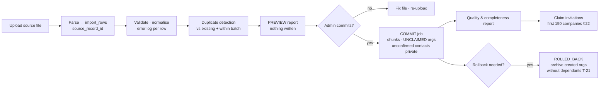

---

## 11. Report generation (§11, §29.1) · Phase 4

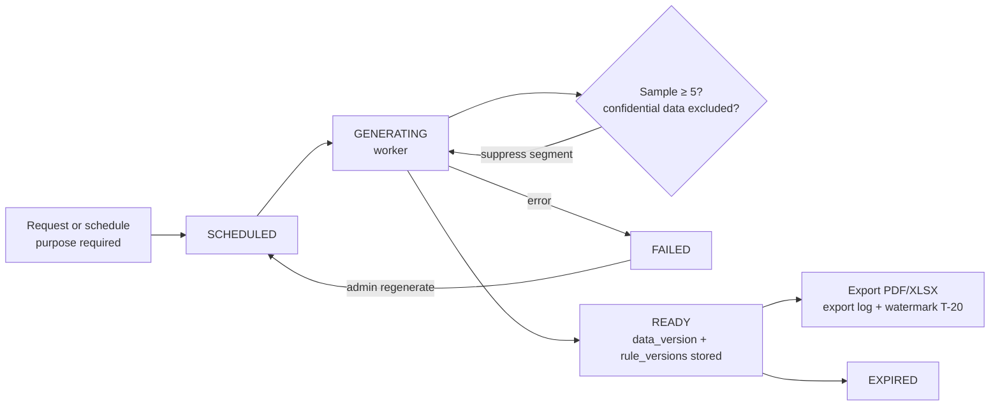

---

## 12. Launch & migration sequence (§22)

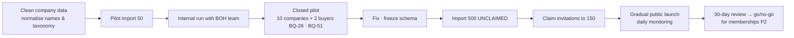
