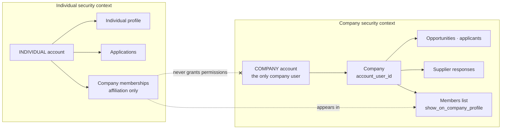
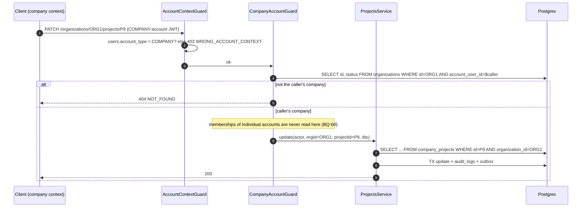
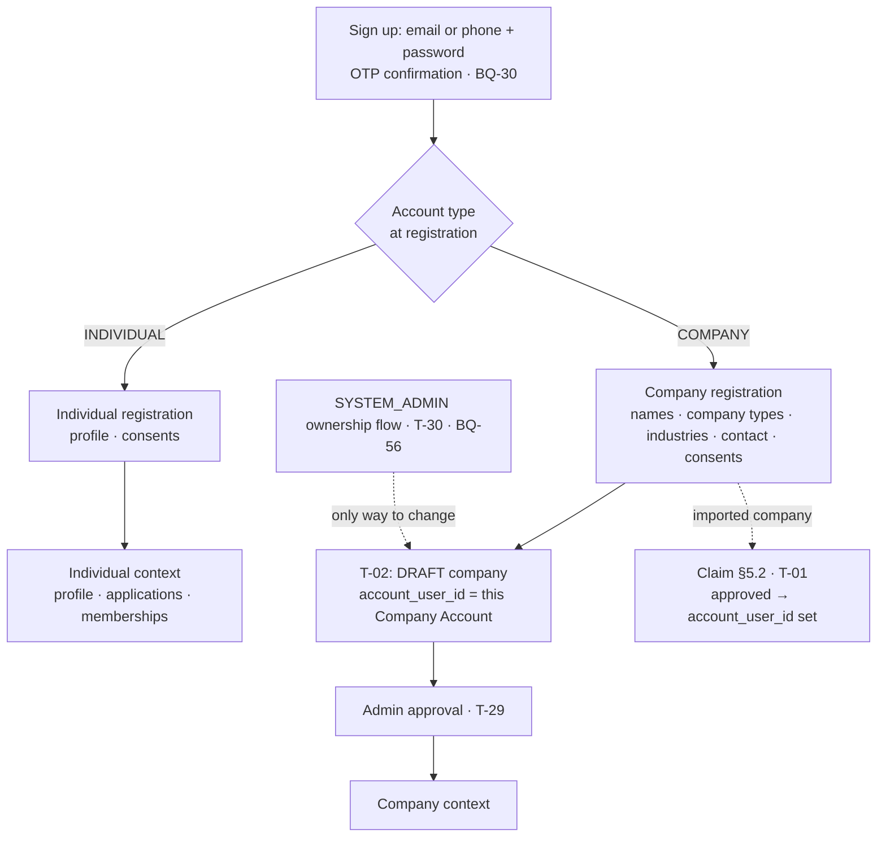

# Account Contexts & Company Context

> PRD sources: §3 (company owner, team member), §4 ("restrict a permission … enforced at server **and query** level"), §5.2, §5.3, AUTH-05.
> **Decisions applied (latest 2026-09-17):**
> - **BQ-60:** Individual and Company accounts are separate security contexts.
> - **BQ-68 / BQ-74:** a company has **exactly one user — the Company Account**. Members and employees have **Individual accounts**; their relation to the company is **membership only**.
> - **Ownership** is created or changed only through the company creation / ownership flow and the admin rules (BQ-04, BQ-05, BQ-56).
> - BQ-61 / BQ-63: company types and industries are classification only.
> - BQ-64: members are shown on the public profile by default.
>
> Related: `auth-architecture.md`, `business-rules.md`, ADR-029, ADR-030. Open: **BQ-68** (remaining details), **BQ-75** (how individuals become members), **BQ-56** (ownership transfer flow), **BQ-57** (approval details).

---

## 1. What is decided

| Rule | Source | Consequence |
|---|---|---|
| Only two account types: `INDIVIDUAL` and `COMPANY` | Rules §1 | `users.account_type`, chosen at registration |
| Each account type has its own registration flow and data | BQ-60 | Individual registration vs company registration |
| Individual and Company accounts are **separate security contexts** | BQ-60 | A token belongs to one account; company routes reject Individual tokens and vice versa |
| **A company has exactly one user: its Company Account** | BQ-68 (2026-09-17) | `organizations.account_user_id` (unique). No company team logins, no company roles |
| One Company Account manages exactly **one** company | BQ-68 | Unique `account_user_id`; a second company needs a second Company Account |
| Employees and members are **Individual accounts** related to the company by **membership** | BQ-68, BQ-74 | `organization_members` = affiliation of INDIVIDUAL accounts; **grants no company permissions** |
| Owning or belonging to a company as an individual grants **no** Company Account permissions | BQ-60 | Company permissions come only from being the company's Company Account |
| **Ownership** is created or changed only by the company creation / ownership flow and admin rules | BQ-04, BQ-05, BQ-56 | Set by company registration (T-02) or an approved claim (T-01); changed only by the admin flow (T-30) |
| The owner creates the company; an admin approves it | BQ-05 | `organization_approvals` (T-29) |
| Members are shown on the public company profile by default; the company can hide specific members | BQ-64 | `organization_members.show_on_company_profile`; public display only |
| Public team data comes from the members' **Individual profiles** | BQ-74 | Name, headline, avatar from `profiles`; no separate team data entry |
| Company types (one or more) and industries (one or more) are classification only | BQ-61, BQ-63 | Never permissions, never verification |
| Supplier requests are visible to and answered by Company Accounts only | BQ-65, BQ-66 | Individual context never sees them |

## 2. Model

```text
INDIVIDUAL ACCOUNT (person)                                   COMPANY ACCOUNT (the company's single login)
 │  own login · own session · own token                         │  own login · own session · own token
 │                                                              │
 ├── individual profile                                         └── COMPANY (organizations.account_user_id = this account)
 ├── applications (JOB · CO_OP · VOLUNTEERING)                        ├── profile · types · industries · projects
 ├── events · points · levels · rewards                               ├── opportunities · applicants · supplier responses
 ├── experiences (employment history)                                 ├── approval requests · verification signals
 └── company memberships ──── member of ────────────────────────────► └── members (Individual accounts, shown/hidden publicly)
       (affiliation only — grants NO company permissions)
```



## 3. How the company context is selected

**The Company Account acts on its own company.** Company routes keep the explicit id for clarity and auditing, and the id must be the caller's company:

```text
/api/v1/organizations/:organizationId/...     :organizationId = organizations.id WHERE account_user_id = caller
/api/v1/me/company                            shortcut to the caller's company
```

| Option | Verdict | Reason |
|---|---|---|
| **A. Company id in the URL, checked against `account_user_id`** | ✅ **Chosen** | Explicit, stateless, auditable; an Individual token can never act on a company |
| B. Company id or permissions in the JWT | ❌ | Stale until refresh |
| C. Individual token + "switch to company" | ❌ | Would let the Individual context borrow company permissions (BQ-60) |

## 4. How authorization checks company access



Guarantees:
1. **Context check.** Company routes require a COMPANY account; individual routes require an INDIVIDUAL account → 403 `WRONG_ACCOUNT_CONTEXT`.
2. **Company match.** `organizations.account_user_id` must equal the caller → otherwise 404 (no id probing).
3. **Resource belongs to the company.** Every repository method on a company route filters by `organizationId`.
4. **No inheritance.** Memberships, employment or ownership claims made by Individual accounts are never consulted for company permissions.

## 5. Members (Individual accounts)

| Capability | Company Account | Member (Individual account) |
|---|---|---|
| See the member list (incl. hidden members) | ✅ | ❌ (sees only the public team) |
| Hide or show a member on the public profile (BQ-64) | ✅ | ❌ (whether members can hide themselves → BQ-75) |
| Remove a member | ✅ | — |
| Leave the company | — | ✅ |
| Manage company profile, opportunities, applicants, supplier responses | ✅ | ❌ **never** |

How an individual becomes a member (company invites, individual requests, or both; whether the company must confirm) → **BQ-75**. The invitation design below is kept as the candidate flow.

**Invariants** (T-02, T-04, T-05, T-30):
- `organizations.account_user_id` references a **COMPANY** account and is **unique** (one company per Company Account).
- `organization_members.user_id` references an **INDIVIDUAL** account (service check + trigger).
- Membership never changes `account_user_id`. Ownership changes only through T-01 (claim), T-02 (creation) or T-30 (admin ownership flow).

## 6. Registration and ownership flows



## 7. Where the context appears in each layer

| Layer | Representation |
|---|---|
| JWT / session | Belongs to exactly one account; no company id, no permissions |
| Account type | `users.account_type`, checked by `AccountContextGuard` |
| Company access | `organizations.account_user_id = caller`, checked by `CompanyAccountGuard` |
| Membership | `organization_members` (Individual accounts): public team display only |
| Audit logs | `actor_user_id` + `organization_id` |
| Row Level Security | ❌ Not used for tenancy (ADR-007) |

## 8. Buyer and government entities — still on hold

Supplier requests are B2B between Company Accounts (rules §7). Institutional workspaces for government entities (§12) remain on hold → **BQ-51**.
