# Database ERD

> PostgreSQL entity-relationship diagrams, split into **focused diagrams** by domain. Field meanings, full constraints and lifecycles are in `database-entities.md`.
>
> - Standard columns (`created_at`, `updated_at`, `created_by`, `updated_by`) are **omitted** from diagrams.
> - `PK` = primary key, `FK` = foreign key, `UK` = unique (alone or as part of a composite unique key; the comment says which).
> - Types are simplified for Mermaid: `uuid_arr` = `uuid[]`, `text_arr` = `text[]`, `enum_X` = PostgreSQL enum `X`.
> - All primary keys are `uuid` unless the table is a join table with a composite key.

## Cardinality legend

| Mermaid | Meaning | Written as |
|---|---|---|
| `\|\|--\|\|` | exactly one to exactly one | **ONE-TO-ONE** |
| `\|\|--o\|` | one to zero-or-one | **ONE-TO-ONE (optional)** |
| `\|\|--o{` | one to zero-or-many | **ONE-TO-MANY** |
| `\|o--o{` | zero-or-one to zero-or-many (nullable FK) | **ONE-TO-MANY (optional parent)** |
| `}o--o{` via join table | many to many | **MANY-TO-MANY** (always implemented with a join table) |

---

## 0. Core overview (key tables only, no attributes)

Shows the backbone that every later phase builds on.

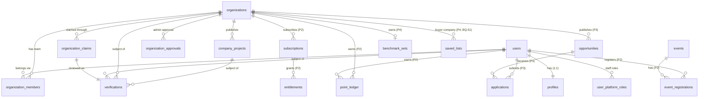

---

## 1. Identity & access (Phase 1)

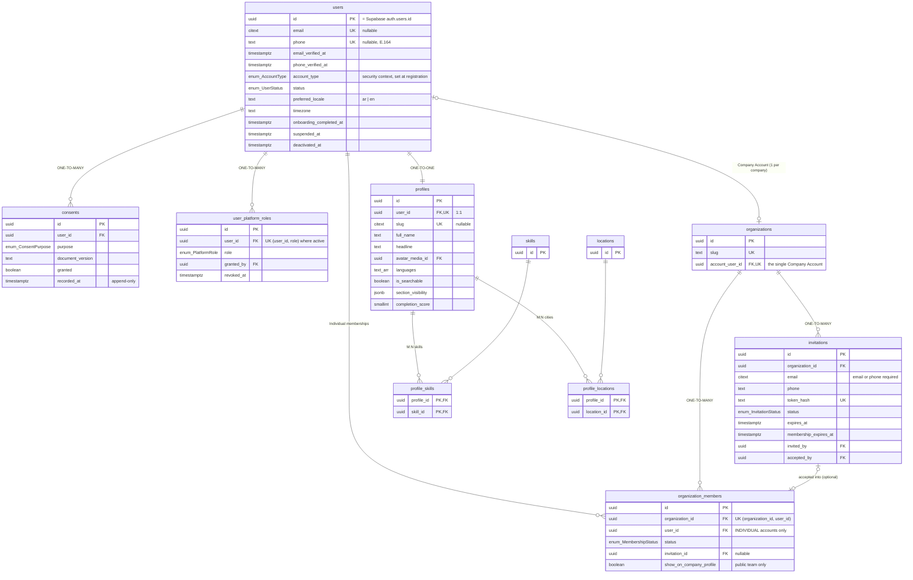

**Relationships**

| Relationship | Type | Notes |
|---|---|---|
| users — profiles | ONE-TO-ONE | Profile created at onboarding. |
| users (COMPANY) — organizations | **ONE-TO-ONE** via `organizations.account_user_id` | The company's single user; the only source of company permissions (BQ-68). |
| users (INDIVIDUAL) ⟷ organizations | **MANY-TO-MANY** via `organization_members` | Membership only; no permissions (BQ-68, BQ-74). |
| users — user_platform_roles | ONE-TO-MANY | Staff only. |
| profiles ⟷ skills, profiles ⟷ locations | MANY-TO-MANY | Join tables. |

---

## 2. Organizations & taxonomy (Phase 1)

```mermaid
erDiagram
    organizations {
        uuid id PK
        enum_OrganizationStatus status
        citext slug UK
        text legal_name_ar
        text legal_name_en
        text trade_name_ar
        text trade_name_en
        text commercial_registration_number UK "partial, normalised"
        text legal_entity_type
        uuid logo_media_id FK
        uuid cover_media_id FK
        smallint founded_year
        text size_range
        jsonb capacity "ranges with source"
        text_arr languages
        citext website_domain
        uuid headquarters_location_id FK
        jsonb field_visibility
        smallint completion_score
        timestamptz approved_at "admin approval"
        timestamptz claimed_at
        timestamptz registration_verified_at "signal"
        timestamptz domain_verified_at "signal"
        timestamptz verified_at "derived, rule BQ-53"
        timestamptz last_confirmed_at
        timestamptz suspended_at
        timestamptz archived_at
        uuid merged_into_organization_id FK "self, nullable"
        uuid source_import_row_id FK "nullable"
    }
    organization_contacts {
        uuid id PK
        uuid organization_id FK
        enum_ContactType type
        text value
        boolean is_public
        boolean is_imported "private until confirmed"
        timestamptz confirmed_at "contact signal"
    }
    organization_industries {
        uuid organization_id PK,FK
        uuid industry_id PK,FK "one or more, classification only"
    }
    industries {
        uuid id PK
        citext slug UK
        text name_ar
        text name_en
    }
    organization_company_types {
        uuid organization_id PK,FK
        enum_CompanyType company_type PK "one or more, classification only"
    }
    organization_services {
        uuid organization_id PK,FK
        uuid service_id PK,FK
        boolean is_primary
    }
    organization_coverage {
        uuid organization_id PK,FK
        uuid location_id PK,FK
    }
    organization_credentials {
        uuid id PK
        uuid organization_id FK
        enum_CredentialType type
        text issuer
        date issued_on
        date expires_on "indexed for alerts"
        uuid document_id FK
        timestamptz verified_at
        boolean is_public
    }
    organization_approvals {
        uuid id PK
        uuid organization_id FK "UK one open request"
        enum_OrganizationApprovalStatus status
        uuid submitted_by FK
        uuid decided_by FK "SYSTEM_ADMIN"
        text reason
    }
    organization_media {
        uuid organization_id PK,FK
        uuid media_asset_id PK,FK
        int sort_order
    }
    organization_claims {
        uuid id PK
        uuid organization_id FK
        uuid claimant_user_id FK
        uuid verification_id FK,UK "1:1"
        text applicant_title
        citext work_email
        boolean work_email_domain_matches
        jsonb automated_checks
        timestamptz closed_at "UK open claim per claimant"
    }
    organization_merges {
        uuid id PK
        uuid source_organization_id FK
        uuid target_organization_id FK
        enum_MergeStatus status
        jsonb detection_signals
        uuid decided_by FK
        text decision_reason
    }
    correction_suggestions {
        uuid id PK
        uuid organization_id FK
        text field_path
        jsonb suggested_value
        enum_CorrectionSuggestionStatus status
        uuid suggested_by FK
    }
    categories {
        uuid id PK
        uuid parent_id FK "self, nullable"
        citext slug UK
        text name_ar
        text name_en
        boolean is_active
    }
    services {
        uuid id PK
        uuid category_id FK
        citext slug UK
        text name_ar
        text name_en
    }
    locations {
        uuid id PK
        uuid parent_id FK "self: city to region"
        enum_LocationType type
        char country_code
        citext slug UK
        text name_ar
        text name_en
    }
    users {
        uuid id PK
    }
    verifications {
        uuid id PK
    }
    media_assets {
        uuid id PK
    }
    documents {
        uuid id PK
    }

    organizations ||--|{ organization_company_types : "one or more types"
    organizations ||--o{ organization_industries : "M:N industries"
    industries ||--o{ organization_industries : ""
    organizations ||--o{ organization_contacts : "ONE-TO-MANY"
    organizations ||--o{ organization_services : "M:N services"
    services ||--o{ organization_services : ""
    organizations ||--o{ organization_coverage : "M:N locations"
    locations ||--o{ organization_coverage : ""
    organizations ||--o{ organization_credentials : "ONE-TO-MANY"
    documents |o--o{ organization_credentials : "evidence (optional)"
    organizations ||--o{ organization_media : "M:N gallery"
    media_assets ||--o{ organization_media : ""
    organizations ||--o{ organization_claims : "ONE-TO-MANY"
    users ||--o{ organization_claims : "claimant"
    verifications ||--|| organization_claims : "ONE-TO-ONE"
    organizations ||--o{ organization_merges : "as source"
    organizations ||--o{ organization_merges : "as target"
    organizations |o--o{ organizations : "merged_into (self)"
    organizations ||--o{ correction_suggestions : "ONE-TO-MANY"
    organizations ||--o{ organization_approvals : "ONE-TO-MANY"
    categories |o--o{ categories : "parent (tree)"
    categories ||--o{ services : "ONE-TO-MANY"
    locations |o--o{ locations : "parent (region)"
    locations |o--o{ organizations : "headquarters (optional)"
```

**Relationships**

| Relationship | Type | Notes |
|---|---|---|
| organizations ⟷ services | MANY-TO-MANY | `organization_services` |
| organizations ⟷ locations (coverage) | MANY-TO-MANY | `organization_coverage` |
| organizations ⟷ media_assets (gallery) | MANY-TO-MANY | `organization_media` |
| organization_claims — verifications | ONE-TO-ONE | The claim holds claim data; the verification is the review case. Grants ownership only (BQ-46). |
| organizations — organization_approvals | ONE-TO-MANY | Admin approval requests (BQ-05). Separate from verification (BQ-46). |
| organizations — organizations | ONE-TO-MANY (self, optional) | `merged_into_organization_id` |
| categories — categories, locations — locations | ONE-TO-MANY (self tree) | |

---

## 3. Company projects (portfolio), verification & media (Phase 1)

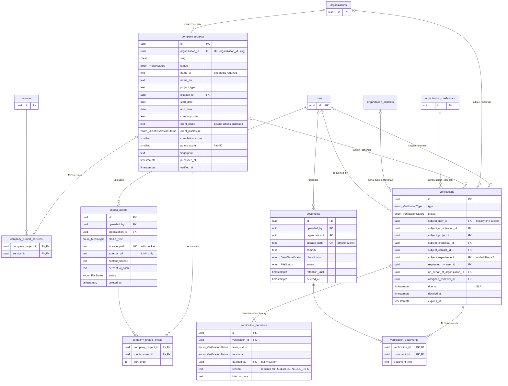

**Polymorphic subjects without losing referential integrity.** `verifications` uses **one nullable FK column per subject type** plus `CHECK (num_nonnulls(...) = 1)`, instead of a generic `subject_type + subject_id`. The same pattern is used by `abuse_reports`, `appeals`, `point_ledger`, `badge_awards`, `visibility_snapshots` and `entitlements`.

---

## 4. Search, content, moderation, notifications, audit, imports, platform (Phase 1)

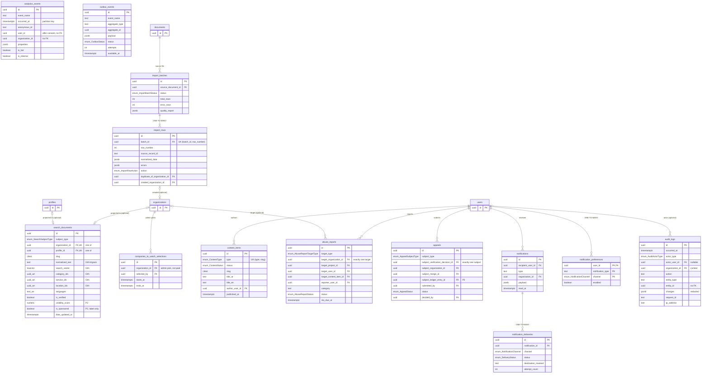

`audit_logs.entity_id`, `analytics_events.*_id` and `outbox_events.aggregate_id` have **no foreign keys on purpose**. They point to many tables, must survive deletion of the referenced row, and (analytics) live in a partitioned table.

---

## 5. Billing & entitlements — ⏸ DEFERRED future monetization (business rules §11)

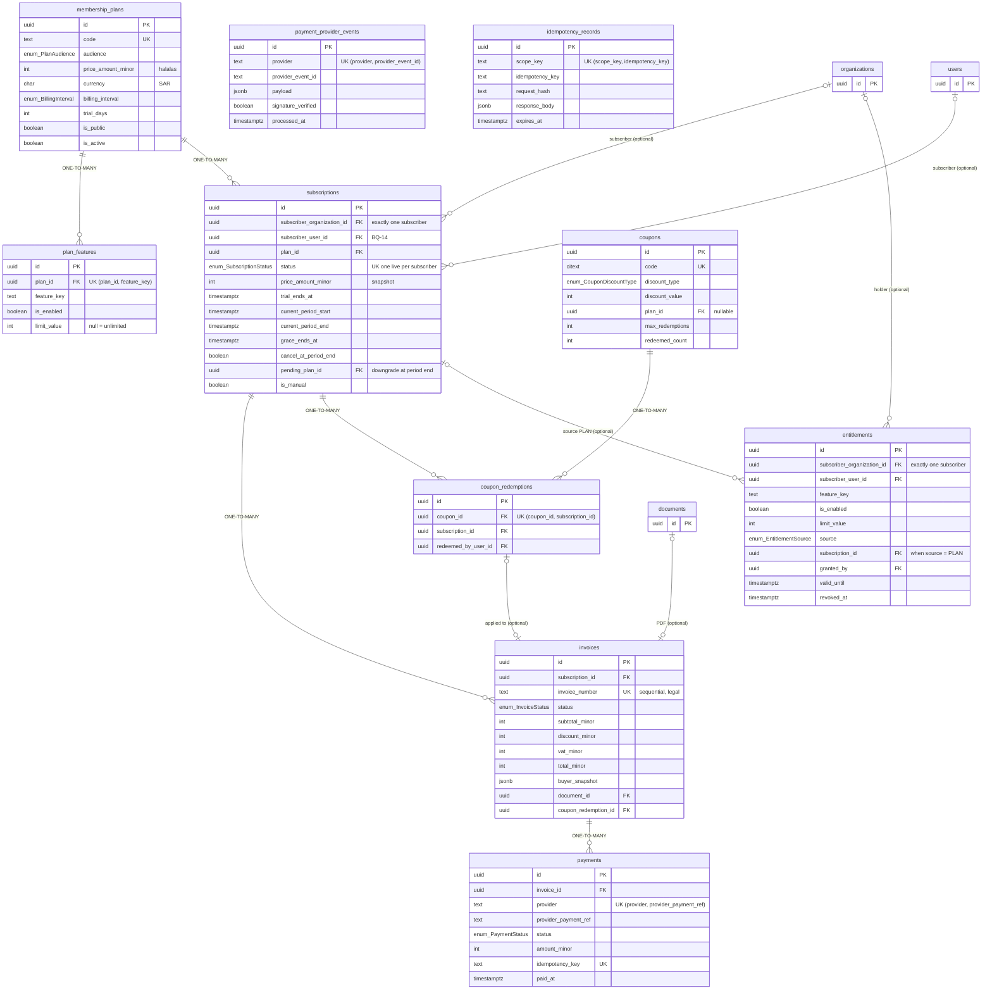

---

## 6. Engagement: points, levels, badges, visibility (Phase 2)

```mermaid
erDiagram
    point_rules {
        uuid id PK
        text code UK
        enum_PointSubjectType subject_type
        enum_PointCategory category
        boolean is_active
    }
    point_rule_versions {
        uuid id PK
        uuid rule_id FK "UK (rule_id, version)"
        int version
        int points "negative for penalties"
        int max_per_subject
        int daily_cap
        int weekly_cap
        boolean requires_verification
        boolean requires_review
        timestamptz effective_from "no overlap per rule"
        timestamptz effective_to
    }
    point_ledger {
        uuid id PK
        enum_PointSubjectType subject_type
        uuid subject_user_id FK "exactly one subject"
        uuid subject_organization_id FK
        enum_PointCategory category
        enum_LedgerEntryType entry_type
        int amount "signed, not zero"
        uuid rule_version_id FK "null only for admin adjustment"
        text source_type
        uuid source_id
        text idempotency_key UK
        uuid reverses_entry_id FK,UK "self, reversed at most once"
        text reason
        timestamptz occurred_at "decay basis"
    }
    point_balances {
        uuid id PK
        uuid subject_user_id FK "UK (subject, category)"
        uuid subject_organization_id FK
        enum_PointCategory category
        int balance "projection"
        uuid last_entry_id FK
        timestamptz frozen_at
    }
    rewards {
        uuid id PK
        text code UK
        uuid unlock_level_id FK
        int unlock_min_points
        boolean is_active "unlocked, never spent"
    }
    member_levels {
        uuid id PK
        text code UK
        int min_points
        int max_points
        boolean requires_verification
        boolean requires_review
        boolean requires_nomination
    }
    level_assignments {
        uuid id PK
        uuid user_id FK "UK one ACTIVE per user"
        uuid level_id FK
        enum_LevelAssignmentStatus status
        int points_at_assignment
        uuid nominated_by FK
        uuid reviewed_by FK
    }
    badges {
        uuid id PK
        text code UK
        enum_PointSubjectType subject_type
        boolean is_manual
        jsonb criteria
    }
    badge_awards {
        uuid id PK
        uuid badge_id FK "UK (badge, subject) where not revoked"
        uuid subject_user_id FK
        uuid subject_organization_id FK
        timestamptz awarded_at
        timestamptz revoked_at
    }
    visibility_snapshots {
        uuid id PK
        uuid subject_user_id FK "UK current per subject"
        uuid subject_organization_id FK
        numeric score "0 to 100"
        jsonb components
        text formula_version
        boolean is_current
        timestamptz computed_at
    }
    engagement_alerts {
        uuid id PK
        uuid subject_user_id FK
        uuid subject_organization_id FK
        text alert_type
        enum_EngagementAlertStatus status
    }
    users {
        uuid id PK
    }
    organizations {
        uuid id PK
    }

    point_rules ||--|{ point_rule_versions : "ONE-TO-MANY versions"
    point_rule_versions |o--o{ point_ledger : "applied by (optional)"
    point_ledger |o--o| point_ledger : "reversed by (self)"
    users |o--o{ point_ledger : "subject (optional)"
    organizations |o--o{ point_ledger : "subject (optional)"
    users |o--o{ point_balances : "ONE-TO-MANY per category"
    organizations |o--o{ point_balances : "ONE-TO-MANY per category"
    member_levels ||--o{ level_assignments : "ONE-TO-MANY"
    member_levels |o--o{ rewards : "unlocks"
    users ||--o{ level_assignments : "history"
    badges ||--o{ badge_awards : "ONE-TO-MANY"
    users |o--o{ badge_awards : "subject (optional)"
    organizations |o--o{ badge_awards : "subject (optional)"
    users |o--o{ visibility_snapshots : "history"
    organizations |o--o{ visibility_snapshots : "history"
    users |o--o{ engagement_alerts : "subject"
    organizations |o--o{ engagement_alerts : "subject"
```

---

## 7. Events (Phase 2)

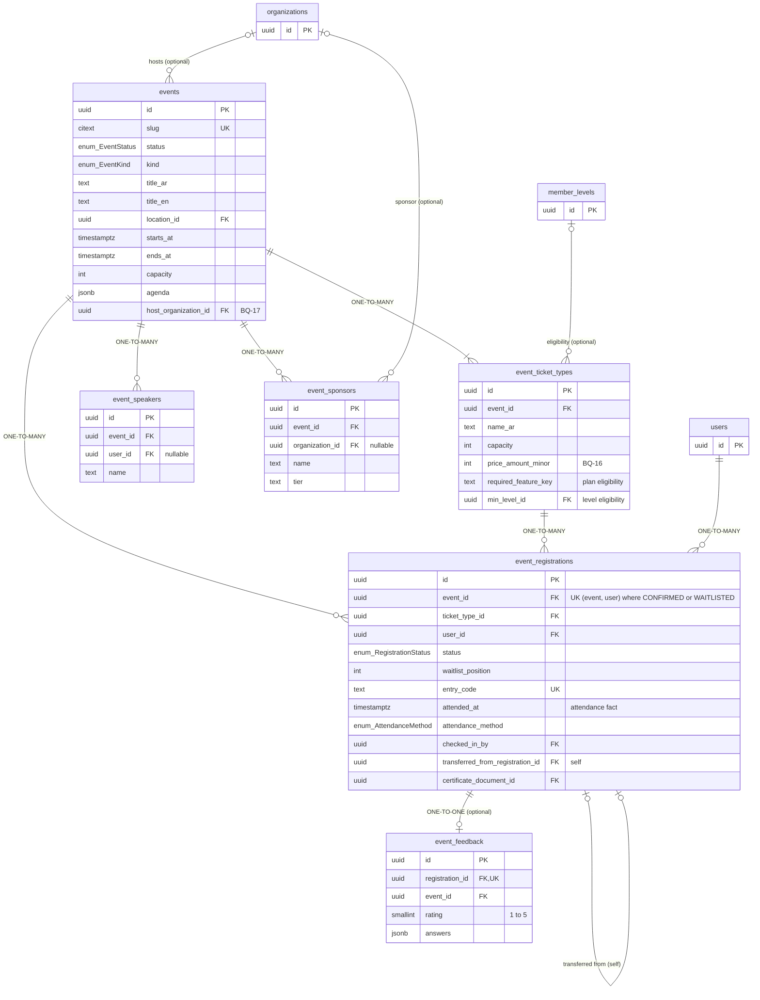

**Users ⟷ events** is **MANY-TO-MANY** through `event_registrations`. The join row carries its own lifecycle (status, attendance, certificate).

---

## 8. Talent (Phase 3)

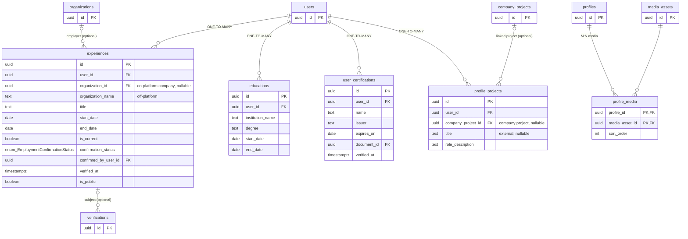

**Users ⟷ organizations (employment)** is MANY-TO-MANY through `experiences`. This is **not** the same as `organization_members`: an employment relationship grants **no permissions** (§10.1 vs §4).

---

## 9. Opportunities (Phase 3) — unified model; `application_messages` and `opportunity_feedback` ⏸ deferred

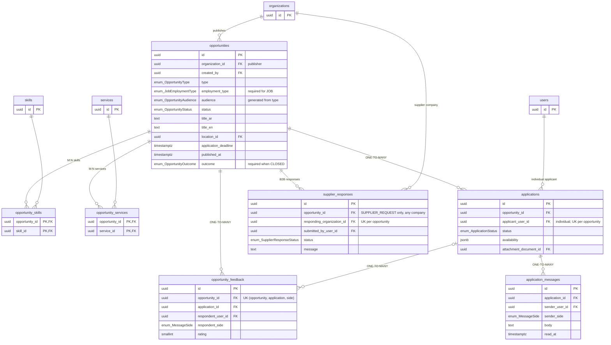

---

## 10. Intelligence & buyer features (Phase 4 · buyer features on hold, BQ-51)

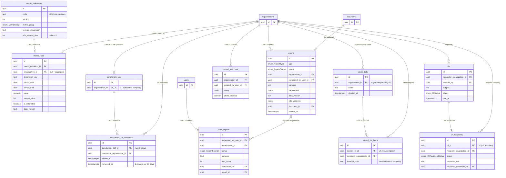

**Organizations ⟷ organizations** appears three times as **MANY-TO-MANY** with different meanings: benchmark competitors, supplier-list entries, and RFI recipients. Each is a separate join table, because each relationship has its own rules and privacy.

---

## Important indexes (summary)

| Table | Index | Why |
|---|---|---|
| users | unique partial `email`, `phone` | Login lookup and duplicate-account prevention (§20.2). |
| organizations | unique `account_user_id` | Company-access check on every company route; one Company Account per company (BQ-68). |
| organization_members | `(organization_id, status, show_on_company_profile)` | Public team section (BQ-64). |
| organizations | GIN trigram on normalised names; `commercial_registration_number` unique partial; `website_domain` | Duplicate detection (ORG-09, §5.3), claim matching (§5.2). |
| organizations | `last_confirmed_at`; `organization_approvals (status, submitted_at)` | Staleness job (ORG-08); admin approval queue (BQ-05). |
| verifications | `(status, type, due_at)` | Reviewer queue ordered by SLA (§23). |
| search_documents | GIN `search_vector`, GIN trigram `normalized_text`, GIN arrays, `visibility_score DESC` | Search under 1 second (§17), Arabic spelling tolerance (§7.4). |
| point_ledger | unique `idempotency_key`; unique `reverses_entry_id`; `(subject, category, occurred_at)` | Exactly-once points, single reversal, caps and decay (§8.5, §8.6, §20.2). |
| subscriptions | unique partial live subscription per subscriber | No double subscription (§20.2). |
| payment_provider_events | unique `(provider, provider_event_id)` | Webhook idempotency (§15.1). |
| event_registrations | unique `entry_code`; partial unique `(event_id, user_id)` | Check-in lookup; one active registration per user. |
| audit_logs | `(entity_type, entity_id, occurred_at)`, `(actor_user_id, occurred_at)`, `(organization_id, occurred_at)` | Investigations (§3 auditor), buyer access log (§12.1, BQ-51). |
| analytics_events | monthly partitions; `(organization_id, event_name, occurred_at)` | Company performance metrics (§11.2) without scanning everything. |
| outbox_events | `(status, available_at)` | Worker polling. |
