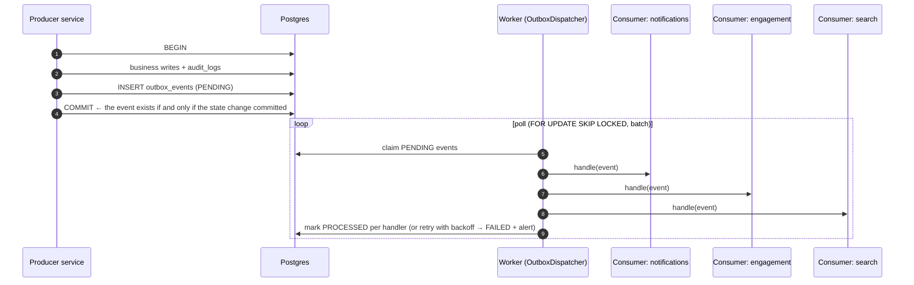
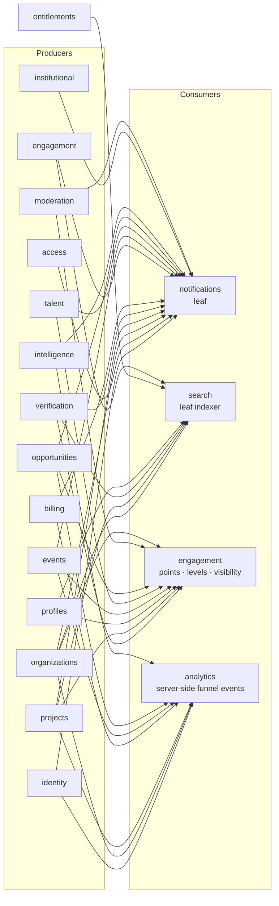

# Domain Events

> Internal business events that decouple modules (notifications, points, search, analytics) from the modules where things happen.
> Mechanism: **transactional outbox + worker dispatcher** (ADR-011). No Kafka or Redis.
> Naming: `<aggregate>.<past-tense-fact>` (e.g. `organization.claim.approved`). Names come from PRD workflows. PRD analytics events (§16) are a **separate** dictionary (§6).

---

## 1. Delivery model



| Property | Guarantee |
|---|---|
| Atomicity | The event is written in the **same transaction** as the state change. There are no "ghost" or lost events |
| Delivery | **At least once**, per consumer (a per-handler record keeps one slow or failing consumer from blocking others) |
| Consumer idempotency | **Required.** Points use `idempotency_key`; search upserts; notifications dedupe on `(event_id, recipient, type)` |
| Ordering | Best effort per `aggregate_id`. Consumers must not rely on global order; they re-read current state when order matters |
| Retries | Exponential backoff, maximum 10 attempts → `FAILED` + ops alert |
| Payload versioning | `event_version` field. Additive changes only; breaking changes use a new version, with both published during migration |

### Envelope

```jsonc
{
  "event_id": "0192f7a1-…",            // uuid v7
  "event_name": "organization.claim.approved",
  "event_version": 1,
  "occurred_at": "2026-10-01T09:12:44Z",
  "aggregate_type": "organization",
  "aggregate_id": "…",
  "actor": { "type": "STAFF", "user_id": "…" },   // null user_id for SYSTEM
  "organization_id": "…",               // tenant context when relevant
  "request_id": "…",                    // trace correlation
  "payload": { /* event-specific, ids + minimal facts, NO personal contact data */ }
}
```

**Payload rule:** ids and minimal facts only. No emails, phone numbers, document contents or free-text reasons marked internal. Consumers fetch what they need through query services (§18 data minimisation).

---

## 2. What is NOT an event (runs synchronously in the same transaction)

| Interaction | Why synchronous | Mechanism |
|---|---|---|
| Audit logging | An audit row must exist if and only if the mutation committed (§18) | `AuditLogger.record(tx, …)` |
| Verification decision → subject state (claim → owner) | Ownership must not change without a correct review (§20.2); no window of inconsistency | `VerificationSubjectHandler` port |
| Organization merge → moving children | All-or-nothing merge (ORG-09) | `OrganizationMergeParticipant` port |
| Subscription change → entitlements | Access must match what was paid (§20.2 billing) | `EntitlementsRecalculator(tx)` |
| Point entry → balance projection | The balance must never disagree with the ledger inside a request | Same transaction in `PointsService` |
| Onboarding → profile creation | One user action | `profiles.OnboardingService` |

---

## 3. Event catalog: Phase 1

Consumer abbreviations: **NTF** notifications · **ENG** engagement (P2+) · **SRC** search · **ANL** analytics · **ORG** organizations · **PRJ** projects · **ADM** admin dashboard counters.

### 3.1 Identity & access

| Event | Producer | Consumers | Payload | Purpose | Mode |
|---|---|---|---|---|---|
| `user.registered` | identity | ANL | `user_id`, `channel` (email/phone) | Registration funnel (§1.2 KPI) | async |
| `user.onboarding.completed` | profiles (onboarding) | ANL, ENG (P2: profile completion baseline) | `user_id`, `account_type` | Onboarding funnel | async |
| `user.suspended` | identity | SRC (hide profile), NTF (none by default) | `user_id`, `reason_code` | Remove from public surfaces | async |
| `user.reinstated` | identity | SRC | `user_id` | Restore visibility | async |
| `user.sessions.revoked` | identity | — (audit only) | `user_id`, `scope` | Traceability | — |
| `consent.changed` | identity | ANL (stop linking events if withdrawn) | `user_id`, `purpose`, `granted` | §16.1 consent-based linking | async |
| `invitation.created` | access | NTF (email/SMS to invitee) | `invitation_id`, `organization_id`, `role`, `channel` | AUTH-05 | async |
| `invitation.accepted` | access | NTF (inform owner) | `invitation_id`, `organization_id`, `user_id`, `role` | | async |
| `membership.visibility_changed` | access | — (SRC team section) | `membership_id`, `organization_id`, `show_on_company_profile` | BQ-64 | async |
| `membership.removed` | access | NTF | `membership_id`, `organization_id`, `user_id` | | async |
| `organization.account_linked` | organizations | NTF, ANL | `organization_id`, `account_user_id`, `source` (CREATION/CLAIM/ADMIN_FLOW) | The company's single Company Account (BQ-68) | async |
| `staff_role.granted` / `staff_role.revoked` | access | NTF (the staff member) | `user_id`, `role` | §18 | async |

### 3.2 Organizations

| Event | Producer | Consumers | Payload | Purpose | Mode |
|---|---|---|---|---|---|
| `organization.created` | organizations | SRC (if public), ANL, ADM | `organization_id`, `status`, `origin` (IMPORT/COMPANY_REGISTRATION) | Index, KPI "companies in base" | async |
| `organization.updated` | organizations | SRC, ENG (PROFILE_COMPLETION sync, P2) | `organization_id`, `changed_fields[]`, `completion_score` | Reindex public fields; completeness points | async (debounced) |
| `organization.status_changed` | organizations | SRC, PRJ (public visibility), NTF (owner), ANL | `organization_id`, `from`, `to`, `reason_code` | Lifecycle effects | async |
| `organization.claim.submitted` | organizations | ANL (`profile_claim_started`), ADM | `claim_id`, `organization_id`, `claimant_user_id` | §16 claim funnel | async |
| `organization.claim.approved` | organizations (handler) | NTF (claimant: "invite your team"), ANL (`profile_claim_completed`), SRC | `claim_id`, `organization_id`, `user_id` | §5.2 | async |
| `organization.claim.rejected` | organizations (handler) | NTF, ANL | `claim_id`, `organization_id`, `user_id` | | async |
| `organization.approval.submitted` | organizations | ADM (approval queue) | `approval_id`, `organization_id`, `submitted_by` | BQ-05 | async |
| `organization.approved` | organizations (T-29) | SRC (publish listing), NTF (owner), ANL | `approval_id`, `organization_id`, `decided_by` | Admin approval — **not** verification; ENG does **not** consume it (BQ-46) | async |
| `organization.approval.changes_requested` / `organization.approval.rejected` | organizations (T-29) | NTF (owner) | `approval_id`, `organization_id` | BQ-05, BQ-57 | async |
| `organization.ownership.transferred` | organizations (T-30) | NTF (old and new Company Account), ANL | `organization_id`, `from_account_user_id`, `to_account_user_id` | BQ-56, BQ-69 | async |
| `organization.verification_signal.approved` / `.expired` | organizations (signal handlers) | SRC (`verification_signals`), ENG (TRUST rule per signal, P2), NTF | `organization_id`, `verification_id`, `signal` (REGISTRATION/DOMAIN/CREDENTIAL/CONTACT) | Independent signals (BQ-47) | async |
| `organization.verified` | organizations (status derivation) | SRC (`is_verified`), NTF, ANL | `organization_id` | Company reached the VERIFIED rule (BQ-53). KPI "verified companies". Trust points come from the signal events, not this one | async |
| `organization.needs_update` | organizations (job) | NTF (owner), SRC (freshness) | `organization_id`, `reason` (STALE/CREDENTIAL_EXPIRED) | ORG-08 | async |
| `organization.credential.expiring` | organizations (job) | NTF (owner) | `organization_id`, `credential_id`, `expires_on` | ORG-05, ORG-08 | async |
| `organization.merged` | organizations | SRC (delete source doc, reindex target), NTF (owners), ANL | `source_organization_id`, `target_organization_id`, `merge_id` | ORG-09 | async (children moved synchronously) |
| `correction.suggested` | organizations | NTF (owner/editors) | `suggestion_id`, `organization_id` | §4 | async |

### 3.3 Projects

| Event | Producer | Consumers | Payload | Purpose | Mode |
|---|---|---|---|---|---|
| `project.submitted` | projects | ADM (queue) | `project_id`, `organization_id` | Review queue | async |
| `project.published` | projects | SRC, NTF (org), ANL (`project_published`: completeness, verification, type), ENG (P2) | `project_id`, `organization_id`, `completion_score`, `points_score`, `is_verified`, `project_type` | §7.3, §16 | async |
| `project.changes_requested` | projects | NTF | `project_id`, `organization_id` | | async |
| `project.rejected` | projects | NTF | `project_id`, `organization_id` | | async |
| `project.archived` | projects | SRC, ENG (PROJECTS sync) | `project_id`, `organization_id` | | async |
| `project.score_changed` | projects | ENG (PROJECTS sync, top 10 ≤ 300) | `project_id`, `organization_id`, `points_score` | §7.3, §8.3 | async (debounced) |

### 3.4 Verification

| Event | Producer | Consumers | Payload | Purpose | Mode |
|---|---|---|---|---|---|
| `verification.submitted` | verification | ADM | `verification_id`, `type`, `due_at` | Queue and SLA | async |
| `verification.info_requested` | verification | NTF (applicant) | `verification_id`, `type`, `subject_ref` | §5.1 status visibility | async |
| `verification.approved` | verification | NTF, ENG (TRUST/EXPERIENCE points, P2), SRC | `verification_id`, `type`, `subject_ref` | Trust derivation | async (subject state already changed in TX) |
| `verification.rejected` | verification | NTF | `verification_id`, `type`, `subject_ref` | | async |
| `verification.expired` | verification (job) | NTF, ENG (reverse trust points), SRC | `verification_id`, `type`, `subject_ref` | BQ-23 | async |

`subject_ref` = `{ kind: "organization" | "user" | "project" | "credential" | "experience", id }`.

### 3.5 Profiles, media, content, moderation, imports

| Event | Producer | Consumers | Payload | Purpose | Mode |
|---|---|---|---|---|---|
| `profile.updated` | profiles | SRC (P3 professionals) | `profile_id`, `user_id`, `changed_fields[]` | | async |
| `profile.completion_changed` | profiles | ENG (PROFILE_COMPLETION once-only items) | `user_id`, `completed_items[]`, `completion_score` | §8.2 | async |
| `profile.visibility_changed` | profiles | SRC | `profile_id`, `is_searchable` | §5.1 privacy | async |
| `media.ready` | media | owning module (e.g. ORG attach) | `asset_id`, `purpose` | Upload pipeline | async |
| `media.rejected` | media | ORG / PRJ (detach), NTF (uploader) | `asset_id`, `reason_code` | §18 malware and type | async |
| `content.published` | content | SRC (sitemap) | `content_item_id`, `type`, `slug` | SEO | async |
| `abuse_report.created` | moderation | ADM, NTF (moderators, urgent types) | `report_id`, `target_type`, `category`, `sla_due_at` | §23 24 h target | async |
| `abuse_report.resolved` | moderation | NTF (reporter) | `report_id`, `outcome` | | async |
| `appeal.submitted` | moderation | ADM | `appeal_id`, `subject_type` | §8.6 | async |
| `appeal.upheld` | moderation | ENG (reversal), ORG (status recompute), NTF | `appeal_id`, `subject_type`, `subject_ref` | Corrective action by owning module | async |
| `appeal.denied` | moderation | NTF | `appeal_id` | | async |
| `import.committed` | imports | ADM, SRC (bulk reindex) | `batch_id`, `created_count`, `updated_count` | §22 | async |
| `import.rolled_back` | imports | SRC | `batch_id`, `archived_organization_ids[]` | §22.1 | async |
| `taxonomy.changed` | taxonomy | SRC (reindex affected docs) | `entity` (category/service/location/skill), `id` | | async |

---

## 4. Event catalog: Phases 2–4

### 4.1 Billing & entitlements — ⏸ deferred (business rules §11)

| Event | Producer | Consumers | Payload | Purpose |
|---|---|---|---|---|
| `subscription.started` | billing | NTF, ANL (`membership_started`: plan, value) | `subscription_id`, `subscriber_ref`, `plan_code`, `status` (TRIAL/ACTIVE), `amount_minor` | §16 |
| `subscription.renewed` | billing | NTF, ANL (`membership_renewed`) | `subscription_id`, `period_end`, `amount_minor` | §7.5 |
| `subscription.plan_changed` | billing | NTF, ANL | `subscription_id`, `from_plan`, `to_plan`, `effective_at` | Upgrade now / downgrade at period end |
| `subscription.grace_started` / `subscription.past_due` | billing | NTF (owner) | `subscription_id`, `grace_ends_at` | Dunning |
| `subscription.cancelled` | billing | NTF, ANL (`membership_cancelled`: reason) | `subscription_id`, `reason_code`, `access_until` | §16 |
| `subscription.expired` | billing | NTF | `subscription_id` | |
| `payment.succeeded` / `payment.failed` | billing | NTF | `payment_id`, `invoice_id`, `amount_minor` | |
| `invoice.issued` | billing | NTF (invoice ready) | `invoice_id`, `subscription_id`, `total_minor` | Tax invoice |
| `coupon.redeemed` | billing | ANL | `coupon_id`, `subscription_id` | |
| `entitlements.changed` | entitlements | SRC (partner label), NTF (none), ENG (none: **never** trust) | `subscriber_ref`, `feature_keys[]` | Feature gates |

### 4.2 Engagement (Phase 2)

| Event | Producer | Consumers | Payload | Purpose |
|---|---|---|---|---|
| `points.credited` / `points.debited` | engagement | ENG (levels, badges, visibility debounce), NTF (optional milestone) | `entry_id`, `subject_ref`, `category`, `amount`, `rule_code` | Downstream projections |
| `points.reversed` | engagement | ENG (levels), NTF (subject, if user-visible, BQ-13) | `entry_id`, `reverses_entry_id`, `subject_ref`, `amount` | §8.1 |
| `points.balance_frozen` | engagement | NTF, SRC (visibility) | `subject_ref`, `reason_code` | §8.2 |
| `level.review_requested` | engagement | ADM, NTF (staff) | `assignment_id`, `user_id`, `level_code` | §8.6 human review |
| `level.changed` | engagement | NTF (member), SRC (P3), ANL | `user_id`, `from_level`, `to_level` | §9.1 |
| `badge.awarded` / `badge.revoked` | engagement | NTF, SRC | `award_id`, `badge_code`, `subject_ref` | §14 |
| `visibility.recomputed` | engagement | SRC (`visibility_score`) | `subject_ref`, `score`, `formula_version` | §8.4 |
| `engagement.anomaly_detected` | engagement (job) | ADM, NTF (staff) | `alert_id`, `alert_type`, `subject_ref` | §8.6 |

### 4.3 Events (Phase 2)

| Event | Producer | Consumers | Payload | Purpose |
|---|---|---|---|---|
| `event.published` | events | NTF (optional audience), ANL | `event_id`, `kind`, `starts_at` | |
| `event.cancelled` | events | NTF (all registrants) | `event_id` | |
| `event.registration.confirmed` | events | NTF (entry code), ANL (`event_registered`: membership) | `registration_id`, `event_id`, `user_id`, `ticket_type_id` | §16 |
| `event.registration.waitlisted` | events | NTF | same + `waitlist_position` | §9.2 |
| `event.registration.promoted` | events | NTF (seat available) | `registration_id`, `event_id`, `user_id` | §9.2 |
| `event.registration.cancelled` | events | NTF, ENG (repeated-cancellation penalty pattern, ❓) | `registration_id`, `event_id`, `user_id`, `cancelled_at` | §8.2 penalties |
| `event.registration.transferred` | events | NTF (both users) | `from_registration_id`, `to_registration_id` | §9.2 |
| `event.attendance.verified` | events | **ENG (ACTIVITY points: the only trigger)**, ANL (`event_attended`) | `registration_id`, `event_id`, `event_kind`, `user_id`, `method`, `occurred_at` | §9.2, §20.2 |
| `event.completed` | events | NTF (survey links), job (certificates) | `event_id` | §9.2 |
| `event.feedback.submitted` | events | ANL | `event_id`, `rating` | Satisfaction |
| `event.certificate.issued` | events | NTF | `registration_id`, `document_id` | §9.2 |

### 4.4 Talent & opportunities (Phase 3)

| Event | Producer | Consumers | Payload | Purpose |
|---|---|---|---|---|
| `experience.confirmation_requested` | talent | NTF (organization confirmers) | `experience_id`, `organization_id`, `user_id` | §10.1 |
| `experience.confirmed` | talent | ENG (TRUST employer 25 / org confirmation 20), NTF, SRC | `experience_id`, `organization_id`, `user_id` | §8.2 |
| `experience.declined` | talent | NTF | `experience_id` | |
| `opportunity.published` | opportunities | SRC, ENG (org RECENT_ACTIVITY/CONTRIBUTION), ANL | `opportunity_id`, `organization_id`, `type`, `audience` | Rules §5, §6 |
| `opportunity.paused` / `opportunity.closed` | opportunities | NTF (applicants), ANL (`opportunity_closed`: result), SRC | `opportunity_id`, `outcome` | §10.3, §16 |
| `opportunity.match_found` ⏸ | opportunities (matching) | NTF | `opportunity_id`, `user_id`, `score` | Deferred (rules §9) |
| `application.submitted` | opportunities | NTF (publishing company), ANL (`opportunity_applied`) | `application_id`, `opportunity_id`, `applicant_user_id` | §16, rules §8 |
| `application.status_changed` | opportunities | NTF (applicant) | `application_id`, `from`, `to` (any company-chosen status, flexible, BQ-67) | Rules §8 |
| `application.withdrawn` | opportunities | NTF (publishing company) | `application_id`, `opportunity_id` | Rules §8 |
| `supplier_response.submitted` / `supplier_response.withdrawn` | opportunities | NTF (buyer company), ANL | `response_id`, `opportunity_id`, `responding_organization_id` | B2B flow, rules §7 |
| `application.message_sent` ⏸ | opportunities | NTF (other side) | `application_id`, `message_id`, `sender_side` | Deferred (rules §9) |

### 4.5 Intelligence & institutional (Phase 4)

| Event | Producer | Consumers | Payload | Purpose |
|---|---|---|---|---|
| `report.requested` | intelligence | job (generate) | `report_id`, `type` | |
| `report.ready` / `report.failed` | intelligence | NTF, ANL (`report_generated`: type, entity, purpose) | `report_id`, `organization_id` | §16 |
| `report.exported` | intelligence | ANL (`report_exported`), ADM | `export_id`, `report_id`, `format`, `purpose` | §12.3, §16 |
| `benchmark.competitor_changed` | intelligence | ANL | `benchmark_set_id`, `added_id`, `removed_id` | §11.1 |
| `rfi.sent` | institutional (on hold, BQ-51) | NTF (recipient companies) | `rfi_id`, `recipient_organization_ids[]` | §12.1 |
| `rfi.responded` | institutional | NTF (requester) | `rfi_id`, `recipient_organization_id` | |
| `saved_search.matches_found` | institutional (job) | NTF | `saved_search_id`, `new_company_ids[]` | §12.1 alerts |

---

## 5. Consumer summary



---

## 6. Domain events vs analytics events (§16)

| | Domain events | Analytics events |
|---|---|---|
| Purpose | Trigger business side effects between modules | Measure product usage and conversion (§16), feed Phase 4 metrics |
| Source of names | This document | PRD §16 dictionary (`search_performed`, `profile_impression`, `profile_viewed`, `contact_clicked`, `profile_claim_started/completed`, `project_published`, `membership_started/renewed/cancelled`, `event_registered/attended`, `opportunity_viewed/applied/closed`, `report_generated/exported`) |
| Transport | `outbox_events` → handlers | `analytics_events` table (+ forwarding to provider) |
| Reliability | At least once, must not be lost | Best effort, batched |
| Personal data | ids only | Linked to the user only after consent (§16.1) |
| Emitted by | Server only | Client (impressions, views, clicks) + server (funnel events derived from domain events) |

Server-side analytics events (`profile_claim_*`, `project_published`, `membership_*`, `event_*`, `opportunity_applied/closed`, `report_*`) are produced by the **analytics module consuming domain events**. Business modules never write analytics directly (except `search` logging `search_performed`, a read path).
