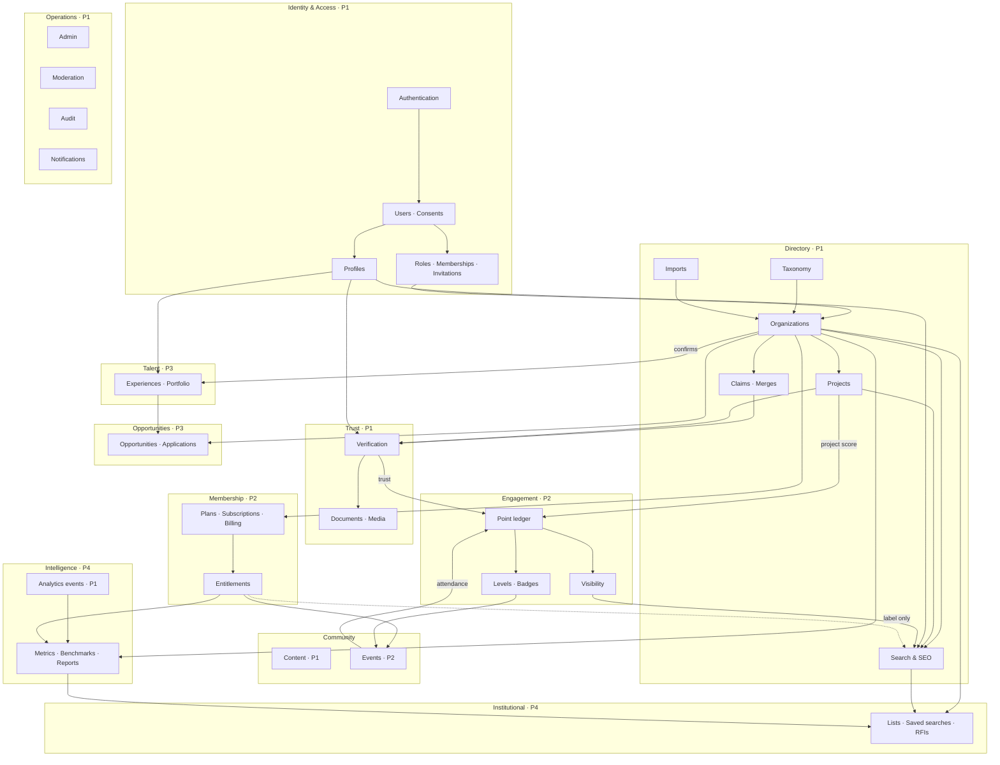

# Domain Map & Domain Relationship Map

> Part 1 (domains) and Part 5 (business relationships), built from the PRD.
> Each candidate domain from the architecture brief was **checked against the PRD**. The result of that check is in §1.
> **Mandatory business rules (2026-09-17)** in `business-rules.md` take precedence; §4 below shows the required domain separation.

---

## 1. Candidate domains, checked against the PRD

| Candidate domain | In PRD? | Evidence | Phase | Backend module |
|---|---|---|---|---|
| Authentication & Identity | ✅ | AUTH-01..06, §19.1 Identity | 1 | `identity` (+ Supabase Auth) |
| Users | ✅ | §14 `users` | 1 | `identity` |
| Profiles | ✅ | §5.1, §14 `profiles` | 1 (basic) / 3 (professional) | `profiles`, `talent` |
| Companies | ✅ | §7.2 ORG-01..10, §14 `organizations` | 1 | `organizations` |
| Company Memberships | ✅ | §3, §4, AUTH-05, §14 `organization_members` | 1 | `access` |
| Roles & Permissions | ✅ | §4 matrix, §3 staff roles | 1 | `access` |
| Verification | ✅ | §5, §19.1, §14 `verifications` | 1 | `verification` |
| Directory | ✅ | §7.2–7.4, §19.1 Directory | 1 | `organizations`, `taxonomy`, `search` |
| Professionals | ✅ | §10.1, §19.1 Talent | 3 | `talent`, `search` |
| Company projects / portfolio | ✅ | §7.3, §14 `projects` → `company_projects`, rules §4 | 1 | `projects` |
| Services | ✅ | ORG-03, §14 `categories / services` | 1 | `taxonomy` |
| Community / Content | ✅ (content: pages, news) · ⚠️ user-generated community content **not specified** | §13 content; §8.2 "accepted content", "helpful answer" (BQ-34) | 1 | `content` |
| Comments / Interactions | ❌ **Not specified** | Only implied (§3 "interaction", §8.6 "mutual recommendations") | — | **Not modelled** (BQ-34, RG-06) |
| Events | ✅ | §9.2, §14 `events` | 2 | `events` |
| Event Registration | ✅ | §9.2, §14 `event_registrations` | 2 | `events` |
| Attendance | ✅ | §9.2 (entry code, manual check-in, points after attendance) | 2 | `events` |
| Opportunities (unified: JOB, CO_OP, VOLUNTEERING, SUPPLIER_REQUEST) | ✅ | §10.2, §10.3, §14 `opportunities`, rules §5 | 3 | `opportunities` |
| Applications (individuals only) | ✅ | §14 `applications`, rules §8 | 3 | `opportunities` |
| Supplier responses (B2B) | ✅ rules §7 | rules §7 | 3 | `opportunities` |
| Membership (subscriptions) | ⏸ deferred (rules §11) | §7.5, §14 `membership_plans`, `subscriptions`, `entitlements` | future | `billing`, `entitlements` |
| Points | ✅ | §8.1–8.3 | 2 | `engagement` |
| Point Ledger | ✅ | §8.1, §14 `point_ledger` | 2 | `engagement` |
| Levels | ✅ | §9.1 | 2 | `engagement` |
| Badges | ✅ | §6 Phase 2, §14 `badges`, `badge_awards` | 2 | `engagement` |
| Rewards / Benefits | Level *benefits* only (§9.1). Points are **not** a redemption currency (decision BQ-08) | §9.1 | 2 | Benefits as eligibility checks; **no rewards tables** |
| Coupons / Redemptions | ⚠️ Coupons for **billing** only (§7.5); "coupons & perks" (§6 Phase 2) undefined; **no points redemption** | §7.5, §6 | 2 | `billing` (`coupons`, `coupon_redemptions`); perks BQ-08 |
| Visibility Score | ✅ | §8.4, §8.5, §14 `visibility_snapshots` | 2 | `engagement` → `search` |
| Notifications | ✅ | §13, §14 `notifications`, §15.2 | 1 | `notifications` |
| Saved Items | ⚠️ Institution supplier lists and saved searches only (§12.1); user bookmarks unclear (BQ-35) | §12.1, §14 `saved_lists` | 4 | `institutional` |
| Reports / Intelligence | ✅ | §11, §19.1 Intelligence, §14 `metric_*`, `reports` | 4 | `intelligence`, `analytics` (raw data from P1) |
| Institutional / Buyer | ⚠️ In PRD, but **on hold**: every organization is a company (BQ-06) | §5.4, §12, §19.1 Institutional | 4 · BQ-51 | `institutional` (placeholder) |
| Admin | ✅ | §13 | 1 | `admin` + admin controllers per module |
| Audit Logs | ✅ | §14 `audit_logs`, §18 | 1 | `audit` |
| **Additional domains found in the PRD** | | | | |
| Consents & privacy | ✅ | §5.1, §14 `consents`, §18 | 1 | `identity` |
| Taxonomy (categories, services, locations, skills) | ✅ | §14, §26 P0 | 1 | `taxonomy` |
| Ownership claims | ✅ | §5.2, glossary | 1 | `organizations` |
| Duplicates & merges | ✅ | ORG-09 | 1 | `organizations` |
| Documents & media | ✅ | §14 `documents`, `company_project_media` (PRD `project_media`), §18 | 1 | `media` |
| Search & SEO | ✅ | §7.4, §17 | 1 | `search` |
| Moderation (abuse reports, appeals) | ✅ | §13, §8.6, §23 | 1 | `moderation` |
| Product analytics | ✅ | §16, §15.2 | 1 | `analytics` |
| Data import | ✅ | §22, §22.1 | 1 | `imports` |
| Benchmarks & comparisons | ✅ | §11.1 | 4 | `intelligence` |
| RFIs | ✅ | §5.4, §12.1, §14 `rfis` | 4 | `institutional` |
| Observatory & partner API | ✅ (not specified) | §6 Phase 5 | 5 | future |

---

## 2. Domain map

```text
BACK OF HOUSE BACKEND
│
├── 1. IDENTITY & ACCESS ........................................ Phase 1
│   ├── Authentication (Supabase Auth)
│   ├── Users · Consents
│   ├── Profiles (basic)
│   └── Access: staff roles · organization memberships · invitations · permissions
│
├── 2. DIRECTORY ................................................ Phase 1
│   ├── Taxonomy: categories · services · regions & cities · skills
│   ├── Organizations: companies only (BQ-06) · exactly one owner each (BQ-04)
│   │   ├── contacts · services · coverage · credentials · media
│   │   ├── admin approval of new companies (BQ-05)
│   │   ├── ownership claims
│   │   └── duplicates & merges · correction suggestions
│   ├── Projects & case studies
│   ├── Search & SEO (public projection)
│   └── Imports
│
├── 3. TRUST ..................................................... Phase 1
│   ├── Verification cases · evidence · decisions · expiry (human decisions, BQ-48)
│   ├── Company verification signals: registration · domain · credential · contact (BQ-47)
│   └── Documents (private) & media (public)
│
├── 4. COMMUNITY ................................................ Phase 1 / 2
│   ├── Content: pages · news (P1)
│   └── Events: tickets · registration · waitlist · attendance · feedback (P2)
│
├── 5. MEMBERSHIP ............................................... Phase 2
│   ├── Plans & features
│   ├── Subscriptions · invoices · payments · coupons
│   └── Entitlements
│
├── 6. ENGAGEMENT ............................................... Phase 2
│   ├── Point rules & versions
│   ├── Point ledger & balances
│   ├── Levels · badges
│   └── Visibility score
│
├── 7. TALENT ................................................... Phase 3
│   └── Experiences (confirmed employment) · education · certifications · portfolio
│
├── 8. OPPORTUNITIES ............................................ Phase 3
│   └── Opportunities · applications · controlled messaging · matching · outcomes
│
├── 9. INTELLIGENCE ............................................. Phase 1 (raw) / 4
│   ├── Analytics events (P1)
│   └── Metrics · benchmarks · comparisons · reports · exports (P4)
│
├── 10. INSTITUTIONAL ........................................... Phase 4 · on hold (BQ-51)
│   └── Workspaces · supplier lists · saved searches · RFIs · access log
│
├── 11. OPERATIONS & GOVERNANCE ................................. Phase 1
│   ├── Admin back office
│   ├── Moderation: abuse reports · appeals
│   ├── Audit logs · export logs
│   └── Notifications (email · SMS · in-app)
│
└── 12. OBSERVATORY & PARTNERS .................................. Phase 5 (not designed)
```



---

## 3. Domain relationship map

```text
USER ───────────────────────────────────────────────────────────── (identity)
 │
 ├── PROFILE (1:1) ─────────────── skills · cities · languages · privacy
 │        └── (P3) EXPERIENCES ──── confirmed by ──► ORGANIZATION   (grants no permissions)
 │                 EDUCATION · CERTIFICATIONS · PROFILE PROJECTS ──► PROJECT
 │
 ├── CONSENTS (append-only)
 │
 ├── STAFF ROLES ───────────────── reviewer · moderator · admin · auditor   (platform scope, MFA)
 │
 ├── VERIFICATIONS (as applicant / as subject) ──► DOCUMENTS
 │
 ├── ORGANIZATION MEMBERSHIPS (role, status, expiry) ──── delegated PERMISSION GRANTS
 │        │
 │        └── ORGANIZATION ─────────────────────────────── always a company (BQ-06) · one OWNER (BQ-04)
 │              ├── CONTACTS · SERVICES ──► TAXONOMY · COVERAGE ──► LOCATIONS · CREDENTIALS · MEDIA
 │              ├── APPROVAL REQUESTS (admin, BQ-05) — not verification (BQ-46)
│              ├── CLAIMS ──► VERIFICATION (1:1) — grants ownership only
 │              ├── VERIFICATION SIGNALS (registration, domain, credential, contact — independent, BQ-47)
 │              ├── MERGES (source/target) · CORRECTION SUGGESTIONS
 │              ├── INVITATIONS ──► MEMBERSHIPS
 │              ├── PROJECTS ──── services · media · client disclosure ──► VERIFICATIONS
 │              ├── SEARCH DOCUMENT (public projection, 0..1)
 │              ├── (P2) SUBSCRIPTION ──► PLAN · INVOICES ──► PAYMENTS · COUPON REDEMPTIONS
 │              │         └── ENTITLEMENTS (effective features)
 │              ├── (P2) POINT LEDGER ──► POINT BALANCES · BADGES · VISIBILITY SNAPSHOTS
 │              ├── (P2) EVENTS hosted / sponsored (BQ-17)
 │              ├── (P3) OPPORTUNITIES ──► APPLICATIONS ──► MESSAGES · FEEDBACK
 │              ├── (P4) BENCHMARK SET ──► 3 COMPETITOR ORGANIZATIONS
 │              ├── (P4) METRIC FACTS · REPORTS ──► DATA EXPORTS
 │              └── (P4, buyer features, BQ-51) SAVED LISTS ──► COMPANY ORGANIZATIONS (+ internal notes)
 │                                     SAVED SEARCHES
 │                                     RFIs ──► RECIPIENT COMPANIES ──► RESPONSES
 │
 ├── (P2) EVENT REGISTRATIONS ──► EVENT ──► TICKET TYPES · SPEAKERS · SPONSORS
 │         └── ATTENDANCE (attended_at) ──► point ledger (via event) ──► FEEDBACK · CERTIFICATE
 │
 ├── (P2) POINT LEDGER ──► BALANCES ──► LEVEL ASSIGNMENTS · BADGE AWARDS · VISIBILITY SNAPSHOTS
 │
 ├── (P3) APPLICATIONS ──► OPPORTUNITY
 │
 ├── ABUSE REPORTS (reporter) · APPEALS (submitter)
 │
 ├── NOTIFICATIONS ──► DELIVERIES · PREFERENCES
 │
 └── AUDIT LOGS (as actor) · ANALYTICS EVENTS (after consent)
```

### 3.1 Relationships that must never be confused

| Looks similar | Actually different | Why it matters |
|---|---|---|
| `organization_members` vs `experiences` | Access rights vs employment history | An ex-employee keeps their confirmed experience but loses all access |
| `verifications` vs `point_ledger (TRUST)` | Evidence checked vs engagement value derived from it | Expiring a verification reverses trust points; points never create verification |
| `subscriptions/entitlements` vs `badges` | Paid features vs earned recognition | The paid partner label is an entitlement, never a badge and never trust |
| `visibility_snapshots` vs search rank | Score vs final position | A score is one signal; relevance still decides (§8.4) |
| `saved_lists` (institution) vs a company's own data | The buyer's private notes | Notes are never visible to the listed company |
| `reports` (analytics) vs `abuse_reports` (بلاغات) | Generated intelligence vs moderation cases | The Arabic PRD uses different words; the schema keeps them separate |
| `organizations.status` vs `verifications.status` | Profile lifecycle vs one evidence case | A company may be VERIFIED while one credential case is REJECTED |
| `organization_approvals` vs `verifications` | Listing approved by an admin vs evidence checked (BQ-46) | An approved company can have zero verified signals |
| Verified professional vs member level | Verification facts vs points (BQ-07) | A member with 1,200 points may be unverified, and a verified professional may have 0 points |

### 3.2 Cardinality summary

| Relationship | Type |
|---|---|
| User — Profile | ONE-TO-ONE |
| User ⟷ Organization (membership) | MANY-TO-MANY (`organization_members`) |
| User ⟷ Organization (employment, P3) | MANY-TO-MANY (`experiences`) |
| Organization — Claim — Verification | ONE-TO-MANY · ONE-TO-ONE |
| Organization — Projects | ONE-TO-MANY |
| Organization ⟷ Service / Location | MANY-TO-MANY |
| Verification ⟷ Document | MANY-TO-MANY |
| Organization/User — Point ledger | ONE-TO-MANY (exactly one subject per entry) |
| Plan — Subscription — Invoice — Payment | ONE-TO-MANY chain |
| User ⟷ Event (registration) | MANY-TO-MANY (`event_registrations`) |
| Opportunity — Applications — Messages | ONE-TO-MANY chain |
| Organization — Benchmark set | ONE-TO-ONE (optional); set ⟷ competitors MANY-TO-MANY (max 3 active) |
| Buyer company ⟷ Company (lists, RFIs; on hold, BQ-51) | MANY-TO-MANY |

---

## 4. Required domain separation (business rules §15)

```text
Account ─────────────── users + Supabase Auth · INDIVIDUAL and COMPANY = separate security contexts (BQ-60)
  ├── Individual ───── profiles · applications · points · rewards · company memberships (no permissions)
  └── Company account ─ exactly one per company (organizations.account_user_id) — the only company user
Company ─────────────── organizations
  ├── CompanyType ───── organization_company_types (one or more; classification ≠ verification ≠ permission)
  ├── Industry ──────── organization_industries (one or more; independent of company type; no permissions)
  ├── Members ───────── organization_members: Individual accounts, show_on_company_profile (public display only)
  └── CompanyProject ── company_projects (portfolio — NOT an opportunity, no applications)
Opportunity ─────────── opportunities (JOB · CO_OP · VOLUNTEERING · SUPPLIER_REQUEST)
  ├── Application ───── applications (individuals only, INDIVIDUAL audience)
  └── SupplierResponse  supplier_responses (any company, SUPPLIER_REQUEST; Company Accounts only)
Verification ────────── verifications + verified_at facts
Points ──────────────── point_ledger · point_balances
Reward ──────────────── rewards catalog: unlocked by points / levels, never spent (BQ-59) · e.g. Profile Highlight
Discovery ───────────── Companies to Watch: admin picks + activity + verification/completeness (not paid, not verification · BQ-70)

Future monetization (not implemented, must stay possible):
Subscription · Payment ─── deferred billing design
Promotion · FeaturedListing · SponsoredContent ─── future promotions module (no tables) · the words Featured / Promoted are reserved for it
```

Classify every new feature with the 11 questions in `business-rules.md` §16 before building it.
