# Enums & Status Map

> Every enum is tagged by how much the PRD supports it:
>
> | Tag | Meaning |
> |---|---|
> | 🟢 **PRD-DEFINED** | The value list appears verbatim in the PRD (section cited). |
> | 🟡 **PRD-DERIVED** | Values follow directly from a PRD workflow, but the PRD gives no explicit list. |
> | 🔴 **PROPOSED** | Technical proposal needed to build. **Not in the PRD. NEEDS BUSINESS DECISION before it is final.** |
>
> 🔵 **RULE-DEFINED** = the value list comes from the mandatory `business-rules.md` (2026-09-17), which overrides PRD lists.
>
> PostgreSQL enums are named in `PascalCase` in Prisma and `snake_case` in SQL (see `database-design-rules.md`).
> Transitions marked *(PRD)* are traceable to the PRD; transitions marked *(proposed)* are engineering proposals.

---

## Contents

1. [Identity & access](#1-identity--access)
2. [Organizations & directory](#2-organizations--directory)
3. [Verification](#3-verification)
4. [Media & documents](#4-media--documents)
5. [Membership & billing](#5-membership--billing-phase-2)
6. [Points, levels, visibility](#6-points-levels-visibility-phase-2)
7. [Events](#7-events-phase-2)
8. [Talent & opportunities](#8-talent--opportunities-phase-3)
9. [Intelligence & institutional](#9-intelligence--institutional-phase-4)
10. [Content, moderation, notifications, platform](#10-content-moderation-notifications-platform)
11. [Supporting enums](#11-supporting-enums-introduced-by-the-entity-catalog)
12. [Enum index](#12-enum-index)

---

## 1. Identity & access

### AccountType — 🔵 RULE-DEFINED (business rules §1) · Phase 1

```text
AccountType
├── INDIVIDUAL
└── COMPANY
```

- **Exactly two** account types. Supplier, organizer, agency, venue and service-provider are **company types** (`CompanyType`), never account types.
- **Set by:** the user **at registration** (BQ-60). Each type has its own registration flow and data.
- **Meaning:** the account's **security context**. INDIVIDUAL and COMPANY accounts are separate contexts: company routes require a COMPANY account; individual routes require an INDIVIDUAL account. The type alone grants no permission; company permissions belong to the company's single Company Account (`organizations.account_user_id`, BQ-68), staff permissions from `user_platform_roles`.
- The student concept was **removed** (BQ-72). **CO_OP** is an opportunity type.
- A company has exactly **one** COMPANY account (`organizations.account_user_id`, BQ-68). People who work for a company use INDIVIDUAL accounts and are **members** (no permissions).
- Replaces the PRD §5.1 list (interested, student, professional, company representative, entity representative) and the frontend's `professional | company | student | other` (BQ-29 resolved).
- ✅ BQ-60 / BQ-68 resolved. Remaining details (type change, same identifier for both types, staff account type) → **BQ-68**.

### UserStatus — 🔴 PROPOSED · Phase 1

```text
UserStatus
├── ACTIVE        verified identifier + may use the platform
├── SUSPENDED     blocked by admin (§13 "تعليق")
└── DEACTIVATED   deleted / anonymised (AUTH-06, later)
```

No `PENDING` value: a `users` row is created only **after** the OTP is verified. AUTH-01 says no activated account exists without verification. The unverified state lives in Supabase Auth, not here.

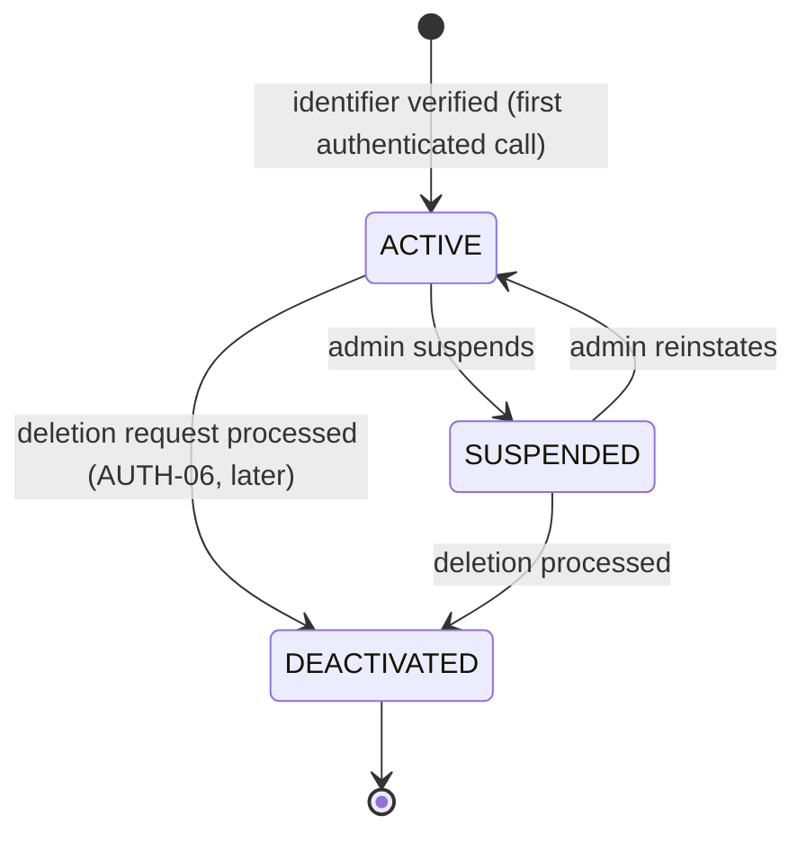

| Transition | Who | Effects |
|---|---|---|
| → SUSPENDED | `SYSTEM_ADMIN` | Revoke all sessions; hide the profile from search; audit log; `user.suspended` |
| → ACTIVE | `SYSTEM_ADMIN` | Audit log; reindex the profile |
| → DEACTIVATED | System (user request) | Anonymise personal data; end memberships; keep ledger and audit rows with a pseudonymous id |

### PlatformRole — 🟢 PRD-DEFINED (§3 staff roles) · Phase 1

```text
PlatformRole                (Back Of House staff, table user_platform_roles)
├── VERIFICATION_REVIEWER   مراجع تحقق
├── CONTENT_MODERATOR       مشرف محتوى
├── SYSTEM_ADMIN            مدير نظام
└── AUDITOR                 مدقق   (read sensitive logs only)
```

- **Granted or revoked by:** `SYSTEM_ADMIN` only. Always audited. MFA is required to use any of these roles (AUTH-03).
- Event check-in staff is not a defined role → **BQ-17**.
- **Verification decisions** are made only by `VERIFICATION_REVIEWER` or `SYSTEM_ADMIN`, always by a person in Phase 1 (BQ-48).
- **Company approval** is decided by `SYSTEM_ADMIN` (BQ-05).

### ~~OrganizationRole~~ — removed (BQ-68)

A company has a **single user — its Company Account** — which holds all company permissions for its own company. There are no OWNER / EDITOR / ANALYST roles and no delegation. Ownership is `organizations.account_user_id`, set only by company creation (T-02), an approved claim (T-01) or the admin ownership flow (T-30).

### MembershipStatus — 🔴 PROPOSED · Phase 1

Membership = an **Individual account's affiliation** with a company (BQ-68). It grants **no** permissions.

```text
MembershipStatus
├── ACTIVE
└── REMOVED     removed by the Company Account, or the member left
```

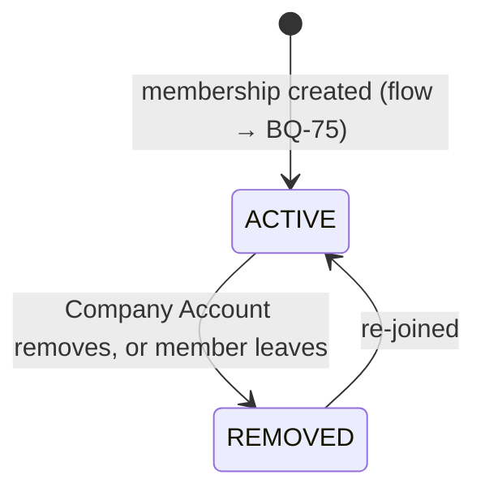

- Public visibility is a separate flag (`show_on_company_profile`, BQ-64), not a status.

### InvitationStatus — 🔴 PROPOSED · Phase 1 (AUTH-05)

```text
InvitationStatus
├── PENDING
├── ACCEPTED
├── REVOKED
└── EXPIRED
```

Candidate flow for adding **Individual** members (BQ-75): the Company Account invites; an INDIVIDUAL account accepts. PENDING → ACCEPTED (individual), PENDING → REVOKED (Company Account), PENDING → EXPIRED. PRD AUTH-05 roles no longer apply (BQ-68).

### ConsentPurpose — 🔴 PROPOSED values, 🟢 concept PRD-DEFINED (§5.1, §14 `consents`, §18) · Phase 1

```text
ConsentPurpose              (list incomplete → RG-25)
├── TERMS_OF_SERVICE
├── PRIVACY_POLICY
├── MARKETING_COMMUNICATIONS
└── ANALYTICS_LINKING       link events to account after consent (§16.1)
```

---

## 2. Organizations & directory

### CompanyType — 🔵 RULE-DEFINED (business rules §2) · Phase 1

```text
CompanyType
├── EVENT_ORGANIZER
├── SUPPLIER
├── VENUE
├── PRODUCTION
├── AGENCY
├── SERVICE_PROVIDER
└── OTHER
```

- A company can have **several** types (BQ-61), stored in `organization_company_types`. Used for **classification, discovery, filtering, profile presentation and business-specific UX**.
- **Never** the source of a permission by itself (rules §2). For example, responding to supplier requests is not limited to `SUPPLIER` unless BQ-66 decides so.
- Compatible with BQ-06: all organizations are companies; this classifies them.
- ✅ BQ-61 resolved: multiple types; classification never grants permissions.
- Classification is **separate from verification**: choosing a type verifies nothing (decision 2026-09-17).

### ~~OrganizationType~~ — removed (BQ-06)

Every organization is a company, so there is no type column or enum. The PRD's government, contracting and research entities (§3, §12) are on hold → **BQ-51**.

### OrganizationApprovalStatus — 🟡 DERIVED from decisions BQ-05, BQ-46 · Phase 1

```text
OrganizationApprovalStatus        (table organization_approvals)
├── PENDING          submitted by the owner, waiting for an admin
├── NEEDS_CHANGES    admin asked for changes (reason required)
├── APPROVED         listing may be published
└── REJECTED         final for this request (resubmission → BQ-57)
```

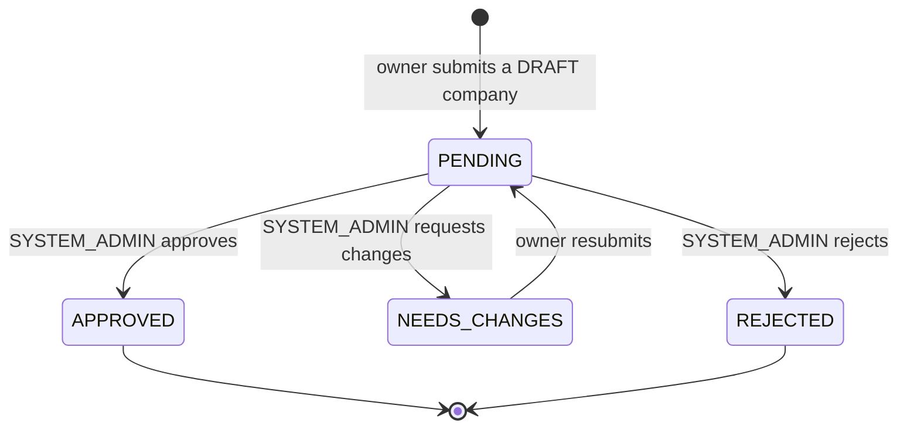

| Transition | Who | What happens |
|---|---|---|
| → PENDING | Company Account | Mandatory fields validated; duplicate check re-run; queued for admins |
| → APPROVED | `SYSTEM_ADMIN` | `organizations.approved_at` set; company becomes CLAIMED and public; **no verification signal is set** (BQ-46); audit; `organization.approved` |
| → NEEDS_CHANGES / REJECTED | `SYSTEM_ADMIN` | Reason required; owner notified |

Approval is **not** a verification case: it lives in `organization_approvals`, not `verifications`.

### OrganizationStatus — 🟢 PRD-DEFINED (§29.1; ORG-07 is a subset) · Phase 1

```text
OrganizationStatus
├── DRAFT                مسودة
├── UNCLAIMED            غير مطالب بها
├── CLAIMED              مطالَب بها
├── UNDER_VERIFICATION   قيد التحقق
├── VERIFIED             موثقة
├── NEEDS_UPDATE         تحتاج تحديثًا
├── SUSPENDED            موقوفة
└── ARCHIVED             مؤرشفة
```

**Storage rule (ADR-018):** `status` is stored, but the system **recalculates it from facts** instead of setting it freely. The facts are: `approved_at`, `claimed_at` and the owner membership, the approved **verification signals** (BQ-47), staleness (`last_confirmed_at`), `suspended_at` and `archived_at`. So when a suspension is lifted, the correct prior state comes back without keeping a separate history.

| Status | Derived when | Source |
|---|---|---|
| `DRAFT` | Created by an owner, not yet approved | BQ-05 |
| `UNCLAIMED` | Imported, no owner | §22 |
| `CLAIMED` | Has an owner **and** is published (claim approved, or new company approved) | §5.2, BQ-46 |
| `UNDER_VERIFICATION` | ⚠️ Rule pending **BQ-53**. **ASSUMPTION:** a CLAIMED company with at least one signal case IN_REVIEW and no VERIFIED status yet | BQ-47 |
| `VERIFIED` | ⚠️ Rule pending **BQ-53**. **ASSUMPTION** (configurable policy): the `ORGANIZATION_REGISTRATION` signal is approved and not expired | BQ-47 |
| `NEEDS_UPDATE` | VERIFIED but stale, or a required signal expired | ORG-08 |
| `SUSPENDED` / `ARCHIVED` | Admin action / merge | §13, ORG-09 |

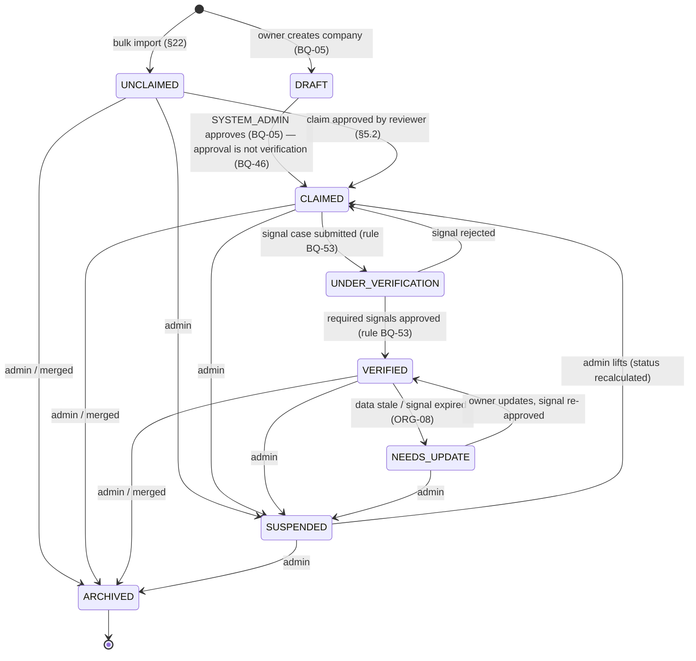

| Transition | Who | Source | What happens |
|---|---|---|---|
| (new) → UNCLAIMED | System (import) | §22 | Public fields indexed; unconfirmed contact data **not published** (§22.1). Whether imports need approval → BQ-57 |
| (new) → DRAFT | Authenticated user | BQ-05 | Duplicate check first (ORG-09); `account_user_id` = the registering Company Account (BQ-68) |
| DRAFT → CLAIMED | `SYSTEM_ADMIN` approves (T-29) | BQ-05, BQ-46 | Listing published and indexed; `organization.approved`; **no** verification signal set |
| UNCLAIMED → CLAIMED | `VERIFICATION_REVIEWER` / `SYSTEM_ADMIN` approves a claim (T-01) | §5.2, BQ-48 | Company linked to the claimant's Company Account; audit |
| → UNDER_VERIFICATION / VERIFIED | Derived from reviewer decisions on signal cases | BQ-47, BQ-53 | Trust points per signal (Phase 2); `organization.verified` when VERIFIED is reached |
| VERIFIED → NEEDS_UPDATE | Scheduler | ORG-08 | Owner notified; staleness threshold **BQ-20** |
| → SUSPENDED | `SYSTEM_ADMIN` | §13 | Removed from search; memberships unaffected; audit |
| → ARCHIVED | `SYSTEM_ADMIN` | §13 | Removed from search; merge record if merged (ORG-09) |

### ClientDisclosureStatus — 🟢 PRD-DEFINED (§7.3) · Phase 1

```text
ClientDisclosureStatus
├── NOT_DISCLOSED   غير معلن   client name never exposed
├── DISCLOSED       معلن       company states it has permission
└── CONFIRMED       تم تأكيده  client confirmed (process → BQ-22)
```

**Rule (PRD §7.3, §27):** the client name is **never** returned by any public API or written to the search projection unless the status is `DISCLOSED` or `CONFIRMED`.

### ProjectStatus — 🟢 PRD-DEFINED (§29.1; §7.3 subset) · Phase 1 · table `company_projects`

```text
ProjectStatus
├── DRAFT           مسودة
├── IN_REVIEW       قيد المراجعة
├── PUBLISHED       منشور
├── NEEDS_CHANGES   يحتاج تعديلًا
├── REJECTED        مرفوض
└── ARCHIVED        مؤرشف
```

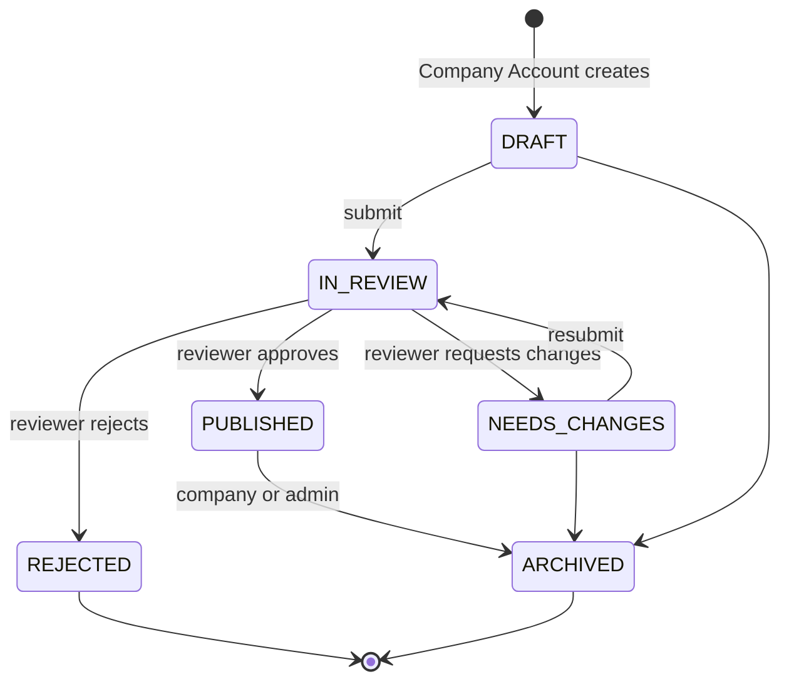

| Transition | Who | What happens |
|---|---|---|
| → IN_REVIEW | Company Account | Completeness computed; queued (target 3 business days, §23) |
| → PUBLISHED | Reviewer (**BQ-39**: reviewer or moderator?) | Indexed; `project.published` → project points recalculated (≤ 50, §7.3) |
| → NEEDS_CHANGES / REJECTED | Reviewer | Company notified with the reason |
| → ARCHIVED | Company or admin | Removed from search; points recalculated (the change is written to the ledger) |

⚠️ **BQ-54:** does editing a PUBLISHED project send it back to review? Can a REJECTED project be resubmitted?

### CredentialType — 🟢 PRD-DEFINED (ORG-05) · Phase 1

```text
CredentialType
├── LICENSE         ترخيص
└── CERTIFICATION   شهادة
```

### MediaType — 🟢 PRD-DEFINED (§14 `project_media` → `company_project_media`: images, video, links) · Phase 1

```text
MediaType
├── IMAGE
├── VIDEO
└── LINK
```

### CorrectionSuggestionStatus — 🔴 PROPOSED · Phase 1 (§4 reviewer "suggest correction", RG-21)

```text
CorrectionSuggestionStatus
├── OPEN
├── ACCEPTED    owner applied it
├── DISMISSED   owner declined
└── WITHDRAWN   reviewer withdrew
```

### MergeStatus — 🔴 PROPOSED · Phase 1 (ORG-09 "suggest a merge, with a decision record")

```text
MergeStatus
├── PROPOSED
├── APPROVED    executed; source organization archived
└── REJECTED    not duplicates
```

### ImportBatchStatus — 🟡 PRD-DERIVED (§22.1 preview, write, rollback) · Phase 1

```text
ImportBatchStatus
├── UPLOADED
├── PREVIEWED     validation + duplicate report, nothing written
├── COMMITTING
├── COMMITTED
├── FAILED
└── ROLLED_BACK   §22.1 "undo an import batch"
```

---

## 3. Verification

### VerificationStatus — 🟢 PRD-DEFINED (§29.1) · Phase 1

```text
VerificationStatus
├── NOT_STARTED   لم يبدأ      (§5.1 "مسودة" maps here)
├── IN_REVIEW     قيد المراجعة
├── NEEDS_INFO    يحتاج معلومات
├── APPROVED      مقبول
├── REJECTED      مرفوض
└── EXPIRED       منتهي
```

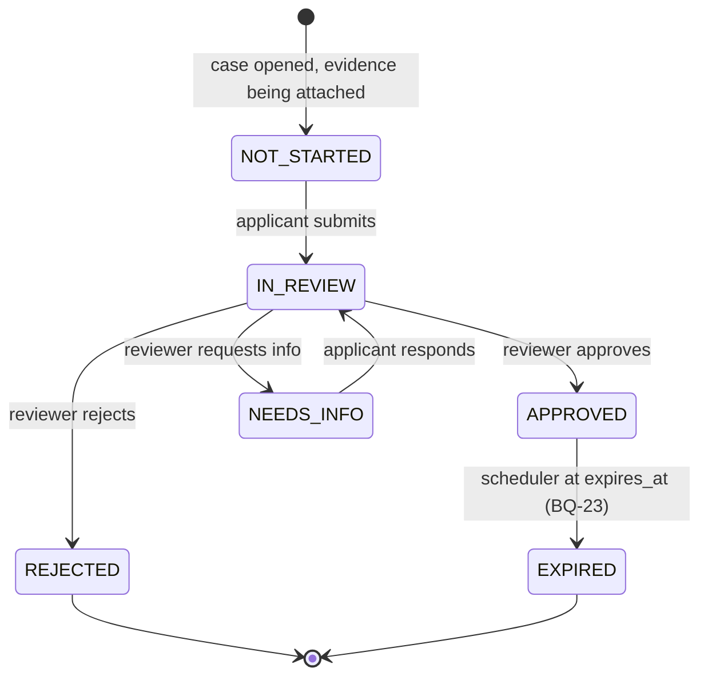

| Transition | Who | What happens |
|---|---|---|
| → IN_REVIEW | Applicant (Individual account, or the Company Account) | Documents locked; queue SLA starts (claims: 2 business days, §23) |
| → APPROVED | `VERIFICATION_REVIEWER`, `SYSTEM_ADMIN` | **The subject handler runs in the same transaction** (e.g. claim → company linked to the Company Account); decision row; audit; `verification.approved` → trust points (Phase 2) |
| → REJECTED | Reviewer | Reason required; applicant notified; may open a **new** case |
| → NEEDS_INFO | Reviewer | Reason required; applicant notified |
| → EXPIRED | Scheduler | Subject recalculated (e.g. VERIFIED company → NEEDS_UPDATE); trust points reversed per rule |

A reviewer can **never** decide a case they submitted, or a case about an organization they are a member of (conflict-of-interest guard).

**Phase 1 rule (BQ-48):** every decision is made by a person holding `VERIFICATION_REVIEWER` or `SYSTEM_ADMIN`. Automated checks (registration, name, domain matching) are shown to the reviewer as hints and never change a case status.

### VerificationType — 🟡 PRD-DERIVED · Phase 1 unless noted

```text
VerificationType
├── USER_IDENTITY              §5.1 identity
├── USER_EXPERIENCE            §5.1 experience (evidence reviewed by staff)
│
│   Company verification signals — independent of each other (BQ-47)
├── ORGANIZATION_REGISTRATION  commercial registration (السجل)         §8.3
├── ORGANIZATION_DOMAIN        official website domain (النطاق)          §8.3
├── ORGANIZATION_CREDENTIAL    one license / certification (التراخيص)   ORG-05, §8.3
├── ORGANIZATION_CONTACT       one contact channel (تأكيد التواصل)      §8.3
│
├── ORGANIZATION_CLAIM         §5.2 ownership claim — grants ownership, verifies NO signal (BQ-46)
├── PROJECT                    §13 project review
└── PROJECT_CLIENT             §7.3 client confirmation (process → BQ-22)
```

- Each signal has its own case, evidence, decision, expiry and trust-point rule. Approving one signal never approves another.
- Company **approval** (BQ-05) is **not** a verification type: see `OrganizationApprovalStatus`.
- "Verified professional" (§3) = approved `USER_IDENTITY` **and** at least one approved `USER_EXPERIENCE`. It is independent of points and levels (BQ-07).
- `ENTITY_REPRESENTATIVE` (§5.4) was removed with BQ-06 → **BQ-51**.
- Company confirmation of an employment relationship (§10.1) is **not** a staff verification. It is `EmploymentConfirmationStatus` (§8 below).

## 4. Media & documents

### FileStatus — 🔴 PROPOSED · Phase 1 (§18 malware scan, type/size limits)

```text
FileStatus
├── PENDING_UPLOAD   signed upload URL issued
├── SCANNING         in quarantine
├── READY            clean, moved to target bucket
├── REJECTED         malware / invalid type / too large
└── DELETED
```

### DataClassification — 🟢 PRD-DEFINED (§18.1)

```text
DataClassification
├── PUBLIC         عام          indexable
├── INTERNAL       داخلي        authorised staff (e.g. detailed points, ops notes)
├── CONFIDENTIAL   سري          encrypted + restricted (CR, authorization letters, invoices)
├── PERSONAL       شخصي         purpose + consent + data-subject rights
└── AGGREGATED     تحليلي مجمع  minimum sample size, no re-identification
```

Used as a **documentation and code-level label** on tables, columns and `documents.classification`. It is not a runtime permission.

---

## 5. Membership & billing — ⏸ DEFERRED future monetization (business rules §11)

### SubscriptionStatus — 🟢 PRD-DEFINED (§29.1)

```text
SubscriptionStatus
├── TRIAL          تجريبي
├── ACTIVE         فعال
├── GRACE_PERIOD   فترة سماح
├── PAST_DUE       متأخر
├── CANCELLED      ملغى
└── EXPIRED        منتهي
```

Transitions are **proposed**. The PRD lists the states but not their order, and it gives no durations → **BQ-15**.

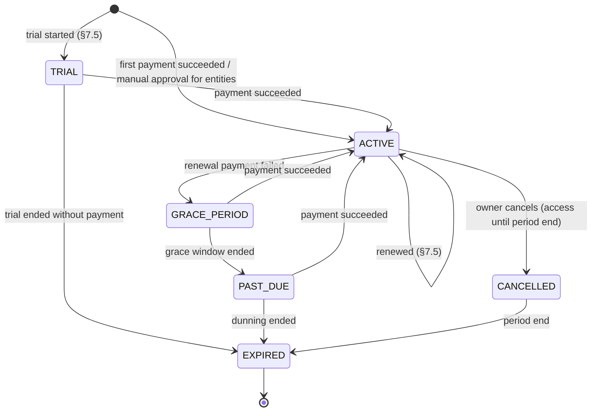

| Transition | Who | What happens |
|---|---|---|
| → ACTIVE | Payment webhook (system) / `SYSTEM_ADMIN` manual approval | Invoice issued; **entitlements recalculated in the same transaction**; `subscription.started` |
| → GRACE_PERIOD / PAST_DUE | System | Owner notified; entitlements kept during grace (**BQ-15**) |
| → CANCELLED | Company Account | Paid features keep working until `current_period_end` |
| → EXPIRED | System | Entitlements drop to the free plan; the paid partner badge is removed. **Trust and organic ranking are unaffected** (§7.5) |
| Plan change | Company Account | Upgrade immediate, downgrade at period end (§7.5) |

### SubscriberType — 🔴 PROPOSED · → **BQ-14**

```text
SubscriberType
├── ORGANIZATION
└── USER            only if individual paid membership is confirmed
```

### InvoiceStatus — 🔴 PROPOSED (§7.5 mentions tax invoices, no states)

```text
InvoiceStatus
├── DRAFT
├── ISSUED
├── PAID
├── VOID
└── REFUNDED
```

### PaymentStatus — 🔴 PROPOSED (§7.5 "حالة دفع", no values)

```text
PaymentStatus
├── PENDING
├── SUCCEEDED
├── FAILED
└── REFUNDED
```

### BillingInterval — 🔴 PROPOSED → **BQ-15**

```text
BillingInterval
├── MONTHLY
└── YEARLY
```

### CouponDiscountType — 🔴 PROPOSED → **RG-11**

```text
CouponDiscountType
├── PERCENTAGE
├── FIXED_AMOUNT
└── TRIAL_EXTENSION
```

### EntitlementSource — 🟡 PRD-DERIVED (§7.5 plans, exemptions, manual approval)

```text
EntitlementSource
├── PLAN            from active subscription
├── EXEMPTION       إعفاء — granted by admin
└── MANUAL_GRANT    manual approval (entities)
```

---

## 6. Points, levels, visibility (Phase 2)

### PointSubjectType — 🟢 PRD-DEFINED (§8.2 member points, §8.3 company points)

```text
PointSubjectType
├── USER
└── ORGANIZATION
```

### PointCategory — 🟢 PRD-DEFINED (§8.2, §8.3)

```text
PointCategory                applies to
├── PROFILE_COMPLETION       USER + ORGANIZATION   (org cap 100)
├── ACTIVITY                 USER                  (weekly cap)
├── RECENT_ACTIVITY          ORGANIZATION          (cap 100, time window)
├── TRUST                    USER + ORGANIZATION   (after verification; org cap 100)
├── EXPERIENCE               USER
├── PROJECTS                 ORGANIZATION          (cap 300; top 10 × ≤ 50)
├── CONTRIBUTION             USER + ORGANIZATION   (org cap 100)
└── PENALTY                  USER (+ ORGANIZATION?) deductions
```

"Paid visibility" (§8.3) is **not** a point category. It lives in billing entitlements and never enters the ledger.

### LedgerEntryType — 🟢 PRD-DEFINED (§8.1, §29.2 "additions and deductions … correction by reverse movement")

```text
LedgerEntryType
├── CREDIT      إضافة
├── DEBIT       خصم (penalty, or computed-score decrease)
└── REVERSAL    حركة عكسية — exact negation of one prior entry
```

Ledger rows are **immutable**, with no status column. There is nothing to transition.

### MemberLevel — 🟢 PRD-DEFINED (§9.1), adjusted by BQ-07 · stored as rows in `member_levels`

```text
MemberLevel            points      extra gate                    assigned by
├── NEW_MEMBER         0–99        —                             system
├── ACTIVE_MEMBER      100–249     —                             system
├── CONTRIBUTING       250–499     —                             system
├── LEVEL_500          500–799     — (no verification, BQ-07)    system   · name pending BQ-52
├── COMMUNITY_LEADER   800–1199    + review                      staff review
└── AMBASSADOR         1200+       + nomination, admin approval  SYSTEM_ADMIN only
```

- Levels depend **only on points** plus the review/nomination gates of §9.1. Verification never gates a level (BQ-07).
- Points are **not a currency**: they are never spent or redeemed; levels unlock benefits only (BQ-08).
- Which balance counts → **BQ-09**.

### LevelAssignmentStatus — 🔴 PROPOSED (§8.6 "human review for upper levels")

```text
LevelAssignmentStatus
├── PENDING_REVIEW
├── ACTIVE
├── REJECTED
└── REVOKED
```

### EngagementAlertStatus — 🔴 PROPOSED (§8.6 "alert on abnormal change")

```text
EngagementAlertStatus
├── OPEN
├── ACKNOWLEDGED
└── RESOLVED
```

---

## 7. Events (Phase 2)

### EventStatus — 🔴 PROPOSED → **BQ-18** (not in §29.1)

```text
EventStatus
├── DRAFT
├── PUBLISHED    registration may open
├── CANCELLED
├── COMPLETED    attendance finalised, surveys sent
└── ARCHIVED
```

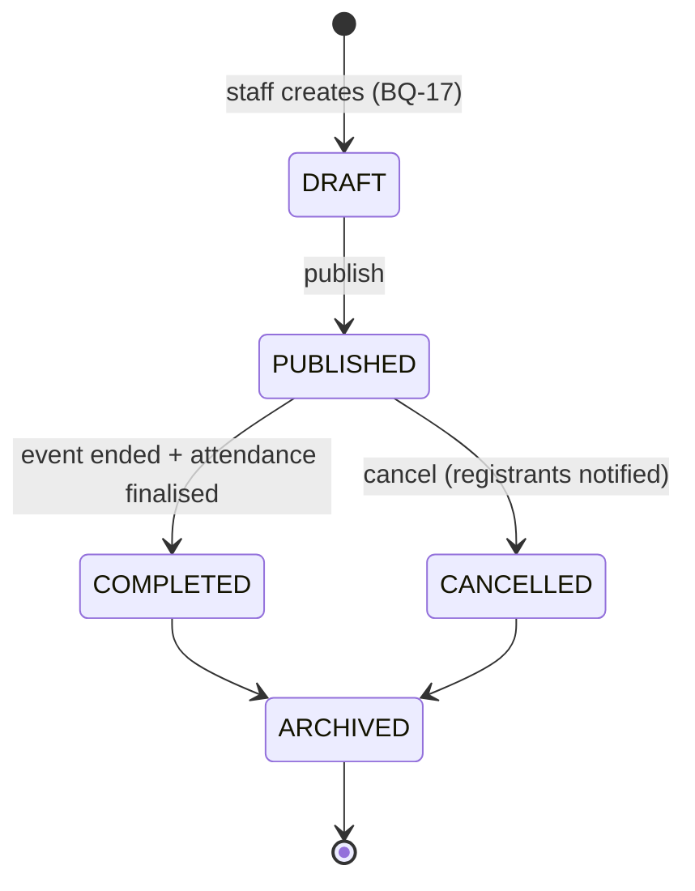

### RegistrationStatus — 🟡 PRD-DERIVED (§9.2 waitlist, cancellation, transfer) · attendance is stored separately

```text
RegistrationStatus
├── CONFIRMED     seat held, entry code issued
├── WAITLISTED    قائمة انتظار
├── CANCELLED     إلغاء
└── TRANSFERRED   استبدال — seat moved to another user (rules → RG-02)
```

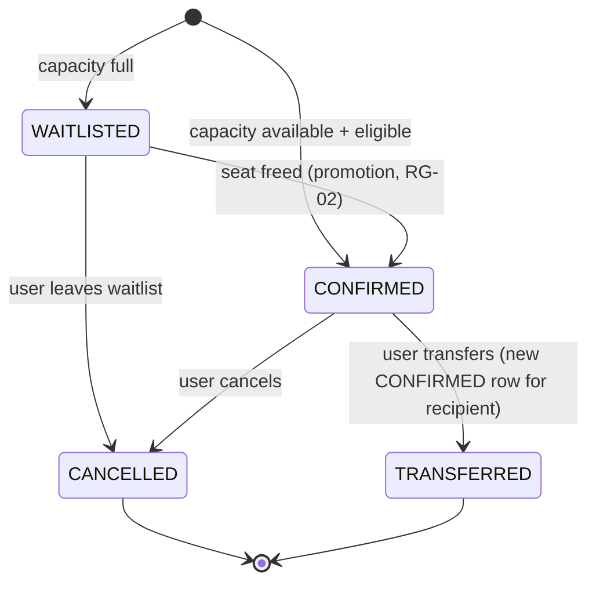

**Attendance** is recorded on the registration as `attended_at` + `attendance_method`, not as a status, because attendance is a *fact*. Points are awarded **only** when `attended_at` is set (§9.2, §20.2). Booking alone never earns points.

### AttendanceMethod — 🟢 PRD-DEFINED (§9.2 unique entry code + manual fallback)

```text
AttendanceMethod
├── ENTRY_CODE   رمز دخول فريد
└── MANUAL       تسجيل حضور يدوي احتياطي
```

---

## 8. Talent & opportunities (Phase 3)

### EmploymentConfirmationStatus — 🔴 PROPOSED (§10.1 "request from the individual, confirmation from the company")

```text
EmploymentConfirmationStatus
├── UNCONFIRMED   no request, or company not on platform
├── PENDING       individual requested confirmation
├── CONFIRMED     Company Account confirmed
└── DECLINED      company declined
```

### OpportunityType — 🔵 RULE-DEFINED (business rules §5, §6) · Phase 3

One unified opportunity model; content and actions change with the type.

| Value | Audience | Published by | Response |
|---|---|---|---|
| `JOB` | INDIVIDUAL | **Verified** company (BQ-73; rule BQ-53) | Individual application · requires `JobEmploymentType` |
| `CO_OP` | INDIVIDUAL | Company | Individual application |
| `VOLUNTEERING` | INDIVIDUAL | Company | Individual application |
| `SUPPLIER_REQUEST` | COMPANY | Buyer company | `SupplierResponse` from a company — **never** an application |

- ✅ **BQ-62:** `PROJECT` is **not** an opportunity type. Company projects are portfolio items in `company_projects`, with no applications.
- Replaces the PRD §10.2 list (PERMANENT_JOB, TEMPORARY_CONTRACT, FREELANCE, SUPPLIER_REQUEST, COOP_TRAINING, PROFESSIONAL_VOLUNTEERING). ✅ BQ-73: JOB carries an employment type and requires a verified publisher.

### OpportunityAudience — 🔵 RULE-DEFINED (business rules §6) · Phase 3

```text
OpportunityAudience        derived from OpportunityType (generated column)
├── INDIVIDUAL             JOB · CO_OP · VOLUNTEERING
└── COMPANY                SUPPLIER_REQUEST
```

Individual-facing listings never include `COMPANY` audience opportunities. ✅ **BQ-65:** supplier requests are visible to **Company Accounts only** — never to visitors or individuals, not even read-only.

### JobEmploymentType — 🔵 RULE-DEFINED (BQ-73) · Phase 3

```text
JobEmploymentType          required when OpportunityType = JOB
├── PERMANENT              دائم
├── TEMPORARY              مؤقت
└── FREELANCE              عمل حر
```

### OpportunityStatus — 🟢 PRD-DEFINED (§29.1; flow §10.3)

```text
OpportunityStatus
├── DRAFT       مسودة
├── IN_REVIEW   مراجعة  (automated check + publishing policy, §10.3)
├── PUBLISHED   منشورة
├── PAUSED      متوقفة
├── CLOSED      مغلقة  (with outcome)
└── ARCHIVED    مؤرشفة
```

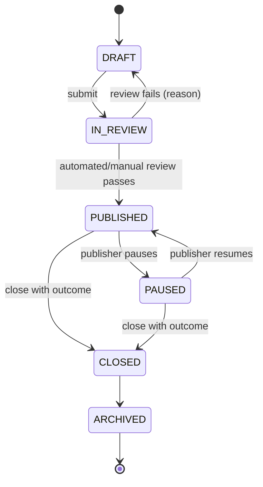

| Transition | Who | What happens |
|---|---|---|
| → PUBLISHED | Publishing company; policy check + `CONTENT_MODERATOR` if review is kept | Match notifications are **deferred** (rules §9) |
| → CLOSED | Publisher | Outcome required; open applications and supplier responses finalised. Surveys are **deferred** (rules §9) |

### OpportunityOutcome — 🔴 PROPOSED → **BQ-25**

```text
OpportunityOutcome
├── FILLED
├── NOT_FILLED
└── CANCELLED
```

### ApplicationStatus — 🔵 RULE-DEFINED (business rules §8) · Phase 3

The **only** application status model. Applies to individual applications (JOB, CO_OP, VOLUNTEERING). Supplier requests use `SupplierResponseStatus`.

```text
ApplicationStatus          stage
├── SUBMITTED              SUBMITTED
├── REVIEWED               REVIEWED
├── SHORTLISTED            SHORTLISTED
├── CONTACT                CONTACT
├── ACCEPTED               DECISION
├── REJECTED               DECISION
└── WITHDRAWN              DECISION (set by the applicant)
```

✅ **BQ-67: transitions are flexible, not sequential.** The company chooses the appropriate status; the stages are labels, not a forced order.

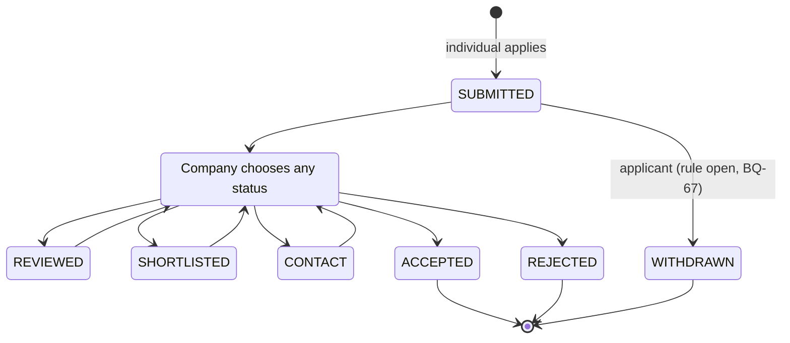

Examples: `SUBMITTED → ACCEPTED` · `SUBMITTED → SHORTLISTED → ACCEPTED` · `SUBMITTED → REJECTED`.

| Transition | Who | What happens |
|---|---|---|
| Any non-final status → REVIEWED / SHORTLISTED / CONTACT / ACCEPTED / REJECTED | Publishing company members with `opportunity.applications.manage` | Applicant notified; audit. **The company decides; Back Of House never makes the hiring decision** (rules §8) |
| → WITHDRAWN | Applicant | Company notified. From which statuses → **BQ-67** (open part) |

- ⚠️ Still open (**BQ-67**): the withdrawal rule, and whether ACCEPTED / REJECTED can be changed afterwards. Until decided, ACCEPTED, REJECTED and WITHDRAWN are treated as final.
- Do **not** add INTERVIEW, OFFER or similar statuses unless approved as a future extension.

### SupplierResponseStatus — 🔴 PROPOSED minimal (business rules §7, BQ-66) · Phase 3

```text
SupplierResponseStatus
├── SUBMITTED    responding company sent its response
└── WITHDRAWN    responding company withdrew it
```

Minimal on purpose. ✅ BQ-66: any Company Account may respond to any supplier request (no company-type restriction; individuals never). More statuses and content can be defined later if needed.

---

## 9. Intelligence & institutional (Phase 4)

### ReportStatus — 🟢 PRD-DEFINED (§29.1)

```text
ReportStatus
├── SCHEDULED    مجدول
├── GENERATING   قيد الإنشاء
├── READY        جاهز
├── FAILED       فشل
└── EXPIRED      منتهي الصلاحية
```

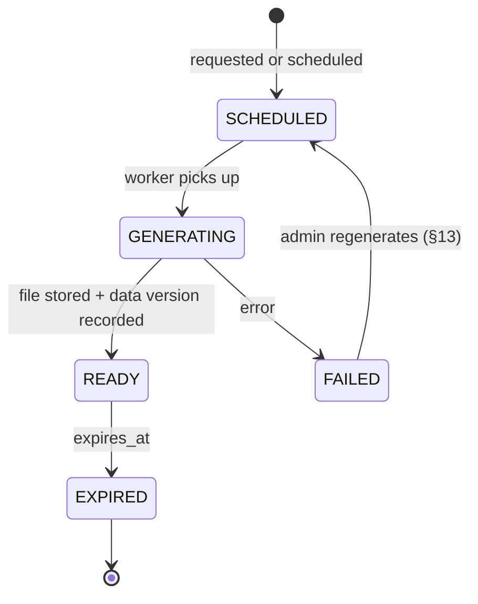

A READY report stores its `data_version` and `rule_versions`, so it can be reproduced exactly (§11.3).

### ReportType — 🟡 PRD-DERIVED (§11, §12.2)

```text
ReportType
├── COMPANY_PERFORMANCE     §11.2
├── DIRECT_COMPARISON       §11.1 (public data only)
├── ANONYMOUS_BENCHMARK     §11.1 (sample ≥ 5)
├── MARKET_REPORT           §4 "market reports" by plan
└── INSTITUTIONAL_REPORT    §12.2 (scope BQ-51)
```

### ExportFormat — 🟢 PRD-DEFINED (§6 Phase 4 "PDF/Excel")

```text
ExportFormat
├── PDF
└── XLSX
```

### RfiStatus — 🔴 PROPOSED → **RG-04**

```text
RfiStatus                   RfiRecipientStatus
├── DRAFT                   ├── PENDING
├── SENT                    ├── RESPONDED
├── CLOSED                  └── DECLINED
└── CANCELLED
```

---

## 10. Content, moderation, notifications, platform

### ContentType — 🟡 PRD-DERIVED (§13 content: pages, news) → **RG-15**

```text
ContentType
├── PAGE
└── NEWS
```

### ContentStatus — 🔴 PROPOSED

```text
ContentStatus
├── DRAFT
├── PUBLISHED
└── ARCHIVED
```

### AbuseReportStatus — 🔴 PROPOSED (§13 "البلاغات", §23 privacy/impersonation reports) → **RG-26**

```text
AbuseReportStatus
├── OPEN
├── IN_REVIEW
├── ACTIONED
└── DISMISSED
```

### AbuseReportTargetType — 🟡 PRD-DERIVED (§13: projects, opportunities; §23 impersonation)

```text
AbuseReportTargetType
├── ORGANIZATION
├── PROJECT
├── USER_PROFILE
├── OPPORTUNITY      Phase 3
└── CONTENT_ITEM
```

### AppealStatus — 🔴 PROPOSED (§8.6 "appeal with a decision record", §13 "objections") → **BQ-41**

```text
AppealStatus
├── SUBMITTED
├── UPHELD      original decision reversed
└── DENIED      original decision stands
```

### NotificationChannel — 🟡 PRD-DERIVED (§15.2 email + messages; §14 `notifications`)

```text
NotificationChannel
├── IN_APP
├── EMAIL
└── SMS
```

`PUSH` is not in the PRD. Add it only if the mobile app is confirmed (**BQ-01**, **RG-14**).

### DeliveryStatus — 🔴 PROPOSED

```text
DeliveryStatus
├── QUEUED
├── SENT
├── FAILED
└── SKIPPED   user preference / missing channel
```

### OutboxStatus — 🔴 PROPOSED (technical, ADR-011)

```text
OutboxStatus
├── PENDING
├── PROCESSED
└── FAILED    after max attempts → alert
```

---

## 11. Supporting enums (introduced by the entity catalog)

```text
LocationType 🟡 (§14 "regions and cities")     ContactType 🟡 (ORG-04)
├── REGION                                     ├── EMAIL
└── CITY                                       ├── PHONE
                                               ├── SOCIAL_ACCOUNT   (official accounts)
EventKind 🟡 (§8.2 meetup 10 / workshop 15)    └── ADDRESS
├── MEETUP
├── WORKSHOP                                   MetricGroup 🟢 (§11.2)
└── OTHER                                      ├── PRESENCE      الحضور
                                               ├── CONVERSION    التحويل
SearchSubjectType 🔴                           ├── QUALITY       الجودة
├── ORGANIZATION                               ├── PROJECTS      المشاريع
└── PROFESSIONAL                               ├── COMMUNITY     المجتمع
                                               └── COMPETITION   التنافس
AppealSubjectType 🔴 (BQ-41)
├── VERIFICATION_DECISION                      AuditActorType 🔴
├── ORGANIZATION_STATUS                        ├── USER
├── ORGANIZATION_MERGE                         ├── STAFF
└── POINT_LEDGER_ENTRY   (Phase 2)             └── SYSTEM

ImportRowAction 🔴                             PlanAudience 🔴 (BQ-14)
├── CREATE                                     ├── COMPANY
├── UPDATE                                     └── INDIVIDUAL
├── SKIP
└── MERGE_CANDIDATE
                                               MessageSide 🔴 (Phase 3)
                                               ├── APPLICANT
                                               └── PUBLISHER
```

---

## 12. Enum index

| Enum | Tag | Phase | Owning module |
|---|---|---|---|
| AccountType | 🔵 | 1 | identity |
| CompanyType | 🔵 | 1 | organizations |
| UserStatus | 🔴 | 1 | identity |
| ConsentPurpose | 🔴 | 1 | identity |
| PlatformRole | 🟢 | 1 | access |
| MembershipStatus | 🔴 | 1 | access |
| InvitationStatus | 🔴 | 1 | access |
| OrganizationApprovalStatus | 🟡 | 1 | organizations |
| OrganizationStatus | 🟢 | 1 | organizations |
| CredentialType | 🟢 | 1 | organizations |
| CorrectionSuggestionStatus | 🔴 | 1 | organizations |
| MergeStatus | 🔴 | 1 | organizations |
| ClientDisclosureStatus | 🟢 | 1 | projects |
| ProjectStatus | 🟢 | 1 | projects |
| MediaType | 🟢 | 1 | media |
| FileStatus | 🔴 | 1 | media |
| DataClassification | 🟢 | 1 | media / docs |
| VerificationStatus | 🟢 | 1 | verification |
| VerificationType | 🟡 | 1 | verification |
| ImportBatchStatus | 🟡 | 1 | imports |
| ContentType | 🟡 | 1 | content |
| ContentStatus | 🔴 | 1 | content |
| AbuseReportStatus / TargetType | 🔴 / 🟡 | 1 | moderation |
| AppealStatus | 🔴 | 1 | moderation |
| NotificationChannel | 🟡 | 1 | notifications |
| DeliveryStatus | 🔴 | 1 | notifications |
| OutboxStatus | 🔴 | 1 | platform/outbox |
| SubscriptionStatus | 🟢 | 2 | billing |
| SubscriberType | 🔴 | 2 | billing |
| InvoiceStatus | 🔴 | 2 | billing |
| PaymentStatus | 🔴 | 2 | billing |
| BillingInterval | 🔴 | 2 | billing |
| CouponDiscountType | 🔴 | 2 | billing |
| EntitlementSource | 🟡 | 2 | entitlements |
| PointSubjectType | 🟢 | 2 | engagement |
| PointCategory | 🟢 | 2 | engagement |
| LedgerEntryType | 🟢 | 2 | engagement |
| MemberLevel (rows) | 🟢 | 2 | engagement |
| LevelAssignmentStatus | 🔴 | 2 | engagement |
| EngagementAlertStatus | 🔴 | 2 | engagement |
| EventStatus | 🔴 | 2 | events |
| RegistrationStatus | 🟡 | 2 | events |
| AttendanceMethod | 🟢 | 2 | events |
| EmploymentConfirmationStatus | 🔴 | 3 | talent |
| OpportunityType | 🔵 | 3 | opportunities |
| OpportunityAudience | 🔵 | 3 | opportunities |
| JobEmploymentType | 🔵 | 3 | opportunities |
| OpportunityStatus | 🟢 | 3 | opportunities |
| OpportunityOutcome | 🔴 | 3 | opportunities |
| ApplicationStatus | 🔵 | 3 | opportunities |
| SupplierResponseStatus | 🔴 | 3 | opportunities |
| ReportStatus | 🟢 | 4 | intelligence |
| ReportType | 🟡 | 4 | intelligence |
| ExportFormat | 🟢 | 4 | intelligence |
| RfiStatus / RfiRecipientStatus | 🔴 | 4 | institutional |

**Totals:** 68 enums — 🔵 6 rule-defined, 🟢 18 PRD-defined, 🟡 12 PRD-derived, 🔴 32 proposed. Billing enums (SubscriptionStatus, SubscriberType, InvoiceStatus, PaymentStatus, BillingInterval, CouponDiscountType, EntitlementSource, PlanAudience) belong to the **deferred** monetization design (rules §11).

| LocationType, ContactType, EventKind | 🟡 | 1 / 2 | taxonomy, organizations, events |
| MetricGroup | 🟢 | 4 | intelligence |
| SearchSubjectType, AppealSubjectType, AuditActorType, ImportRowAction | 🔴 | 1 | search, moderation, audit, imports |
| PlanAudience, MessageSide | 🔴 | 2 / 3 | billing, opportunities |

> **Code-defined, not database enums:** the permission catalog (`auth-architecture.md`), domain event names (`domain-events.md`) and analytics event names (PRD §16).
