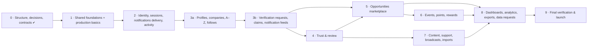

# Back of House backend: two-surface structure and execution plan (v2.2)

> **Version 2.2, 2026-10-11.** v2.1, plus the later decisions of 2026-10-11 (§0.4). **Phase 0 is built** (§3, Phase 0). Decisions are logged in [open-questions.md](open-questions.md) §0, [architecture-decisions.md](architecture-decisions.md) (ADR-031 … ADR-033) and [business-rules.md](business-rules.md) §21. Live progress per operation: [gap-report.md](gap-report.md).
>
> One backend serves two clients:
>
> | Surface | Client | Who uses it | Contract source |
> |---|---|---|---|
> | **App** | Flutter mobile app (and any future member website, BQ-01) | Members (individuals, students) and Company Accounts | [contracts/app/openapi.yaml](../contracts/app/openapi.yaml): the Flutter contract (79 ops after BQ-78) plus `/ping` and `/meta/app-version` = 81. The hand-off's 76 member/company ops show which features it still lacks ([gap-report.md](gap-report.md) §2) |
> | **Admin** | Web back-office | Back of House team: Super admin, Reviewer, Editor, Support, Analyst | [contracts/admin/openapi.yaml](../contracts/admin/openapi.yaml): the hand-off's 119 `/admin/*` ops converted (D1, D2, D3, D5) = 116, plus `/ping` = 117. Source hand-off kept in [docs/admin/](admin/) |
>
> The back-office is always called **admin** in code, docs and tests, never "web". A member website would use the **App** surface.

---

## 0. What changed from v1

### 0.1 Changes

| # | Change | Reason |
|---|---|---|
| 1 | ~~The legacy `/api/v1/*` paths stay mounted as an alias of the app surface for a deprecation window~~ (superseded in v2.2: no alias, D11), plus `GET /api/app/v1/meta/app-version`. | Moving the prefix is a breaking change for any app build already installed. It is not "only a config change". |
| 2 | Contract-first: `contracts/{app,admin}/openapi.yaml` are the source of truth. CI regenerates each spec from code and fails on any difference. `oasdiff` fails on breaking changes. `openapi-typescript` generates the admin client types. | A contract and the code that can drift apart is not a contract. |
| 3 | An `Actor` type is passed into every service call. Role-dependent rules live in `modules/<domain>/policies`. | Rules such as the Support points cap must hold even when a service is called from a job, an event handler or another surface. |
| 4 | Admin web uses an opaque server-side session in an httpOnly cookie, with CSRF protection and CORS limited to the admin origin. JWTs stay for the mobile app only. | Browser tokens in JavaScript are exposed to XSS. An opaque session can be revoked immediately. |
| 5 | D5 rewritten. Staff sign in through the company identity provider (OIDC); the fallback is a separate Supabase project. Staff never share the member user pool. | Keeps staff MFA, joiners and leavers in the IdP the company already runs. A leaked member account can never become staff. |
| 6 | Outbox/domain events in Phase 1 (already built). Notification delivery and active-user tracking in Phase 2. Phase 3 split into 3a/3b. | Later phases depend on events and notifications. Dashboards need activity history from day one. Phase 3 was too large. |
| 7 | Boundary rules restated: imports through `index.ts`, no cycles, separate `worker.ts` process. | Already in the repo (§0.2). The plan now names them as rules every phase must keep. |
| 8 | `@AuditRead('<action>')` for sensitive reads. Grants plus a trigger block UPDATE/DELETE on the audit log and points ledger. Optional hash chain. | An interceptor cannot tell which reads are sensitive. Append-only must hold even for the table owner. |
| 9 | Production basics from Phase 1, each with a measurable exit: observability, environments, expand/contract migrations, PITR plus restore test, security scanning, ASVS L2, virus scanning, load targets. | Phase 9 becomes final verification, not the first time these appear. |
| 10 | D10: PDPL and hosting region. Work items for consent, retention, breach procedure and Arabic search. | Saudi personal data. Arabic names must sort and match correctly. |
| 11 | One vocabulary: "opportunities" on both surfaces. 8 admin routes renamed (D1). | Two words for one concept doubles the mapping work forever. |
| 12 | Opportunities ship to the app and admin at the same time (D8). | Every opportunity is reviewed before it goes live, so the app side is useless without the admin review lane. |

### 0.2 Repo facts that differ from the review (checked 2026-10-11)

| Review point | What the repo already has | Effect on this plan |
|---|---|---|
| 6. "Phase 1: transactional outbox + domain events" | **Built (Stage 3).** `src/platform/outbox/`: writer, dispatcher with lease claiming, retries, `@OnDomainEvent`, purge. Tested in `test/integration/transactions-audit-outbox.int-spec.ts`. | Phase 1 only adds the event catalog convention and the "side effects through events" check. |
| 7. "Add a separate worker entrypoint" | **Built.** `src/worker.ts` + `src/worker.module.ts`, a `worker` service in `docker-compose.yml`, `npm run start:worker`, ADR-022. | Kept as a rule. Deployment as its own service is a Phase 1 exit item per environment. |
| 7. "index.ts only" and "no circular imports" | **Built.** `.dependency-cruiser.js` rules `modules-import-each-other-through-index` and `no-circular`, run in CI (`npm run depcruise`). | Phase 0 adds only the surface rules (§1.5). |
| 8. "UPDATE/DELETE blocked by grants AND a trigger" | **Built for `audit_logs`.** The migration revokes UPDATE/DELETE/TRUNCATE from `boh_app` and adds the `audit_logs_immutable` / `audit_logs_no_truncate` triggers (`app.raise_immutable()`). Tests in `database-foundation.int-spec.ts` include "blocked by the immutability trigger even for the table owner". The points ledger table does not exist yet. | Phase 6 applies the same pattern to the ledger. |
| 8. "Audit interceptor for every admin write" | `AuditLogger` **refuses to write outside a transaction** (ADR-016: audit is atomic with the change). An interceptor runs outside the service transaction. | Writes are audited **inside the service transaction**. The admin interceptor only *asserts* that a mutating admin request wrote at least one audit row. Reads use `@AuditRead`. See §1.4. |
| 5. "PostgREST/table access off for anon and authenticated, RLS as safety net" | **Built.** The migration revokes all rights on schema `app` from `anon`, `authenticated` and `service_role`. RLS is enabled deny-all on every app table. README step 5 keeps `app` out of the Data API. Test: "denies rows to a role without BYPASSRLS". | Phase 2 adds an exit test that impersonates `anon` and `authenticated` explicitly. |
| 9. "/docs/admin not public in production" | Swagger is **already disabled** when `APP_ENV=production` (`src/http-app.ts`). | Kept. In staging, `/docs/admin` also requires an admin session. |
| 9. "Structured logs with trace_id"; "dependency scanning" | **Built.** pino with redaction, request id → `trace_id`. CI runs gitleaks and `npm audit --omit=dev --audit-level=high`. **Not built:** OpenTelemetry, Sentry, static code scanning (SAST), container scanning. | Phase 1 adds only what is missing. |
| 10. "Arabic normalisation: alef/hamza, taa marbuta, diacritics, tatweel + pg_trgm" | **Built.** `app.normalize_ar()` (SQL) and `normalizeArabic()` (TS) share 16 fixtures covering all of those forms. `pg_trgm` is installed. **Not built:** Arabic collation for A–Z sorting, the letter rail, trigram indexes, real-name fixtures. | Phase 3a adds only the missing parts. |
| 1. "Keep the legacy `/api/v1/*` routes the Flutter app uses" | **No such routes exist in this repo.** The only `/api/v1` route is `/api/v1/health`. The first implementation (camelCase, `/api/v1`) was removed in commit `44eeade`. The Flutter app runs on mocks (`USE_MOCK_DATA=true`); only auth has a real client. Its configured base URL is `https://backofhouse.space/api` **with no `/v1`**. | **Decided (D11): no alias.** No store build calls the real API, and nothing is live at `backofhouse.space/api`. |
| 3. "`company_member` with company role" | **ADR-030 (accepted):** one Company Account per company, no company roles. Individual members get no permissions. The Flutter contract has one `OWNER` and checks *permissions* (`EDIT_PROFILE`, `MANAGE_OPPORTUNITIES` …), never role names. | The `Actor` variant is `company` with a permission list (§1.4), not `company_member` with a role. The hand-off's owner/recruiter/editor roles are **not** built (P3). |
| 6. "Notification delivery in Phase 1 or 2" | Nothing is built yet. | Phase 2. |

### 0.3 Product-rule conflicts found while checking

| # | Conflict | Sources | Status (2026-10-11) |
|---|---|---|---|
| P1 | **Are points spent on rewards?** The repo's business rules say points are **never deducted** and only unlock rewards (BQ-08, BQ-59, decided). The Flutter contract and the hand-off both deduct points on redeem (`REDEEMED_REWARD`, `INSUFFICIENT_POINTS`). | `business-rules.md` vs `docs/app/README.md`, hand-off doc 01 §7 | **Decided (BQ-76):** points are spent on redeem; level from lifetime earned points, so spending never lowers it (supersedes BQ-08/BQ-59) |
| P2 | **Editing a live opportunity.** In the Flutter contract a published listing changes only through a **revision** and stays live during review. The hand-off sends it back to `pending_review`, so it goes offline. | `docs/app/README.md` "Listings" vs hand-off doc 01 §3 | **Decided:** the live version stays live; edits are reviewed as a pending revision that replaces it on approval; the admin queue labels them "Revision" |
| P3 | **Company roles.** The hand-off has owner/recruiter/editor with different rights. The repo has one Company Account per company (ADR-030). | hand-off doc 02 vs ADR-030 | **Decided:** ADR-030 for launch; the `company` Actor carries a permissions list; admin company detail shows the single account, not a team list |
| P4 | **Attendance points.** The hand-off awards +150 per event. The repo's points architecture has meetup 10 and workshop 15. | hand-off doc 01 §7 vs `points-architecture.md` | **Decided (BQ-77):** design scale: attendance 150, volunteer shift 200, profile 50, referral 50 (max 10/month); reward prices 300–1,500 |
| P5 | **Social and phone-code sign-in.** The Flutter contract has `/auth/social` (Google) and phone-code sign-in. BQ-30 excludes social login; BQ-58 is open. Found while recording D1. | Flutter contract vs BQ-30 | **Decided (BQ-78):** email + password and phone SMS code; no social login; `/auth/social` removed from `contracts/app` |
| P6 | **Students.** Both contracts use students (`profile_status = STUDENT`, co-op for students only). BQ-72 removed the student concept. | `docs/app/README.md`, hand-off doc 01 §3 vs BQ-72 | **Decided (BQ-79):** students kept (reverses BQ-72); student ID accepted for verification |
| P7 | **Unverified companies posting JOBs.** BQ-73: publishing a JOB requires a verified company. The hand-off's automated check only *warns*. | BQ-73 vs hand-off doc 01 §3 | **Decided (BQ-80):** JOB needs a verified company, 422 `COMPANY_NOT_VERIFIED`; other types allowed |
| P8 | **Is PROJECT an opportunity type?** Both contracts list `PROJECT`, and BQ-80 names "projects". BQ-62 says it is portfolio work only. Found while recording BQ-80. | BQ-62 vs both contracts | **Open → BQ-81** (blocks Phase 5) |

Answers are recorded in `business-rules.md` §21 as well, so the sources stop disagreeing.

### 0.4 Changes in v2.2

| Change | Reason |
|---|---|
| Staff sign in with **Google Workspace via OIDC** (ADR-032). `hd` claim and email domain both checked; 2-Step Verification enforced in Workspace (runbook control); `NOT_STAFF` for anyone without an active staff account; invite = `staff_accounts` row with status `INVITED`, no token | D5 / TQ-28 decided |
| **No legacy alias.** §1.7 now covers forced updates only, and Phase 10 is removed | D11 / TQ-29: no store build calls the real API |
| Member sign-in: email + password and phone SMS code; Google sign-in removed from `contracts/app` | BQ-78 |
| Students kept; points spent on redeem; design points scale; JOB needs a verified company (`COMPANY_NOT_VERIFIED`) | BQ-79, BQ-76, BQ-77, BQ-80 |
| Contracts are built and tagged with `x-phase`. Coverage now reads the contracts themselves (§4): app 81, admin 117 | Phase 0 |
| The code-vs-contract check is `scripts/contracts/check.mjs` (operations, success codes, parameters) instead of `oasdiff diff`. `oasdiff` still guards breaking changes in CI | oasdiff is a Go binary, not available on npm. A Node check runs locally and in CI with no extra tooling |

---

## 1. The structure

### 1.1 Rule

**Business logic is shared. Everything a client touches is separate.**

Shared:
- one database;
- one set of domain modules, which hold the rules, policies, transactions and state machines.

Separate per surface:
- route prefix;
- authentication;
- controllers and DTOs;
- contract;
- Swagger page;
- tests;
- docs.

### 1.2 Source tree

Items marked **(new)** don't exist yet. `surfaces/` was built in Phase 0.

```text
src/
├── main.ts                    api process (exists)
├── worker.ts                  worker process: outbox dispatcher + pg-boss jobs (exists, ADR-022)
├── config/  common/  platform/          shared technical layers (exist)
│
├── modules/                   SHARED business domains, no HTTP (new from Phase 1, audit exists)
│   └── <domain>/
│       ├── index.ts           public API: query services, ports, event types, use-case services
│       ├── services/          use cases + transactions; every method takes an Actor
│       ├── policies/          role- and ownership-dependent rules (§1.4)
│       ├── domain/            pure rules: state machines, caps, SLA maths (no Nest/Prisma)
│       ├── repositories/  events/  handlers/  jobs/
│       └── __tests__/
│
└── surfaces/                  (built in Phase 0: surfaces.module.ts, surface-paths.ts, surface-route-check.ts, surface-docs.ts)
    ├── app/                   → /api/app/v1/*
    │   ├── app-surface.module.ts      RouterModule prefix, AppAuthGuard, Swagger "app"
    │   ├── meta/              ping, app-version (built); taxonomy (Phase 1)
    │   ├── auth/  me/  companies/  professionals/  opportunities/  events/  rewards/  news/  support/
    │   └── company-workspace/ /company/* (Company Accounts)
    └── admin/                 → /api/admin/v1/*
        ├── admin-surface.module.ts    RouterModule prefix, AdminSessionGuard, CsrfGuard,
        │                              PermissionGuard, AuditAssertInterceptor, Swagger "admin"
        ├── meta/              ping (built)
        ├── auth/  team/  my-work/  overview/
        ├── opportunities-review/  verification/  claims/  users/  companies/  moderation/
        ├── events/  points/  rewards/  news/  broadcasts/  support/  imports/
        └── analytics/  exports/  audit-log/  settings/
```

Each surface feature folder holds:
- `<feature>.controller.ts`
- `dto/`: request and response classes for this surface only
- `<feature>.mapper.ts`: domain object → this surface's response. The app gets one language; the admin gets `LocalizedText {en, ar}`.

Phase 0 updates [nest-module-map.md](nest-module-map.md) §2.1, because controllers move from `modules/<domain>/controllers` to `surfaces/*`.

### 1.3 What differs per surface

| Concern | App (`/api/app/v1`) | Admin (`/api/admin/v1`) |
|---|---|---|
| **Identity** | Member user pool (Supabase Auth behind the API's `/auth/*`, ADR-003) | **Google Workspace via OIDC** (ADR-032): only our Workspace domain (`hd` claim **and** email domain); active `staff_accounts` row required, otherwise 403 `NOT_STAFF`. **Never the member pool** |
| **Sign-in methods** | Email + password; phone + SMS code with per-phone and per-IP rate limits, code expiry, attempt cap. No social login (BQ-78) | Google only. 2-Step Verification enforced in Google Workspace ([runbooks/staff-access.md](runbooks/staff-access.md)); no TOTP of our own |
| **Credential on requests** | `Authorization: Bearer <JWT>` (access token + refresh token, secure storage on device) | Opaque session id in cookie `__Host-boh_admin` (httpOnly, Secure, SameSite=Strict, Path=/). **No bearer tokens accepted** |
| **Session rules** | JWT expiry + refresh rotation | `admin_sessions` row: 30-min idle (sliding), 12 h absolute. Deleted immediately on role change, on disabling the `staff_accounts` row, or on sign-out |
| **CSRF** | n/a (no cookies) | SameSite=Strict, plus an `X-CSRF-Token` double-submit on POST/PUT/PATCH/DELETE, plus an `Origin` check |
| **CORS** | None (native app) | Only the admin origin, `credentials: true` |
| **Wrong credential** | Admin cookie gets 401 | Member JWT gets 401 |
| **Actor** | `member` or `company` (§1.4) | `staff` |
| **Coarse check (guard)** | Account context (individual vs company, ADR-029) | `@RequirePermission(key)` from the role matrix |
| **Fine rules** | Domain policies (§1.4) | Domain policies (§1.4) |
| **Language** | One language from `Accept-Language` | `LocalizedText { en, ar }` |
| **Paging** | `page`, `page_size` → `meta.has_more` | `page`, `page_size`, `sort` → `meta.total`, `total_pages` |
| **Audit** | Domain-level (points, applications …) | Every write in-transaction, asserted by an interceptor; sensitive reads via `@AuditRead` |
| **Contract** | `contracts/app/openapi.yaml` | `contracts/admin/openapi.yaml` (+ generated `admin-api.d.ts`) |
| **Swagger** | `/docs/app` (non-production) | `/docs/admin` (non-production, admin session required) |
| **Tests** | `test/e2e/app/` | `test/e2e/admin/`, `test/authz/admin-matrix.e2e-spec.ts` |
| **Docs** | `docs/app/` | `docs/admin/` |

**Shared by both:**
- error body `{code, message, trace_id, errors}` with one catalog, `docs/error-codes.md` (D3);
- snake_case JSON;
- `/api/health`, `/api/health/ready`.

### 1.4 Actor, policies and audit in the domain

Phase 1 adds this type:

```ts
type Actor =
  | { kind: 'member';  userId: string; isStudent: boolean }
  | { kind: 'company'; userId: string; companyId: string; permissions: CompanyPermission[] } // ADR-030: one Company Account
  | { kind: 'staff';   staffId: string; role: StaffRole; permissions: PermissionKey[] }
  | { kind: 'system';  job: string };                                                     // worker jobs, event handlers
```

- **Resolution.** Each surface guard builds the Actor and puts it in `RequestContext`. Controllers pass it explicitly to every service method. Services never read HTTP state.
- **Guards** do the coarse check: the right surface, the right account context, the permission key present. This gives fast 403s and drives the permission matrix test.
- **Policies** in `modules/<domain>/policies/*.policy.ts` hold every rule that depends on who is calling. **Services call them, so the rule holds whichever surface, job or handler calls the service.** Initial set:

| Rule | Policy |
|---|---|
| Support adds at most 500 points per member per Riyadh calendar month, and never deducts | `engagement/policies/points-adjustment.policy.ts` |
| Only Super admin changes "Companies to watch" | `organizations/policies/featured.policy.ts` |
| Email and phone masked unless `users.contact.view` (staff) or shared on the application (company) | `profiles/policies/contact-visibility.policy.ts` |
| Personal-data export columns only with `exports.personal_data` | `exports/policies/personal-data.policy.ts` |
| Only the owning Company Account changes application status; staff never can | `opportunities/policies/application-status.policy.ts` |
| Only verification decisions set verified | `verification/policies/verification-decision.policy.ts` |

- **Audit of writes.** The service calls `AuditLogger.record()` inside its transaction (ADR-016, already enforced by `AuditLogger`). On the admin surface, `AuditAssertInterceptor` fails the request in tests, and logs an error in production, when a POST/PUT/PATCH/DELETE wrote no audit row.
- **Audit of sensitive reads.** `@AuditRead('verification.document.view')` on the controller method. The interceptor writes the audit row in its own transaction **before** returning the response. If the audit write fails, the read fails (fail closed). It is used for:
  - document views;
  - user contact views;
  - export downloads;
  - signed private-file URLs.

### 1.5 Boundary rules (dependency-cruiser, `npm run depcruise`, CI)

| Rule | Status |
|---|---|
| `no-circular` | exists |
| Modules import each other only through `index.ts` (`modules-import-each-other-through-index`) | exists |
| `common/` ↛ `platform/`, `modules/`; `platform/` ↛ `modules/`; `domain/` has no Nest or Prisma | exists |
| `surfaces/app` ↛ `surfaces/admin`, and the reverse (`app-surface-not-admin`, `admin-surface-not-app`) | **built** (Phase 0) |
| `modules/`, `platform/`, `common/` ↛ `surfaces/` (`business-logic-not-surfaces`) | **built** (Phase 0) |
| `surfaces/*` → `modules/<x>/index.ts` only (`surfaces-use-module-index`) | **built** (Phase 0) |
| `worker.ts` / `worker.module.ts` ↛ `surfaces/` (`worker-has-no-surfaces`) | **built** (Phase 0) |
| Startup check: every route sits under `/api/app/v1`, `/api/admin/v1` or `/api/health` (plus the non-production `/docs/*` pages); otherwise boot fails (`src/surfaces/surface-route-check.ts`) | **built** (Phase 0) |
| Cross-module side effects through outbox events, not direct calls to another module's mutating service (attendance → points → notification) | new, Phase 1: architecture test `test/architecture/module-index.spec.ts` fails when an `index.ts` exports a mutating service not listed in the declared edges of `module-dependency-map.md` |

### 1.6 Contracts: one source of truth

```text
contracts/
├── app/openapi.yaml                  source of truth for the app surface
├── admin/openapi.yaml                source of truth for the admin surface
└── admin/types/admin-api.d.ts        generated by openapi-typescript, committed
```

Every operation carries `x-phase`. `contracts/phase.json` holds the current phase.

CI, on every push and PR (`.github/workflows/ci.yml`):

1. `npm run contract:coverage` (`scripts/contracts/coverage.mjs`): every operation has exactly one valid `x-phase`.
2. `npm run contract:generate` (`scripts/contracts/generate.ts`) creates the app without initialising it (no database), and writes `build/openapi.app.json` and `build/openapi.admin.json` (`buildSurfaceDocuments`, `include: [AppSurfaceModule]` / `[AdminSurfaceModule]`).
3. `npm run contract:check` (`scripts/contracts/check.mjs`) compares code with contract, and fails when:
   - an operation is in the code but not in the contract;
   - a contract operation due by the current phase is not implemented;
   - an implemented operation's success status codes or path/query parameters differ.
4. `npm run contract:types` regenerates `contracts/admin/types/admin-api.d.ts` (openapi-typescript 7.13.0). `git diff --exit-code` then fails the build when the committed types are stale.
5. PRs only, workflow `contract-breaking-changes.yml`, which re-runs when labels change: `tufin/oasdiff:v1.32.1 breaking <base> <head> --fail-on ERR` for each contract.
   - **App:** breaking changes always fail; ship them under `/api/app/v2`.
   - **Admin:** breaking changes pass only with the PR label **`breaking-change-approved`**, for a release coordinated with the admin web app.
6. Phase 1 adds `jest-openapi` response validation in e2e tests, which checks request and response **bodies** against the contract. Until then, bodies are not compared.

Workflow: change the YAML first, then the code, in the same PR.

### 1.7 Forced updates (no legacy alias)

- **No legacy alias (D11, TQ-29).** No store build calls the real API, and nothing is live at `backofhouse.space/api`, so `/api/v1/*` simply returns 404. The e2e test `surfaces.e2e-spec.ts` checks this.
- **`GET /api/app/v1/meta/app-version?platform=IOS|ANDROID`** is public. It returns `{ platform, min_supported_version, latest_version, update_url }`.
  - **Built in Phase 0.** It must ship before the first store release (D11): a build without this call can never be forced to update.
  - Today the values come from env (`APP_IOS_*`, `APP_ANDROID_*`). The schema rejects a minimum above the latest version, and update URLs are required in staging and production. Phase 1 moves them to `settings`, editable by a Super admin.
  - The app calls it on launch and blocks below the minimum.

### 1.8 Docs

```text
docs/
├── app/            moved from docs/app-api/ (README; the YAML moved to contracts/app/)
├── admin/          moved from backend-handoff-web/ (hand-off reference; contracts/admin/ is the source of truth)
├── gap-report.md   generated by npm run gap-report
├── runbooks/       staff-access.md (ADR-032 operational control)
├── error-codes.md  shared error catalog (D3)
└── *.md            shared architecture (existing)
```

---

## 2. Decisions

Recorded 2026-10-11 in [open-questions.md](open-questions.md) §0 and [architecture-decisions.md](architecture-decisions.md).

**Still open, in order:**
1. **D10 / BQ-31** (hosting region, PDPL): blocks Phase 1.
2. **TQ-04** (SMS provider for Saudi numbers): blocks Phase 2.
3. **BQ-81** (PROJECT as an opportunity type): blocks Phase 5.

Nothing blocks Phase 0, which is built.

| # | Topic | Decision | Status |
|---|---|---|---|
| D1 | **Contract and vocabulary** | The Flutter contract wins for app routes; the hand-off's member ops only add missing features (saved items, devices, support tickets, data requests, contact sharing). **"Opportunities" on both surfaces.** Admin routes renamed: `GET /admin/listings` → `/admin/opportunities`; `GET /admin/listings/{id}` → `/admin/opportunities/{id}`; `POST /admin/listings/{id}/approve`, `/request-changes`, `/reject`, `/close` → `/admin/opportunities/{id}/…` (4 routes); `GET /admin/companies/{id}/listings` → `/admin/companies/{id}/opportunities`; `GET /admin/analytics/top-listings` → `/admin/analytics/top-opportunities`. **8 routes in total.** Also renamed: permission keys `listings.view/review` → `opportunities.view/review`; export dataset `listings` → `opportunities`; audit actions `listing.*` → `opportunity.*`; settings `reviewEveryListing`, `hideContactDetailsInListings` → `review_every_opportunity`, `hide_contact_details_in_opportunities`; error `LISTING_NOT_EDITABLE` → `NOT_EDITABLE` (Flutter code). `supplier-requests` stays (a supplier request is an opportunity type in both contracts). **Consequence:** the app keeps the API's `/auth/*` routes (ADR-003 option b; answers TQ-02). | ✅ Decided (ADR-031) |
| D2 | **JSON casing** | snake_case on both surfaces. | ✅ Decided (ADR-019) |
| D3 | **Error body** | Keep `{code, message, trace_id, errors}`. One catalog `docs/error-codes.md` (code, HTTP status, surface, meaning). A unit test fails when an `ErrorCode` value is missing from the catalog. Where codes conflict, the Flutter code wins (e.g. `NOT_EDITABLE`, `INSUFFICIENT_POINTS` as 409). | ✅ Decided (ADR-008 amended) |
| D4 | **Prefixes** | `/api/app/v1` and `/api/admin/v1`; health at `/api/health`; app paging per the Flutter contract. No legacy alias (D11). | ✅ Decided and built (ADR-008, ADR-031) |
| D5 | **Admin identity** | **Google Workspace via OIDC** (code + PKCE). The server accepts only our Workspace domain and checks the `hd` claim **and** the verified email domain. 2-Step Verification is enforced in the Workspace admin console for the staff group, as a runbook control; there is no TOTP of our own. `staff_accounts` holds role and status (`INVITED`, `ACTIVE`, `DISABLED`). A Google account without an active row gets 403 `NOT_STAFF`. Invite: a Super admin adds name, work email and role → row `INVITED` → the first Google sign-in activates it. No passwords, no invite tokens. Routes: `GET /auth/oidc/start`, `GET /auth/oidc/callback`, `POST /auth/logout`. Session: opaque httpOnly cookie, 30-min idle, 12 h max, ended immediately on role change or disable. Never the member pool; the backend is the only database client. | ✅ Decided (ADR-032) |
| D6 | **Jobs, storage, processes** | Keep pg-boss (ADR-010) and the storage port (ADR-009). Jobs run only in the separate `worker` process (`JOBS_ENABLED=true`), deployed as its own service (ADR-022). | ✅ Decided |
| D7 | **Entity names** | Keep the repo's names (`organizations`, `opportunities`, `content_items`, `verifications` …). The gap report maps them to the hand-off's names. | ✅ Decided |
| D8 | **Order of Phases 5 and 6** | **Phase 5 (marketplace) before Phase 6 (events, points, rewards).** Each phase ships its app and admin lanes **in the same release**: every opportunity is reviewed before going live, so the app side must not reach users before the admin review queue. | ✅ Decided |
| D9 | **Hand-off open questions** | Profile completion **+50** points. Support hours **Sunday–Thursday 09:00–17:00 Asia/Riyadh**. **No review skip** for verified companies. Levels **L1 0 · L2 100 · L3 500 · L4 1,500** (Flutter table). | ✅ Decided, pending product owner sign-off |
| D10 | **PDPL and hosting region** | Confirm the hosting region for personal data (BQ-31, TQ-09/ADR-023). Consent records versioned per purpose. Retention per data type (BQ-33): verification documents, audit logs, analytics events, support tickets, exports, deleted accounts. Breach procedure: detect, assess, notify the regulator and affected people within the PDPL deadline, record. Data subject requests (Phase 8) count as PDPL rights fulfilment. | **Open (BQ-31): top of the list, blocks Phase 1** |
| D11 | **App version and legacy alias** | **No legacy alias**: no store build calls the real API and nothing is live at `backofhouse.space/api`. `GET /api/app/v1/meta/app-version` ships before the first store release (built in Phase 0). | ✅ Decided (TQ-29) |
| D12 | **Audit hash chain** | **None at launch.** Revisit if a regulator or partner requires tamper evidence; the design then is the daily digest (`audit_digests`, write-once copy). | ✅ Decided (ADR-016 amended) |
| D13 | **Performance and availability targets** | App reads p95 **< 300 ms**; app writes p95 **< 800 ms**; admin tables p95 **< 1 s**; search p95 ≤ 1 s with 2,000+ companies (§17); uptime **99.5 %** monthly at launch, **99.9 %** target after; RPO **15 min** (PITR); RTO **4 h**. | ✅ Decided (ADR-033; answers BQ-32) |

---

## 3. Phases

Each phase is organised in lanes:
- **Domain:** shared;
- **App:** `surfaces/app`;
- **Admin:** `surfaces/admin`;
- **Platform:** where production work starts.

**A phase is done when all of these pass:**
- `npm run test:all`;
- the CI `contracts` job (§1.6);
- `test/authz/admin-matrix.e2e-spec.ts`, from Phase 2;
- `backend-implementation-status.md` and `docs/gap-report.md` updated in the same PR.

Each phase ships both lanes in one release (D8).



Phase 5 depends on Phase 4 (an auto-flagged opportunity opens a moderation case). Phase 6 follows Phase 5 (D8).

### Phase 0 · Structure, decisions, contracts: **DONE 2026-10-11** (branch `phase-0-structure`)

No feature code.

**Decisions and documents**
- D1–D9, D11–D13, P2, P3 and BQ-76 … BQ-80 are recorded.
- `business-rules.md` §21 has D9, P2, P3 and BQ-76 … BQ-80.
- `docs/gap-report.md` is generated by `npm run gap-report` (`scripts/gap-report.mjs`):
  - operations per surface and phase, implemented or not;
  - 25 hand-off member features still missing from `contracts/app`;
  - 42 hand-off models mapped to repo entities;
  - differences to resolve.
- `docs/error-codes.md` lists every code. `INTERNAL_ERROR` is renamed to `SERVER_ERROR` (Flutter code, D3).
- `docs/runbooks/staff-access.md` documents the Google Workspace 2-Step Verification control (ADR-032).
- Updated: `nest-module-map.md` (§2 banner and tree), `auth-architecture.md` (two identities; §1.6 superseded for staff), `README.md`, `backend-implementation-status.md`.

**Docs and contracts**
- `docs/app-api/README.md` moved to `docs/app/README.md`, and `backend-handoff-web/` to `docs/admin/`.
- **`contracts/app/openapi.yaml`** is the Flutter contract with these edits:
  - servers `/api/app/v1`;
  - `/auth/social` removed (BQ-78);
  - phone-code limits documented;
  - `COMPANY_NOT_VERIFIED` on submit (BQ-80);
  - student ID in `VerificationDocument` (BQ-79);
  - `trace_id` and the generic codes added to `Error`;
  - `/ping` and `/meta/app-version` added;
  - `x-phase` on all 81 operations.

  The 25 missing hand-off features are added in their phases (gap report §2).
- **`contracts/admin/openapi.yaml`** is generated once from the hand-off by `scripts/contracts/convert-admin-handoff.mjs`:
  - only the `/admin/*` operations, with servers `/api/admin/v1`;
  - D1 renames (8 routes, permission keys, schemas `Opportunity*`);
  - snake_case fields and query parameters;
  - `UPPER_SNAKE` enum values, with `IN_REVIEW` / `PUBLISHED` / `CO_OP` / `VOLUNTEERING` aligned to Flutter;
  - `{data, meta}` envelopes and the shared `Error` body;
  - cookie + CSRF security;
  - D5: 5 routes dropped (`login`, `mfa/verify`, `mfa/confirm`, `GET invites/{token}`, `POST invites/{token}/accept`), OIDC `start` and `callback` added, `mfa_enabled` removed;
  - `/ping`;
  - `x-phase` on all 117 operations.
- `contracts/admin/types/admin-api.d.ts` is generated for the admin web team.

**Code**
- `src/surfaces/`:
  - `surfaces.module.ts` (RouterModule `app/v1`, `admin/v1`);
  - `app/` (`GET /ping`, `GET /meta/app-version`);
  - `admin/` (`GET /ping`);
  - `surface-route-check.ts` (boot fails on a route outside a surface);
  - `surface-docs.ts` (one OpenAPI document per surface).
- Global prefix `api`; health at `/api/health` (Dockerfile healthcheck and log filter updated).
- Swagger at `/docs/app` and `/docs/admin`, never in production.
- App-version env vars with validation (`APP_IOS_*`, `APP_ANDROID_*`).
- Five dependency-cruiser rules (§1.5).
- CI: contract coverage, generate, check and types steps, plus the `contract-breaking-changes` job.
- No legacy alias (D11).
- Not created: the empty `test/e2e/app`, `test/e2e/admin` and `test/authz` folders. Each appears with its first test (Phase 2).

**Exit:** all met, results 2026-10-11.

| Criterion | Evidence |
|---|---|
| Two Swagger pages, each with `GET /ping` | `test/e2e/surfaces.e2e-spec.ts`: `/docs/app-json` lists only `/api/app/v1/*` (incl. `/ping`, `/meta/app-version`); `/docs/admin-json` lists only `/api/admin/v1/*` (incl. `/ping`); both pings answer `{ data: { status: 'OK', surface } }` |
| A route outside a surface fails boot | `src/surfaces/surface-route-check.spec.ts`: a stray controller makes `app.init()` throw `Routes outside the app and admin surfaces (ADR-031): GET /api/stray` |
| An app → admin import fails depcruise | `npm run test:architecture` (serial, its own CI step): `test/architecture/surface-boundaries.spec.ts` runs the project rules on `test/architecture/fixtures/surface-leak`: `app-surface-not-admin` and `business-logic-not-surfaces` errors, non-zero exit; the real `src/` passes |
| `meta/app-version` | `surfaces.e2e-spec.ts`: returns `min_supported_version`, `latest_version`, `update_url`; unknown platform → 422 `VALIDATION_FAILED` |
| Contract check green, red on code-only routes | `npm run contracts`: OK (app 2 of 2 due, admin 1 of 1 due). Against a spec with an extra route and a changed status it fails with both differences |
| Coverage | `npm run contract:coverage` exits 0 (§4) |

### Phase 1 · Shared foundations and production basics

> **Progress (2026-10-28).** Hosting (D10 / BQ-31) is still open, so Phase 1 is split:
>
> **1A, hosting-independent: built on branch `phase-1a-foundations`.**
> - `Actor` in `RequestContext`; `SurfaceAuthGuard` (deny by default per surface, resolvers per surface, null until Phase 2); `PermissionGuard` + `@RequirePermission`.
> - The staff permission matrix in code (`modules/access`), unit-tested against the hand-off table.
> - `Accept-Language` → locale; `LocalizedText`; app and admin page types.
> - `Idempotency-Key` (table, interceptor, hourly purge job).
> - `@AuditRead` (fail closed) and the admin-write audit check.
> - `settings` (table, D9 defaults, rules enforced in the schema, `GET/PUT /api/admin/v1/settings`, app-version now served from settings).
> - CI: CodeQL, Dependabot, squawk on new migrations, a schema-drift test.
> - `docs/security/asvs-l2.md`.
> - **Bug fixed along the way:** the database session now runs in UTC (`-c TimeZone=UTC`). The pg adapter sends dates without an offset, so a non-UTC Postgres shifted every timestamp comparison. A regression test covers it.
>
> **1B, still open:**
> - **Taxonomy: built (branch `phase-1b-taxonomy`).**
>   - **Tables:** `locations` (13 regions + cities, seeded everywhere), `skills` (crafts), `industries`, and `taxonomy_labels` for the fixed lists' labels and order.
>   - **Admin:** `GET/PUT /api/admin/v1/taxonomy/{kind}` for `cities`, `crafts`, `industries`, `company_types`, `opportunity_types`, `news_topics`.
>     - On extendable lists, items left out are deactivated, never deleted.
>     - Fixed lists can only be renamed and reordered.
>     - Every change is audited.
>   - **App:** `GET /api/app/v1/meta/taxonomy`, public, in one language.
>   - **Seeds:** crafts and the draft industries list are seeded only locally and in tests (BQ-21, RG-28).
>   - **Contracts:** every Phase 1 operation in both contracts is implemented, so `contracts/phase.json` is now `1`.
> - **Uploads + virus scan:** waits on hosting and TQ-10.
> - **Waits on hosting:** OpenTelemetry + Sentry, environments, backups/PITR + restore drill, container image scan, k6 load tests, PDPL retention table + breach runbook.
> - **Can be done any time:** `jest-openapi` response-body tests, `test/architecture/module-index.spec.ts`, the event-catalog convention.

**Domain**
- `Actor` type and `RequestContext.actor`.
- Policy convention, with `test/architecture/module-index.spec.ts`.
- Event catalog convention in `domain-events.md`. The outbox itself exists.
- `settings`: typed keys, defaults, app-version values.
- `taxonomy`: cities, crafts, opportunity types, company categories.
- Seed: settings and earning rules, registration locked at 0.

**Shared (`common/` and `platform/`)**
- `Accept-Language` resolution.
- `LocalizedText`.
- Page pagination with `total`.
- `Idempotency-Key` interceptor + `idempotency_records` + `idempotency.purge` job.
- Uploads:
  - files land in quarantine;
  - the worker checks type and size, hashes and **virus-scans** them (TQ-10; ClamAV container or a managed API), then moves them to the public or private bucket;
  - private files get 5-minute signed URLs through `@AuditRead`.
- `@AuditRead` and `AuditAssertInterceptor` (§1.4).

**App**
- `POST /uploads`.
- `GET /meta/taxonomy`, in one language.

**Admin**
- `GET/PUT /settings` and `GET/PUT /taxonomy/{kind}`, bilingual.

**Platform**
- **Observability:**
  - OpenTelemetry SDK in api and worker: HTTP, Express and pg auto-instrumentation;
  - trace context carried through the outbox payload into the worker;
  - logs carry `trace_id` and `request_id`;
  - metrics labelled `surface=app|admin`;
  - Sentry in api and worker, with the existing redaction applied to events.
- **Environments:** local (embedded Postgres), dev, staging and production as separate Supabase projects. The same image tag is promoted dev → staging → production. `/api/health/ready` reports `app_env` and the git SHA.
- **Migrations:**
  - expand/contract rule written into `database-design-rules.md`;
  - `squawk` runs in CI on new migration SQL;
  - a column is dropped only in a later release than the code that stopped using it.
- **Backups:** PITR on staging and production; first restore drill into a scratch project.
- **Security:**
  - secrets only from the hosting secrets manager (TQ-09);
  - CodeQL (or Semgrep) static scanning plus Dependabot;
  - Trivy scan of the Docker image;
  - start `docs/security/asvs-l2.md`, the OWASP ASVS L2 checklist with a status per requirement.
- **Load testing:** k6 scripts in `test/load/` with D13 thresholds in the script, so `k6 run` exits non-zero on a miss.
- **PDPL documents:** a retention table per data type (D10) in `security-and-audit.md`; breach procedure in `docs/runbooks/data-breach.md`.

**Exit:**
- `test/e2e/idempotency.e2e-spec.ts`: a replay returns the stored response; a different body returns 422 `IDEMPOTENCY_KEY_REUSED`.
- `test/integration/upload-scan.int-spec.ts`: the EICAR test file stays quarantined and never gets a download URL.
- `test/e2e/admin/audit-read.e2e-spec.ts`: a private-file URL request writes one audit row; with audit writes failing, the read returns 5xx.
- `test/e2e/admin/audit-assert.e2e-spec.ts`: a test admin write that skips `AuditLogger` fails.
- `test/integration/policies/actor-bypass.int-spec.ts`: calling `SettingsService.update` directly with a `member` Actor throws `FORBIDDEN`.
- In staging, one request is visible as a single trace from api → Postgres → outbox → worker.
- A test exception appears in Sentry with no email or phone in it.
- The CodeQL and Trivy CI jobs are green; `squawk` is green.
- The restore drill is logged in `docs/runbooks/restore-drill-<date>.md` with a measured restore time ≤ RTO (D13).
- `api` and `worker` run as separate services in staging, and `/api/health/ready` reports `app_env=staging`.

### Phase 2 · Identity, sessions, notification delivery, activity tracking

> **Progress (2026-10-29).** **2A, staff identity: built on branch `phase-2a-staff-identity`.**
> - **Google Workspace sign-in** (`/auth/oidc/start`, `/auth/oidc/callback`, `/auth/logout`): state stored server-side and single use; PKCE; nonce check; `hd` **and** email domain must equal the Workspace domain; the email must be verified. Google ID tokens are verified with `node:crypto` against Google's JWKS.
> - **Staff accounts:** an invite creates an `INVITED` account, activated by the first sign-in. `NOT_STAFF` for anyone else, and every refusal is audited.
> - **Opaque session cookie** `__Host-boh_admin` (httpOnly, Secure, SameSite=Strict) with the double-submit CSRF token `__Host-boh_csrf` + `X-CSRF-Token`.
>   - It ends after 30 idle minutes (a setting) or 12 hours (`ADMIN_SESSION_MAX_HOURS`).
>   - A role change or disable ends it immediately.
> - **Sign-in limits:** 20 a minute per IP.
> - **Endpoints and rules:** `/me`, `/roles`, `/team`, `/team/invites`, `/team/{id}`; `LAST_SUPER_ADMIN` is enforced under a row lock.
> - **Seeded Super admin** from env.
> - **Scheduled job** `admin-auth.purge`; modules now declare cron jobs with `JobsService.defineCron`.
> - **Permission-matrix e2e:** `test/authz/admin-matrix.e2e-spec.ts` (5 roles × every implemented admin op).
>
> **Still open:** the member side (Supabase Auth behind `/auth/*`, phone code needs **TQ-04**), notification delivery, activity tracking. Hosting is deferred while in development (open-questions.md §0, 2026-10-29).

**Domain**
- `identity`: `users`, account type, suspension, **consent records** (purpose, version, timestamp; PDPL, D10).
- `access`:
  - typed permission matrix (hand-off doc 02, renamed per D1);
  - `staff_accounts` (name, work email, role, status `INVITED` / `ACTIVE` / `DISABLED`). Invites create an `INVITED` row; the email must be on the Workspace domain (`EMAIL_DOMAIN_NOT_ALLOWED`). The first Google sign-in activates it. No tokens and no expiry links (ADR-032);
  - `admin_sessions`, deleted immediately on role change or disable;
  - `LAST_SUPER_ADMIN` rule.
- `notifications` delivery:
  - in-app store;
  - FCM and email adapters behind ports;
  - bilingual templates;
  - per-user preferences;
  - shared quiet-hours helper;
  - fed only by outbox handlers;
  - duplicate events produce one notification.
- **Activity tracking:**
  - every authenticated app-surface request does `INSERT … ON CONFLICT DO NOTHING` into `user_activity_days(user_id, riyadh_day)`, with an in-process cache so it costs one write per user per day;
  - `users.last_active_at` updated at most hourly.

**App**
- `auth/*` per the Flutter contract: register (with the `STUDENT` profile status, BQ-79), email + password login, **phone + SMS code** (`/auth/phone/code`, `/auth/phone/verify`), refresh, logout, forgot/reset. No social login (BQ-78).
- Phone-code limits: rate limits per phone number and per IP, code expiry, an attempt cap per code, and a new code invalidating the old one. SMS goes through an `SmsPort`; the provider is **TQ-04** (Saudi numbers, sender-ID registration), and a fake adapter is used until it is chosen.
- `GET/PATCH /me`, `PATCH /me/preferences`, `PUT /me/devices` (FCM token).
- `AppAuthGuard`, which builds a `member` or `company` Actor.

**Admin**
- Google Workspace OIDC (ADR-032): `GET /auth/oidc/start`, `GET /auth/oidc/callback`, `POST /auth/logout`. The callback verifies the ID token and requires both the `hd` claim and the email domain to match `STAFF_GOOGLE_WORKSPACE_DOMAIN`. An `INVITED` row is activated on first sign-in.
- Session cookie `__Host-boh_admin`; `CsrfGuard`; CORS for the admin origin only.
- `GET /me` (permissions + home screen), `GET /roles`, team endpoints, invites.
- Sign-in rate limit on `oidc/start` and `oidc/callback` per IP.
- A Super admin seeded from env.

**Exit:**
- `test/e2e/cross-surface-auth.e2e-spec.ts`: a member JWT gets 401 on every admin route; an admin cookie gets 401 on every app route. The route list comes from both contracts.
- `test/authz/admin-matrix.e2e-spec.ts`: each of the 5 roles gets 2xx on its `x-permission` ops and 403 on all others, for every Phase 2 admin op.
- `test/e2e/admin/session.e2e-spec.ts`:
  - idle for 30 min + 1 s → 401;
  - 12 h absolute → 401;
  - after a role change the old cookie → 401;
  - POST without `X-CSRF-Token` → 403;
  - CORS preflight from another origin is refused.
- `test/integration/direct-db-access.int-spec.ts`: as `anon` and as `authenticated` (roles created by the test), `SELECT` on every `app` table fails with permission denied.
- `test/integration/notifications.int-spec.ts`: one event produces one in-app row and one FCM call (fake adapter) in the recipient's language; the same event twice still gives one.
- `test/integration/activity.int-spec.ts`: 100 requests by one user on one Riyadh day give 1 row.
- The `LAST_SUPER_ADMIN` unit test passes.
- `test/e2e/admin/oidc.e2e-spec.ts` (fake IdP):
  - `hd` of another domain → 403 `NOT_STAFF`;
  - right `hd` but an email on another domain → 403 `NOT_STAFF`;
  - our domain without a `staff_accounts` row → 403 `NOT_STAFF`;
  - an `INVITED` row becomes `ACTIVE` on first sign-in;
  - a `DISABLED` row → 403 `NOT_STAFF`, and its existing sessions → 401.
- `test/e2e/app/phone-code.e2e-spec.ts`: wrong code → 422 `INVALID_CODE`; after the attempt cap or the per-phone limit → 429 `RATE_LIMITED`; an expired code → 422 `INVALID_CODE`.

### Phase 3a · Profiles, companies, A–Z index, follows

**Domain**
- `profiles`:
  - contact sharing, private by default (`contact-visibility.policy.ts`);
  - experiences, portfolio, saved items, connections, professionals directory.
- `organizations`:
  - company sign-up creates an unverified company and its Company Account (ADR-030, P3);
  - company profile and projects;
  - follows with `followers_count`.
- **Arabic search and A–Z:**
  - sort by name with ICU collation (`ar-x-icu` for `ar`, `en-x-icu` for `en`);
  - letter rail from the first letter of the normalised name (`app.normalize_ar`, exists), with alef forms grouped under ا;
  - GIN trigram indexes on normalised names;
  - fixture file of ≥ 50 real Saudi company and person names.
- `search`: companies and professionals first. Later phases add events, opportunities and news to the same endpoint.

**App**
- `/me/profile` (contact sharing)
- `/professionals`, connections
- `/companies`, `/companies/{id}`, follow
- `/companies/{id}/projects`
- `/company`, `/company/stats`, `/company/projects`
- `/search`

**Admin**
- None in this phase. The read models are reused in Phase 4.

**Exit:**
- `test/integration/contact-privacy.int-spec.ts`: email and phone are absent from every app response unless shared.
- `test/e2e/app/company-context.e2e-spec.ts`: an Individual token on `/company/*` gets 403 `WRONG_ACCOUNT_CONTEXT`; another company's resource gets 404.
- `test/integration/arabic-index.int-spec.ts`:
  - the real-name fixtures sort in the expected order;
  - `أحمد`, `احمد` and `إحمد` find the same row;
  - the letter rail lists only letters that have results.
- With 2,000 seeded companies, `k6 run test/load/companies-index.js` meets search p95 ≤ 1 s.

### Phase 3b · Verification requests, claims, notification feeds

**Domain**
- `verification` requests with private, virus-scanned documents (Phase 1 pipeline). `IDENTITY` accepts a National ID, an Iqama or a **student ID** (BQ-79).
- `claims` requests.
- Notification feed queries.

**App**
- `/me/verification`, `/me/verification/documents`, `/me/verification/submit`
- `POST /companies/{id}/claims`
- `/me/notifications`, mark read, read-all

**Admin**
- `GET /notifications` (the bell).

**Exit:**
- `test/e2e/app/verification-request.e2e-spec.ts`: upload after submit → 409 `VERIFICATION_LOCKED`; submit without both documents → 409 `VERIFICATION_INCOMPLETE`.
- A document is reachable only through a signed URL, and every URL issued writes an audit row.
- The admin bell lists the new verification request for Reviewer and Super admin only.

### Phase 4 · Trust and review

**Domain**
- Verification decisions (approve, more info, reject), `due_at` 3 working days out. `verification-decision.policy.ts` is the only path to verified.
- Claim decisions: ownership moves; the company is not verified by this.
- Moderation cases: reports on one target join one case; actions dismiss, warn, remove, suspend.
- Suspension; internal notes.

**App**
- `POST /reports`.

**Admin**
- verification ×5, with signed document URLs and `@AuditRead`
- claims ×3
- users ×7 (list, bulk, detail, suspend, unsuspend, password reset, remove verification), with masked contact unless `users.contact.view`, plus `allowed_actions`
- companies ×6, with featured-to-watch for Super admin only (`featured.policy.ts`). `GET /admin/companies/{id}/team` returns the single Company Account and the public team of Individual members, not a role list (P3)
- notes ×2
- moderation ×3

**Exit:**
- Unit test `verification/domain/verification-state.spec.ts` covers every transition.
- `test/integration/policies/verified-only-by-decision.int-spec.ts`: no other service method changes the verified flag. It calls every `organizations` and `profiles` write with `is_verified` in the input and checks the flag is unchanged.
- `actor-bypass.int-spec.ts` is extended: a Reviewer Actor calling `OrganizationsService.setFeatured` throws `FORBIDDEN`.
- `admin-matrix` covers all Phase 4 ops.

### Phase 5 · Opportunities marketplace

App and admin ship together (D8). Blocked by **BQ-81** (is PROJECT an opportunity type?) for the type list only.

**Domain**
- `opportunities`:
  - state machine with the revision flow (P2, decided): a published opportunity stays live while a pending revision is reviewed, and approval replaces the live version;
  - automated checks on submit: verified company, contact details, working hours, pay, fee language → auto-flag plus a moderation case through an event;
  - `NOT_EDITABLE`;
  - review deadline and SLA states.
- Applications:
  - one per member per opportunity;
  - privacy snapshot taken when the member applies;
  - status changed only by the owning Company Account (`application-status.policy.ts`);
  - withdraw;
  - co-op for students only: `NOT_ELIGIBLE` with reason `STUDENTS_ONLY` (BQ-79).
- Submit rules (BQ-80):
  - a JOB from an unverified company → 422 `COMPANY_NOT_VERIFIED`, as a hard rule, not a warning;
  - CO_OP, VOLUNTEERING and SUPPLIER_REQUEST are allowed for unverified companies and reviewed as usual;
  - PROJECT depends on **BQ-81**.
- Supplier responses, with prices visible only to the requester.
- Jobs: `opportunity.sla` and `opportunity.autoclose`.
- Notifications through events.

**App**
- `/opportunities`, `/companies/{id}/opportunities`, `/me/applications`, saved opportunities, `/home`.
- `/company/opportunities` (incl. revision), `/company/applicants`, `/company/supplier-requests`, `/company/supplier-responses`.

**Admin**
- `opportunities` ×6 (renamed per D1); the message shows as from "Back of House". The review queue shows revisions with the label "Revision" and a diff against the live version.
- `applications` (read-only).
- `supplier-requests` ×2.
- `companies/{id}/opportunities`, `users/{id}/applications`.

**Exit:**
- Unit test `opportunities/domain/opportunity-state.spec.ts` covers every transition, including revision.
- `test/integration/opportunity-revision.int-spec.ts`: while a revision is pending, `GET /opportunities/{id}` returns the live version; after approval it returns the revised version; after rejection the live version is unchanged.
- `test/architecture/admin-contract.spec.ts`: `contracts/admin/openapi.yaml` contains no operation that writes application status.
- `actor-bypass.int-spec.ts`: a `staff` Super admin Actor calling `ApplicationsService.changeStatus` throws `FORBIDDEN`.
- `test/e2e/app/submit-job-unverified.e2e-spec.ts`: an unverified company submitting a JOB → 422 `COMPANY_NOT_VERIFIED`; a VOLUNTEERING opportunity → 200 `IN_REVIEW`.
- `test/integration/review-sla.int-spec.ts`:
  - `due_soon` at 20 h after submission;
  - `overdue` at 24 h + 1 s.
- App and admin are deployed to staging in the same release, and the e2e journey "submit → approve → visible in `/opportunities`" passes.

### Phase 6 · Events, points, rewards

All inputs decided (BQ-76, BQ-77, D9). Nothing blocks this phase.

**Domain**
- `events`:
  - registrations with a QR pass and 0 points;
  - check-ins idempotent per pass per day;
  - unmatched scans;
  - `event.reminder` and `event.complete` jobs.
- `engagement`:
  - append-only ledger with **revoked UPDATE/DELETE/TRUNCATE and the `raise_immutable()` trigger**, the same pattern as `audit_logs`;
  - balance caches;
  - nightly `points.reconcile`;
  - earning rules (`RULE_LOCKED`);
  - seed earning rules (BQ-77):
    - event registration 0 (locked);
    - verified attendance +150 (editable per event);
    - confirmed volunteer shift +200;
    - profile completed +50, once;
    - friend joins and attends +50, max 10 a month;
  - balance = the sum of the ledger; **level** from lifetime **earned** points only (L1 0 · L2 100 · L3 500 · L4 1,500), so spending never lowers it (BQ-76);
  - attendance award idempotent on `event_attendance:<user>:<event>`, emitted as an event and consumed by `notifications`;
  - manual adjustments (`points-adjustment.policy.ts`);
  - rewards priced 300–1,500 (Profile Highlight 500);
  - **redemption spends points**: lock the balance row, check balance, level and stock, then write a negative ledger entry and the redemption in one transaction. Failures are `INSUFFICIENT_POINTS`, `LEVEL_TOO_LOW` and `OUT_OF_STOCK`, all 409 (docs/error-codes.md).

**App**
- `/events`, registration, `/discover/counts`
- `/me/points` and transactions
- `/rewards`, redeem; `contracts/app` gains `LEVEL_TOO_LOW` and `OUT_OF_STOCK`

**Admin**
- events ×7
- points ×2
- earning-rules ×2
- rewards ×3
- redemptions ×2
- `users/{id}/points`, `users/{id}/events`

**Exit:**
- `test/integration/points-ledger.int-spec.ts`: `boh_app` cannot UPDATE or DELETE, and the trigger blocks the table owner.
- Concurrency: 20 parallel `award-points` calls write 1 row; 20 parallel redemptions never take the balance (or stock) below 0.
- `test/integration/levels.int-spec.ts`: a member at 1,600 lifetime points (L4) who redeems 500 still has L4 and a balance of 1,100.
- `actor-bypass.int-spec.ts`: a Support Actor adding 501 points in one Riyadh month throws `MONTHLY_CAP_REACHED`, and deducting throws `FORBIDDEN`.
- Attendance → points → notification runs only through outbox events: an integration test asserts no direct import, plus `module-index.spec.ts`.

### Phase 7 · Content, support, broadcasts, imports

**Domain**
- `content`:
  - bilingual articles (`TRANSLATION_MISSING`);
  - pre-publish checks;
  - Riyadh scheduling and the `article.publish` job;
  - sanitized HTML;
  - comments, likes, saves.
- `support`:
  - tickets;
  - 4-working-hour first-reply deadline (D9 hours);
  - internal notes;
  - macros;
  - send & solve, plus a satisfaction survey.
- `broadcasts`: audience rules, marketing opt-out, push quiet hours 23:00–08:00.
- `imports`:
  - files virus-scanned (Phase 1 pipeline);
  - validate → preview → confirm;
  - error report.

**App**
- `/news` (incl. comments, likes, saves)
- `/support/tickets` and messages

**Admin**
- articles ×8
- support ×5
- broadcasts ×6
- imports ×5

**Exit:**
- Unit test `support/domain/working-hours.spec.ts`: a ticket opened Thursday 16:00 Riyadh is due Sunday 12:00.
- `test/integration/broadcast-quiet-hours.int-spec.ts`: a push scheduled for 23:30 is delivered at 08:00.
- `test/integration/import-preview.int-spec.ts`: preview writes 0 rows to domain tables.
- Publishing an article without Arabic returns 422 `TRANSLATION_MISSING`.

### Phase 8 · Dashboards, analytics, exports, data requests

**Domain**
- `analytics`:
  - metric definitions (hand-off doc 06);
  - materialized views refreshed every 15 min by `analytics.refresh`;
  - "active" read from `user_activity_days` (Phase 2).
- `exports`:
  - CSV/XLSX/PDF, with Arabic RTL in PDF;
  - personal-data columns (`personal-data.policy.ts`);
  - 24-hour expiry;
  - scheduled exports email a link only;
  - creating and downloading are both audited (`@AuditRead`).
- **Data subject requests (PDPL, D10):** `data-request.process` builds a download, or anonymises the account on delete, within the D10 deadline. Optional `audit_digests` (D12).

**App**
- `POST /me/data-requests`

**Admin**
- my-work ×4, overview, search
- analytics ×4
- reports catalog
- exports ×4, scheduled-exports ×4, saved-reports ×2
- audit-log
- `users/{id}/data-requests`

**Exit:**
- `test/integration/metrics.int-spec.ts`: each doc 06 metric matches a hand-computed value on fixtures.
- `actor-bypass.int-spec.ts`: an Analyst Actor asking for `email` → `PERSONAL_DATA_FORBIDDEN`.
- An export download URL expires 24 h after it is ready (test with a fake clock).
- The data-request journey e2e passes: after delete, the user's email and phone are absent from every table and the audit rows keep only the user id.

### Phase 9 · Final verification and launch

Everything here was introduced earlier; this phase proves it in one go.

- Seed data that matches the screens on both surfaces: Saudi Events Group, Riyadh Tech Summit, Stage Manager, Reem Alharbi with 2,450 points.
- `admin-matrix` covers all 116 permission-checked admin ops (117 minus `/ping`).
- The `contracts` job and the `jest-openapi` suites are green for both surfaces.
- k6 load tests meet every D13 target in staging at the expected launch load (state the request rate in the report).
- An external **penetration test** finds no open critical or high issues; `docs/security/asvs-l2.md` has no "fail" rows.
- Restore drill and breach-procedure tabletop exercise are both recorded under `docs/runbooks/`.
- The PDPL checklist (D10) is signed off: hosting region, consent, retention jobs running, breach procedure, data requests.
- Sentry alerting and SLO dashboards per surface are live, alerting below 99.5 % monthly uptime (D13).

**Exit:** every item above has a linked artifact (CI run, report or runbook file) in the launch checklist `docs/launch-checklist.md`.

---

## 4. Coverage

Each operation maps to exactly one phase through its `x-phase` tag in the contract. `npm run contract:coverage` checks it in CI. Output from 2026-10-11, after the D1, D5 and BQ-78 changes:

```text
Phase coverage (every operation has exactly one x-phase)

app    total  81 | 0:2  2:9  3a:17  3b:6  5:27  6:10  7:10
admin  total 117 | 0:1  1:4  2:9  3b:1  4:26  5:11  6:18  7:24  8:23

OK: every operation maps to exactly one phase
```

**What changed since v2.1:**
- **App 80 → 81.** `/auth/social` was removed (BQ-78); `/ping` and `/meta/app-version` were added (Phase 0).
- **Admin 119 → 117.** Five password, TOTP and invite-token routes were dropped; OIDC `start` and `callback` and `/ping` were added (D5). Phase 2 admin went from 12 to 9.

**Not yet in `contracts/app`:** the 25 hand-off member features (saved items, devices, support tickets, data requests …). Each is added in its phase ([gap-report.md](gap-report.md) §2), and the counts above grow as it lands. Implementation progress per operation is in [gap-report.md](gap-report.md) §1.

### 4.1 App surface (81, paths relative to `/api/app/v1`)

| Phase | Ops | Operations |
|---|---|---|
| 0 | 2 | `GET /ping`, `GET /meta/app-version` |
| 2 | 9 | `POST /auth/register`, `POST /auth/login`, `POST /auth/phone/code`, `POST /auth/phone/verify`, `POST /auth/refresh`, `POST /auth/logout`, `POST /auth/forgot-password`, `POST /auth/reset-password`, `GET /me` |
| 3a | 17 | `GET /me/profile`, `PATCH /me/profile`, `GET /companies`, `GET /companies/{id}`, `PUT /companies/{id}/follow`, `DELETE /companies/{id}/follow`, `GET /companies/{id}/projects`, `GET /professionals`, `PUT /professionals/{id}/connection`, `DELETE /professionals/{id}/connection`, `GET /company`, `PATCH /company`, `GET /company/stats`, `GET /company/projects`, `POST /company/projects`, `PATCH /company/projects/{id}`, `DELETE /company/projects/{id}` |
| 3b | 6 | `GET /me/verification`, `POST /me/verification/documents`, `POST /me/verification/submit`, `GET /me/notifications`, `POST /me/notifications/{id}/read`, `POST /me/notifications/read-all` |
| 5 | 27 | `GET /me/applications`, `POST /me/applications`, `POST /me/applications/{id}/withdraw`, `GET /opportunities`, `GET /opportunities/{id}`, `GET /companies/{id}/opportunities`, `GET /company/opportunities`, `POST /company/opportunities`, `GET /company/opportunities/{id}`, `PATCH /company/opportunities/{id}`, `POST /company/opportunities/{id}/submit`, `POST /company/opportunities/{id}/return-to-draft`, `POST /company/opportunities/{id}/close`, `POST /company/opportunities/{id}/revision`, `PATCH /company/opportunities/{id}/revision`, `POST /company/opportunities/{id}/revision/submit`, `GET /company/opportunities/{id}/applicants`, `GET /company/applicants/recent`, `GET /company/applicants/{id}`, `POST /company/applicants/{id}/status`, `GET /company/supplier-requests/invited`, `GET /company/supplier-requests/{id}`, `GET /company/supplier-requests/{id}/responses`, `GET /company/supplier-responses`, `POST /company/supplier-responses`, `GET /company/supplier-responses/{id}`, `POST /company/supplier-responses/{id}/status` |
| 6 | 10 | `GET /me/points`, `GET /me/points/transactions`, `GET /discover/counts`, `GET /events`, `GET /events/{id}`, `PUT /events/{id}/registration`, `DELETE /events/{id}/registration`, `GET /rewards`, `GET /rewards/{id}`, `POST /rewards/{id}/redeem` |
| 7 | 10 | `GET /news`, `GET /news/{id}`, `GET /news/{id}/related`, `PUT /news/{id}/save`, `DELETE /news/{id}/save`, `PUT /news/{id}/like`, `DELETE /news/{id}/like`, `GET /news/{id}/comments`, `POST /news/{id}/comments`, `DELETE /news/{id}/comments/{commentId}` |
| **Total** | **81** | |

### 4.2 Admin surface (117, paths relative to `/api/admin/v1`)

| Phase | Ops | Operations |
|---|---|---|
| 0 | 1 | `GET /ping` |
| 1 | 4 | `GET /settings`, `PUT /settings`, `GET /taxonomy/{kind}`, `PUT /taxonomy/{kind}` |
| 2 | 9 | `POST /auth/logout`, `GET /auth/oidc/callback`, `GET /auth/oidc/start`, `GET /me`, `GET /roles`, `GET /team`, `PATCH /team/{id}`, `POST /team/invites`, `DELETE /team/invites/{id}` |
| 3b | 1 | `GET /notifications` |
| 4 | 26 | `GET /{subject}/{id}/notes`, `POST /{subject}/{id}/notes`, `GET /claims`, `POST /claims/{id}/approve`, `POST /claims/{id}/reject`, `GET /companies`, `GET /companies/{id}`, `PATCH /companies/{id}`, `POST /companies/{id}/suspend`, `GET /companies/{id}/team`, `POST /companies/{id}/verification/remove`, `GET /moderation/cases`, `GET /moderation/cases/{id}`, `POST /moderation/cases/{id}/actions`, `GET /users`, `GET /users/{id}`, `POST /users/{id}/password-reset`, `POST /users/{id}/suspend`, `POST /users/{id}/unsuspend`, `POST /users/{id}/verification/remove`, `POST /users/bulk`, `GET /verification-requests`, `GET /verification-requests/{id}`, `POST /verification-requests/{id}/approve`, `POST /verification-requests/{id}/reject`, `POST /verification-requests/{id}/request-info` |
| 5 | 11 | `GET /applications`, `GET /companies/{id}/opportunities`, `GET /opportunities`, `GET /opportunities/{id}`, `POST /opportunities/{id}/approve`, `POST /opportunities/{id}/close`, `POST /opportunities/{id}/reject`, `POST /opportunities/{id}/request-changes`, `GET /supplier-requests`, `GET /supplier-requests/{id}/responses`, `GET /users/{id}/applications` |
| 6 | 18 | `GET /earning-rules`, `PUT /earning-rules/{key}`, `GET /events`, `POST /events`, `GET /events/{id}`, `PATCH /events/{id}`, `GET /events/{id}/attendance`, `POST /events/{id}/award-points`, `POST /events/{id}/check-ins`, `POST /points/adjustments`, `GET /points/ledger`, `GET /redemptions`, `POST /redemptions/{id}/fulfil`, `GET /rewards`, `POST /rewards`, `PATCH /rewards/{id}`, `GET /users/{id}/events`, `GET /users/{id}/points` |
| 7 | 24 | `GET /articles`, `POST /articles`, `GET /articles/{id}`, `PATCH /articles/{id}`, `GET /articles/{id}/checks`, `POST /articles/{id}/schedule`, `POST /articles/{id}/unpublish`, `POST /articles/{id}/unschedule`, `GET /broadcasts`, `POST /broadcasts`, `POST /broadcasts/{id}/cancel`, `POST /broadcasts/{id}/schedule`, `POST /broadcasts/{id}/test`, `POST /broadcasts/estimate`, `GET /imports`, `POST /imports`, `GET /imports/{id}`, `POST /imports/{id}/confirm`, `GET /imports/templates/{kind}`, `GET /support/macros`, `GET /support/tickets`, `GET /support/tickets/{id}`, `PATCH /support/tickets/{id}`, `POST /support/tickets/{id}/messages` |
| 8 | 23 | `GET /analytics/breakdowns/{key}`, `GET /analytics/kpis`, `GET /analytics/series/{key}`, `GET /analytics/top-opportunities`, `GET /audit-log`, `GET /exports`, `POST /exports`, `GET /exports/{id}`, `GET /exports/{id}/download`, `GET /my-work/analyst`, `GET /my-work/editor`, `GET /my-work/reviewer`, `GET /my-work/support`, `GET /overview`, `GET /reports/catalog`, `GET /saved-reports`, `POST /saved-reports`, `GET /scheduled-exports`, `POST /scheduled-exports`, `PATCH /scheduled-exports/{id}`, `DELETE /scheduled-exports/{id}`, `GET /search`, `POST /users/{id}/data-requests` |
| **Total** | **117** | |
