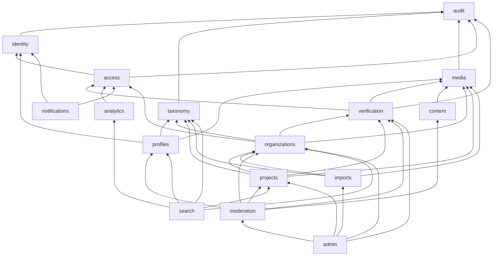
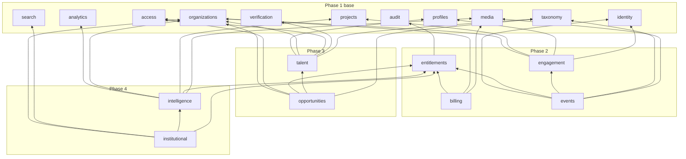
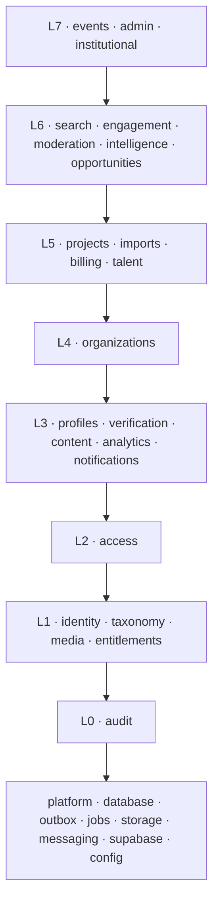
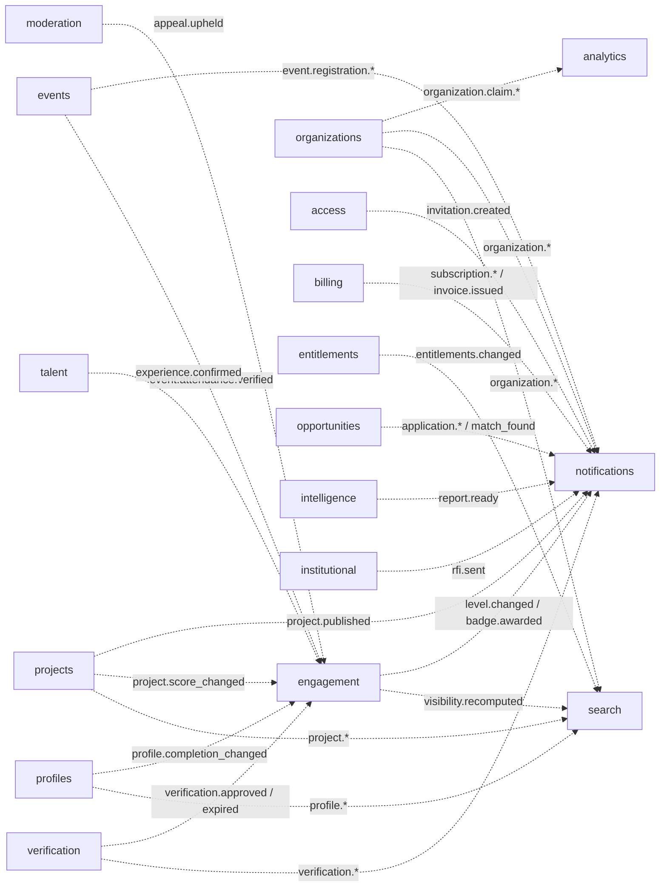
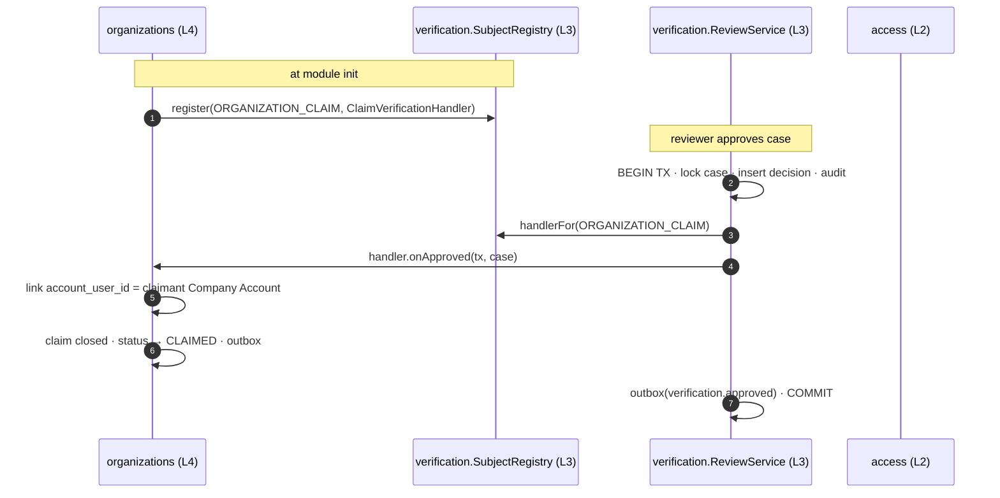

# Module Dependency Map

> `A --> B` means **module A imports module B's public API** (compile-time and Nest DI dependency).
> Every domain module also depends on the platform modules (`database`, `outbox`, `jobs`, `config`, `observability`). Those edges are omitted.
> Dashed arrows are **not imports**: they are domain events delivered through the outbox, or ports implemented by the higher module.

---

## 1. Rules

1. **The graph must stay acyclic.** CI runs `dependency-cruiser` with a `no-circular` rule over `src/modules/**`, plus a check that other modules import only from each module's `index.ts`.
2. **`forwardRef()` is forbidden** in business modules. If you need it, the design is wrong. Use one of the three techniques in §4.
3. **Dependencies point from volatile/specific modules to stable/general ones.** `audit`, `taxonomy`, `identity`, `media` and `entitlements` sit at the bottom; `admin`, `institutional` and `events` at the top.
4. **Writes stay inside the owning module.** Crossing a boundary to *change* state happens through (a) a service call along a declared edge, (b) a port implemented by the higher module, or (c) a domain event.
5. **Leaf consumers** (`notifications`, `analytics` for events, `search` for indexing, `admin`) must never be imported by business modules for side effects. They only listen.

---

## 2. Dependency graphs

### 2.1 Phase 1: core & directory

### 2.2 Phases 2–4 (Phase 1 modules shown as the base)

> **Business rules §11:** `billing` and `entitlements` are deferred. In the MVP no module imports them; the edges above apply only when monetization is built.

### 2.3 Layering (proof of acyclicity)

Every module depends only on modules in **lower** layers.

| Layer | Modules | Depends on layers |
|---|---|---|
| **L0** | `audit` | platform only |
| **L1** | `identity`, `taxonomy`, `media`, `entitlements` | L0 |
| **L2** | `access` | L0–L1 |
| **L3** | `profiles`, `verification`, `content`, `analytics`, `notifications` | L0–L2 |
| **L4** | `organizations` | L0–L3 |
| **L5** | `projects`, `imports`, `billing`, `talent` | L0–L4 |
| **L6** | `search`, `engagement`, `moderation`, `intelligence`, `opportunities` | L0–L5 |
| **L7** | `events`, `admin`, `institutional` | L0–L6 |

---

## 3. Event flows (not dependencies)

These arrows show **who reacts to whom** through the outbox. A consumer never imports the producer for this. It subscribes to the event name and payload type from the producer's `index.ts`, which is a **type-only** import and allowed in any direction. See `domain-events.md`.

**Allowed type-only import exception.** `import type { VerificationApprovedEvent } from '@modules/verification'` is allowed from any module, because event contracts are data, not behaviour. dependency-cruiser is configured with `dependencyTypesNot: ["type-only"]` for the event-contract path.

---

## 4. Potential circular dependencies and how they are solved

### C-1 · `organizations` ⟷ `verification`

**Problem.** Organizations opens verification cases (org → verification). When a reviewer approves a claim, the verification module must create the owner and update the organization's status (verification → org).

**Solution: dependency inversion with a handler registry, run inside the same transaction.**

`verification` defines the `VerificationSubjectHandler` interface. `organizations`, `projects` and `talent` implement it. The **lower** module defines the port and the **higher** module implements it, so the import edge still points downward.

### C-2 · `access` ⟷ `organizations`

**Problem.** Organizations grants owners (org → access). Access needs the organization's **status** (e.g. a suspended or archived company) when resolving permissions (access → org).

**Solution: allowed identity-column join.** `access.MembershipsRepository` reads `organizations.status` through a Prisma relation `include` (read-only). The allow-list of cross-module identity columns is:

| Table | Columns readable by other modules via joins |
|---|---|
| organizations | `id`, `status`, `slug`, `legal_name_*`, `trade_name_*`, `logo_media_id` |
| users | `id`, `status`, `preferred_locale` |
| profiles | `id`, `user_id`, `slug`, `full_name`, `avatar_media_id` |
| company_projects | `id`, `organization_id`, `status`, `slug`, `name_*` |

Anything beyond these columns must go through the owning module's query service. Writes are never allowed.

### C-3 · `organizations` merge ⟷ `projects`, `billing`, `engagement`, …

**Problem.** A merge (ORG-09, T-03) must move rows owned by *other* modules (projects, subscriptions, point ledger subjects, etc.) inside one transaction. But those modules depend on `organizations`, not the other way round.

**Solution: `OrganizationMergeParticipant` port.** `organizations` defines `{ moveToTarget(tx, sourceId, targetId): Promise<void> }` and a registry. `projects`, `billing`, `engagement`, `opportunities`, `intelligence` and `institutional` each register a participant that moves **their own** rows. `access` is **below** `organizations`, so organizations simply calls `access.MembershipsService.mergeMemberships(tx, …)` directly.

### C-4 · `identity` ⟷ `profiles` (onboarding)

**Problem.** Onboarding marks the user onboarded and records consents (identity), and it creates a profile (profiles).

**Solution: put the use case in the higher module.** `profiles.OnboardingService` calls `identity.UsersService.markOnboarded(tx)` and `identity.ConsentsService.record(tx)`. Identity never needs profiles.

### C-5 · `events` ⟷ `engagement`

**Problem.** Ticket eligibility may depend on a member level (events → engagement). Attendance earns points (engagement → events).

**Solution: an event for the reverse direction.** `events` imports `engagement.LevelsQuery`. `engagement` consumes `event.attendance.verified` from the outbox and never imports `events`.

### C-6 · `media` ⟷ every module that stores documents

**Problem.** Deciding whether actor X may download document D depends on what D is attached to (a verification case, a credential, an invoice, a report).

**Solution: `DocumentAccessPolicy` port.** `media` defines the port. `verification`, `organizations`, `billing` and `intelligence` register policies. `media` asks every registered policy and grants access if one allows it, then audits the access.

### C-7 · `search` ⟷ `analytics`

`search` logs `search_performed` through `analytics.AnalyticsIngestService` (search → analytics). `analytics` never needs search. **No cycle**, but keep it that way: zero-result reporting reads `analytics_events`, not `search`.

### C-8 · `notifications` ⟷ everyone

`notifications` imports only `identity` and `access` (to resolve recipients). Every producer reaches it **only through events**. If a module ever calls `NotificationsService` directly, a cycle risk appears. That is forbidden by lint (`notifications` is not exported for business modules).

### C-9 · `moderation` ⟷ modules it acts on

`moderation` reads targets (moderation → organizations, projects, …). Corrective actions are done by the owning modules, either through admin endpoints or by consuming `appeal.upheld` / `abuse_report.resolved`. Moderation never calls a mutating service of a module above or beside it.

---

## 5. Dependency matrix

✅ = direct import · 📨 = consumes events from · 🔌 = implements a port defined by

| Module ↓ depends on → | audit | identity | taxonomy | media | entitlements | access | profiles | verification | analytics | organizations | projects | talent | engagement | search | intelligence |
|---|---|---|---|---|---|---|---|---|---|---|---|---|---|---|---|
| identity | ✅ | | | | | | | | | | | | | | |
| access | ✅ | ✅ | | | | | | | | | | | | | |
| profiles | ✅ | ✅ | ✅ | ✅ | | | | | | | | | | | |
| verification | ✅ | | | ✅ 🔌 | | ✅ | | | | | | | | | |
| organizations | ✅ | | ✅ | ✅ 🔌 | | ✅ | | ✅ 🔌 | | | | | | | |
| projects | ✅ | | ✅ | ✅ | | | | ✅ 🔌 | | ✅ 🔌 📨 | | | | | |
| search | | | ✅ 📨 | | 📨 | | ✅ 📨 | | ✅ | ✅ 📨 | ✅ 📨 | | 📨 | | |
| notifications | | ✅ | | | | ✅ 📨 | | 📨 | | 📨 | 📨 | 📨 | 📨 | | 📨 |
| billing | ✅ | | | ✅ 🔌 | ✅ | | | | | ✅ 🔌 | | | | | |
| engagement | ✅ | ✅ | | | | | ✅ 📨 | 📨 | | ✅ 🔌 📨 | ✅ 📨 | 📨 | | | |
| events | ✅ | ✅ | ✅ | ✅ | ✅ | | | | | | | | ✅ | | |
| talent | ✅ | | ✅ | ✅ | | ✅ | ✅ | ✅ 🔌 | | ✅ | | | | | |
| opportunities | ✅ | | ✅ | ✅ | ✅ | ✅ | ✅ | | | ✅ 🔌 | | ✅ | | | |
| intelligence | ✅ | | | ✅ 🔌 | ✅ | | | | ✅ | ✅ 🔌 | ✅ | | | | |
| institutional | ✅ | | | | ✅ | | | | | ✅ 🔌 | | | | ✅ | ✅ |

---

## 6. How to add a new dependency

1. Check the layer table (§2.3). If the target is in the same or a higher layer, **stop**. Use an event or a port.
2. Add the import only from the target's `index.ts`.
3. Update this document (graph + matrix) in the same pull request.
4. CI (`dependency-cruiser`) must pass.
