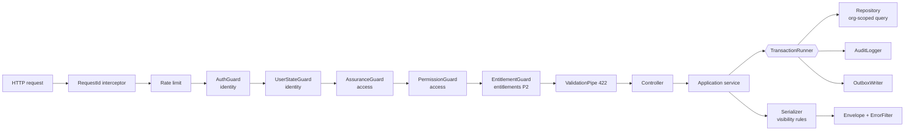

# NestJS Module Map

> **Style:** a modular monolith (PRD §19: "a modular application service that starts as a single organised application before being split into services"; ADR-001).
> Modules follow the **logical units in PRD §19.1** (Identity, Directory, Verification, Membership, Engagement, Community, Talent, Opportunities, Intelligence, Institutional, Admin, Notifications). Where a unit contains several independent concepts with different lifecycles, it is split further (e.g. Directory → taxonomy, organizations, projects, search).
> Dependency rules and the graph: `module-dependency-map.md`.
> **Mandatory business rules:** `business-rules.md` (2026-09-17). ⏸ = designed but deferred; not built unless explicitly requested.

---

## 1. PRD logical units → NestJS modules

| PRD §19.1 unit | Responsibility (PRD) | NestJS modules | Phase |
|---|---|---|---|
| Identity | Users, sessions, permissions | `identity`, `access`, `profiles` | 1 |
| Directory | Companies, classifications, projects, search | `taxonomy`, `organizations`, `projects`, `search`, `imports` | 1 |
| Verification | Requests, evidence, reviews | `verification`, `media` (documents) | 1 |
| Membership | Plans, subscriptions, entitlements | `billing`, `entitlements` ⏸ deferred future monetization (rules §11) | — |
| Engagement | Points, badges, visibility | `engagement` | 2 |
| Community | Events and content | `events` (P2), `content` (P1) | 1–2 |
| Talent | Professionals, employment relationships | `talent` | 3 |
| Opportunities | Opportunities, applications, matching | `opportunities` | 3 |
| Intelligence | Metrics, comparison, reports | `intelligence`, `analytics` (raw events from P1) | 1 / 4 |
| Institutional | Entity workspaces, lists, RFIs | `institutional` (on hold: every organization is a company, BQ-06 → BQ-51) | 4 |
| Admin | Administration, audit, settings | `admin`, `audit`, `moderation` | 1 |
| Notifications | Email, messages, notifications | `notifications` | 1 |

---

## 2. Source tree

> **Amended 2026-10-11 (ADR-031, execution plan v2.2):** controllers and DTOs live in **`src/surfaces/app`** (`/api/app/v1`, Flutter app) and **`src/surfaces/admin`** (`/api/admin/v1`, back-office). They do not live in `modules/<domain>/controllers`. Domain modules hold services, policies, domain rules, repositories, events and handlers only. dependency-cruiser enforces the split (`app-surface-not-admin`, `admin-surface-not-app`, `business-logic-not-surfaces`, `surfaces-use-module-index`), and boot fails if a route sits outside a surface (`src/surfaces/surface-route-check.ts`). Where the tree below shows `controllers/` inside a module, read it as `src/surfaces/<surface>/<feature>/`.

```text
backofhousebackend/
├── prisma/
│   ├── schema/                         # multi-file Prisma schema, one file per module
│   │   ├── _base.prisma                # generator, datasource, shared enums
│   │   ├── identity.prisma
│   │   ├── access.prisma
│   │   ├── organizations.prisma
│   │   └── ...
│   ├── migrations/                     # Prisma Migrate (+ hand-written SQL for CHECK, partial indexes, RLS, triggers)
│   └── seed/                           # taxonomy, levels, point rules, first admin
├── supabase/                           # Supabase CLI config for LOCAL dev only (auth settings, SMS hook, storage buckets)
├── src/
│   ├── main.ts
│   ├── app.module.ts
│   ├── worker.ts                       # second entrypoint: outbox dispatcher + jobs (same codebase)
│   │
│   ├── config/                         # typed, validated env config (fails fast at boot)
│   │   ├── app.config.ts
│   │   ├── database.config.ts
│   │   ├── supabase.config.ts
│   │   └── env.schema.ts
│   │
│   ├── common/                         # framework-level, no business rules
│   │   ├── decorators/                 # @Public @RequirePermission @RequireEntitlement @CurrentActor @AllowIncompleteOnboarding @AuditAction
│   │   ├── guards/                     # guard ORDER is set in app.module (see auth-architecture §2.3)
│   │   ├── filters/                    # global exception → { code, message, trace_id, errors }
│   │   ├── interceptors/               # request-id, logging, response envelope
│   │   ├── pipes/                      # ValidationPipe (422), ParseUuid
│   │   ├── errors/                     # DomainError base + error code registry
│   │   ├── pagination/                 # cursor encode/decode, Page<T>
│   │   ├── i18n/                       # LocalizedText type, locale resolution
│   │   ├── text/                       # Arabic normalisation (alef/hamza/ta marbuta/tashkeel), slugify
│   │   └── context/                    # RequestContext (AsyncLocalStorage): requestId, actor, org
│   │
│   ├── platform/                       # technical infrastructure modules (no business rules)
│   │   ├── database/                   # PrismaService, TransactionRunner (tx propagation via ALS)
│   │   ├── supabase/                   # JWKS verifier, Supabase admin client (auth + storage)
│   │   ├── storage/                    # StoragePort + SupabaseStorageAdapter (signed URLs, buckets)
│   │   ├── messaging/                  # EmailPort, SmsPort + provider adapters
│   │   ├── outbox/                     # OutboxWriter (in-tx), OutboxDispatcher (worker), @OnDomainEvent
│   │   ├── jobs/                       # pg-boss wrapper, @Job handlers, cron schedules
│   │   ├── idempotency/                # Idempotency-Key interceptor (Phase 2)
│   │   ├── observability/              # pino logger with redaction, health checks, metrics
│   │   └── rate-limit/                 # throttler config
│   │
│   ├── surfaces/                       # ADR-031: HTTP only, one folder per client
│   │   ├── app/                        # /api/app/v1 — Flutter app (members, Company Accounts)
│   │   └── admin/                      # /api/admin/v1 — admin back-office (staff)
│   │
│   └── modules/                        # business domains (no controllers)
│       ├── identity/
│       ├── access/
│       ├── profiles/
│       ├── taxonomy/
│       ├── media/
│       ├── organizations/
│       ├── projects/
│       ├── verification/
│       ├── search/
│       ├── content/
│       ├── moderation/
│       ├── notifications/
│       ├── audit/
│       ├── analytics/
│       ├── imports/
│       ├── admin/
│       ├── entitlements/               # ⏸ deferred — future monetization (rules §11)
│       ├── billing/                    # ⏸ deferred — future monetization (rules §11)
│       ├── engagement/                 # Phase 2
│       ├── events/                     # Phase 2
│       ├── talent/                     # Phase 3
│       ├── opportunities/              # Phase 3
│       ├── intelligence/               # Phase 4
│       └── institutional/              # Phase 4
│
└── test/
    ├── e2e/                            # critical journeys (§20.2)
    ├── authz/                          # permission matrix: positive + NEGATIVE tests (§20.1)
    └── factories/
```

### 2.1 Internal layout of a module (example: `organizations`)

```text
modules/organizations/
├── organizations.module.ts
├── index.ts                        # PUBLIC API: only what other modules may import
├── controllers/
│   ├── public-companies.controller.ts      # /companies (public read)
│   ├── organizations.controller.ts         # /organizations/:organizationId
│   ├── organization-claims.controller.ts   # /companies/:id/claims, /me/claims
│   └── admin-organizations.controller.ts   # /admin/organizations
├── services/                       # application services: use cases + transactions
│   ├── organizations.service.ts
│   ├── organization-claims.service.ts
│   ├── organization-merges.service.ts
│   └── organizations.query.ts      # read-only service exported to other modules
├── domain/                         # pure logic, no Nest or Prisma imports → unit-tested
│   ├── organization-status.ts      # derive status from facts (ADR-018)
│   ├── completion-score.ts
│   └── duplicate-matching.ts
├── policies/                       # resource-level authorization rules
├── repositories/                   # Prisma access; every tenant query takes organizationId
├── dto/                            # request/response DTOs (class-validator)
├── events/                         # event names + payload types this module EMITS
├── handlers/                       # subscribers for events this module CONSUMES
│   └── claim-verification.handler.ts   # implements VerificationSubjectHandler
└── __tests__/
```

**Module rules**
1. Other modules import **only from `index.ts`**, which exports a module's query services, ports and event types. Enforced by an ESLint `no-restricted-imports` / dependency-cruiser rule.
2. **A module writes only to its own tables** (table ownership in `database-entities.md`).
3. Reads of another module's data go through that module's exported **query service**. One pragmatic exception: Prisma relation `include`s of **identity columns** (`id`, `type`, `status`, `slug`, names) of another module's table are allowed for joins (see `module-dependency-map.md` §3).
4. Side effects in another module happen through **domain events** (outbox) or a **registered port** (dependency inversion). A direct call to a mutating service is allowed only along a declared dependency edge.
5. `domain/` has no framework imports.

---

## 3. Platform modules

| Module | Responsibility | Used by | External integration |
|---|---|---|---|
| `config` | Load and validate env (zod). Typed config namespaces | all | — |
| `database` | `PrismaService`; `TransactionRunner.run(fn)` that propagates the transaction through AsyncLocalStorage, so audit and outbox writes join the caller's transaction | all domain modules | Supabase Postgres (Supavisor) |
| `supabase` | JWT verification via JWKS; Supabase admin client | identity, media/storage | Supabase Auth, Supabase Storage |
| `storage` | `StoragePort`: signed upload URLs, move between buckets, signed download URLs | media | Supabase Storage |
| `messaging` | `EmailPort`, `SmsPort` | notifications | Email provider, Saudi SMS provider (§15.2) |
| `outbox` | `OutboxWriter.emit(event)` in the transaction; `OutboxDispatcher` (worker) delivers to `@OnDomainEvent` handlers with retries | all domain modules | — |
| `jobs` | pg-boss queues + cron (expiry, staleness, decay, renewals, reconciliation) | many | — |
| `idempotency` | `Idempotency-Key` header support (§15.1) | billing, events, engagement admin | — |
| `observability` | Structured logs with **secret and PII redaction** (§28), health endpoints, metrics, trace id | all | Monitoring provider (TQ-09) |
| `rate-limit` | Throttling per IP, user and route class | global | — |

---

## 4. Domain modules

Each entry lists: **responsibility · entities owned · controllers · services · data access · dependencies · events emitted · events consumed · external integrations.**

### 4.1 `identity`: Phase 1

| Aspect | Detail |
|---|---|
| Responsibility | App-side identity: user record, **account type and security context** (INDIVIDUAL / COMPANY, BQ-60), consents, account state, session revocation. Provides `AccountContextGuard`. Authentication is done by Supabase (ADR-003) |
| Entities owned | `users`, `consents` |
| Controllers | `MeController` (`/me`, `/me/consents`, `/me/sessions`), `AdminUsersController` (`/admin/users`) |
| Services | `UsersService` (upsert from token, `markOnboarded(tx)`, suspend/reinstate), `ConsentsService` (`record(tx, …)`), `SessionsService` (revoke through the Supabase admin API) |
| Guards provided | `AuthGuard` (JWKS verify + `session_id` check), `UserStateGuard` |
| Data access | `UsersRepository`, `ConsentsRepository` |
| Depends on | platform: database, supabase, outbox · `audit` |
| Emits | `user.registered`, `user.onboarding.completed`, `user.suspended`, `user.reinstated`, `user.sessions.revoked`, `consent.changed` |
| Consumes | — |
| External | Supabase Auth (admin API, JWKS) |

### 4.2 `access`: Phase 1

| Aspect | Detail |
|---|---|
| Responsibility | Authorization: the permission catalog, platform staff roles, `CompanyAccountGuard` (the company's single Company Account, BQ-68), **Individual company memberships** (affiliation only, public team visibility, BQ-64), invitations (candidate flow, BQ-75). Never grants company permissions from memberships (BQ-60) |
| Entities owned | `user_platform_roles`, `organization_members`, `invitations` |
| Controllers | `OrganizationMembersController` (`/organizations/:organizationId/members`), `InvitationsController` (`/organizations/:organizationId/invitations`, `/invitations/:token/accept`), `MyCompanyController` (`/me/company`, `/me/company-memberships`), `AdminStaffRolesController` |
| Services | `AccessService` (resolve permissions; request-scoped cache), `CompanyAccountGuard`, `MembershipsService` (Individual memberships, public team visibility), `InvitationsService`, `StaffRolesService`, `PermissionCatalog` (code) |
| Guards provided | `AssuranceGuard` (aal2), `PermissionGuard` |
| Data access | `MembershipsRepository` (joins `organizations.status`, an allowed identity-column read; company access via `account_user_id`, BQ-68), `InvitationsRepository`, `StaffRolesRepository` |
| Depends on | platform · `identity` (user lookup for invitation matching) · `audit` |
| Emits | `invitation.created`, `invitation.accepted`, `invitation.revoked`, `membership.created`, `membership.role_changed`, `membership.removed`, `membership.expired`, `organization.owner_granted`, `staff_role.granted`, `staff_role.revoked` |
| Consumes | `user.suspended` (suspend memberships? **no**, access is blocked by UserStateGuard; recorded only) |
| Scheduled jobs | Expire memberships and invitations (§12.3) |
| External | — |

### 4.3 `profiles`: Phase 1

| Aspect | Detail |
|---|---|
| Responsibility | **Individual account** profile: name, headline, skills, cities, languages, privacy, completion score (§5.1). Hosts the registration use cases for both flows (`RegistrationService`: individual → profile; company → delegates company creation to `organizations`)* |
| Entities owned | `profiles`, `profile_skills`, `profile_locations` |
| Controllers | `RegistrationController` (`POST /registration/individual`, `POST /registration/company`), `MyProfileController` (`/me/profile`), `PublicProfilesController` (`/professionals/:slug`, **Phase 3**) |
| Services | `OnboardingService` (one transaction: `identity.UsersService.markOnboarded` + `identity.ConsentsService.record` + create profile + audit + outbox), `ProfilesService`, `ProfileCompletionCalculator` (domain), `ProfilesQuery` (exported) |
| Depends on | platform · `identity` · `taxonomy` · `media` · `audit` |
| Emits | `profile.updated`, `profile.completion_changed`, `profile.visibility_changed` |
| Consumes | `user.suspended` (hide from search) |
| Note | Onboarding lives here, not in `identity`, because it creates a profile. `profiles → identity` is the only allowed direction (`identity` must never import `profiles`) |

\* `profiles` imports `organizations` only for the company registration flow; if this creates a dependency cycle, the company flow moves to `organizations` (which already depends on lower layers). Decide at implementation.

### 4.4 `taxonomy`: Phase 1

| Aspect | Detail |
|---|---|
| Responsibility | Categories tree, services, regions and cities, skills, **industries** (BQ-63). Seeded before development (§26 P0) |
| Entities owned | `categories`, `services`, `locations`, `skills` |
| Controllers | `TaxonomyController` (`/categories`, `/services`, `/locations`, `/skills`: public), `AdminTaxonomyController` |
| Services | `CategoriesService`, `ServicesService`, `LocationsService`, `SkillsService`, `TaxonomyQuery` (exported, cached in memory per instance with a short time-to-live) |
| Depends on | platform · `audit` |
| Emits | `taxonomy.changed` (search reindex) |
| Consumes | — |
| External | Maps/addresses (§15.2 Phase 1–2), optional |

### 4.5 `media`: Phase 1

| Aspect | Detail |
|---|---|
| Responsibility | Upload lifecycle for public media and private documents: signed upload, quarantine, scan, hashing, signed download URLs with audit (§18) |
| Entities owned | `media_assets`, `documents` |
| Controllers | `UploadsController` (`POST /uploads`, `POST /uploads/:id/complete`), `DocumentAccessController` (`GET /documents/:id/access-url`) |
| Services | `UploadsService`, `MediaService`, `DocumentsService` (access check through registered `DocumentAccessPolicy` ports), `FileScanJob`, `PerceptualHashJob` |
| Depends on | platform: storage, jobs · `audit` |
| Emits | `media.ready`, `media.rejected`, `document.accessed` |
| Consumes | — |
| External | Supabase Storage; malware scanner (TQ-10) |

### 4.6 `organizations`: Phase 1

| Aspect | Detail |
|---|---|
| Responsibility | Company records — every organization is a company (BQ-06), classified by `company_type` (rules §2, never a permission source) — (ORG-01..10), claims (§5.2), creation by the owner with duplicate check (§5.3, BQ-05), **admin approval** (BQ-05, separate from verification, BQ-46), independent **verification signals** (BQ-47), ownership transfer (BQ-56), merges (ORG-09), correction suggestions (§4), status derivation (ADR-018), public company read model |
| Entities owned | `organizations`, `organization_contacts`, `organization_services`, `organization_coverage`, `organization_credentials`, `organization_media`, `organization_claims`, `organization_approvals`, `organization_merges`, `correction_suggestions` |
| Controllers | `PublicCompaniesController` (`/companies/:slug`), `OrganizationsController`, `OrganizationClaimsController`, `CorrectionSuggestionsController`, `OrganizationApprovalsController` (`/organizations/:organizationId/approval-requests`), `AdminOrganizationApprovalsController`, `AdminOrganizationsController` (suspend, archive, merges, duplicates, owner transfer) |
| Services | `OrganizationsService`, `OrganizationApprovalsService` (T-29), `OwnershipTransferService` (T-30), `OrganizationClaimsService`, `DuplicateDetectionService`, `OrganizationMergesService`, `OrganizationStatusService`, `CredentialsService`, `OrganizationsQuery` (exported) |
| Handlers | `ClaimVerificationHandler` (ownership only), `RegistrationSignalHandler`, `DomainSignalHandler`, `CredentialSignalHandler`, `ContactSignalHandler` (implement `VerificationSubjectHandler`, registered with `verification`) |
| Depends on | platform · `access` (grant ownership) · `taxonomy` · `media` · `verification` (open cases, register handlers) · `audit` |
| Emits | `organization.created`, `organization.updated`, `organization.status_changed`, `organization.claim.submitted`, `organization.claim.approved`, `organization.claim.rejected`, `organization.approval.submitted`, `organization.approved`, `organization.approval.changes_requested`, `organization.approval.rejected`, `organization.ownership.transferred`, `organization.verification_signal.approved`, `organization.verification_signal.expired`, `organization.verified`, `organization.merged`, `organization.credential.expiring`, `organization.needs_update` |
| Consumes | `media.rejected` (clear logo/cover) |
| Scheduled jobs | Credential expiry alerts, staleness check (ORG-08) |
| External | — |

### 4.7 `projects` (Company Projects / portfolio): Phase 1

| Aspect | Detail |
|---|---|
| Responsibility | A company's **past work** — portfolio and case studies (§7.3, business rules §4). Not an Opportunity, not a Job; no dependency on `opportunities`. Client name optional. Mandatory and quality fields, client disclosure, review workflow, completion score and project points score (≤ 50), fingerprint |
| Entities owned | `company_projects`, `company_project_services`, `company_project_media` |
| Controllers | `OrganizationProjectsController` (`/organizations/:organizationId/projects`), `PublicProjectsController` (`/companies/:slug/projects`, `/companies/:slug/projects/:projectId`), `AdminProjectsController` (review queue) |
| Services | `ProjectsService`, `ProjectReviewService`, `ProjectScoreCalculator` (domain), `ProjectsQuery` (exported) |
| Handlers | `ProjectVerificationHandler`, `ProjectClientVerificationHandler` |
| Depends on | platform · `organizations` (query: org exists, status) · `taxonomy` · `media` · `verification` · `audit` |
| Emits | `project.submitted`, `project.published`, `project.changes_requested`, `project.rejected`, `project.archived`, `project.score_changed` |
| Consumes | `organization.status_changed` (hide projects of suspended or archived organizations from public) |
| Ports implemented | `OrganizationMergeParticipant`: moves its own `company_projects` rows to the target organization **inside** the merge transaction (T-03). The port is defined by `organizations` and registered by `projects`, so `organizations` never imports `projects` |

### 4.8 `verification`: Phase 1

| Aspect | Detail |
|---|---|
| Responsibility | Generic verification engine: cases, evidence, reviewer queue with SLA, decisions and history, expiry. Decisions are always made by a `VERIFICATION_REVIEWER` or `SYSTEM_ADMIN` in Phase 1 (BQ-48). Company approval is **not** handled here (BQ-46). **Knows nothing about subjects**: subject modules register handlers |
| Entities owned | `verifications`, `verification_documents`, `verification_decisions` |
| Controllers | `MyVerificationsController` (`/me/verifications`, applicant actions), `OrganizationVerificationsController` (`/organizations/:organizationId/verifications`), `AdminVerificationsController` (queue, assign, approve, request-info, reject) |
| Services | `VerificationsService` (open, attach, submit, respond), `ReviewService` (decide, runs the handler **inside the transaction**), `VerificationSubjectRegistry`, `VerificationExpiryJob` |
| Ports exported | `VerificationSubjectHandler { type; onApproved(tx, case); onRejected(tx, case); onExpired(tx, case); canView(actor, case) }` |
| Depends on | platform · `media` (documents) · `access` (conflict-of-interest: is the reviewer a member of the subject organization?) · `audit` |
| Emits | `verification.submitted`, `verification.info_requested`, `verification.approved`, `verification.rejected`, `verification.expired` |
| Consumes | — |

### 4.9 `search`: Phase 1

| Aspect | Detail |
|---|---|
| Responsibility | Public directory search (§7.4): public-only projection, Arabic/English normalisation, filters, default sort by relevance + visibility, SEO data (sitemaps) |
| Entities owned | `search_documents` |
| Controllers | `CompanySearchController` (`GET /companies`), `ProfessionalSearchController` (`GET /professionals`, Phase 3), `SeoController` (`GET /seo/sitemap-entries`) |
| Services | `SearchIndexer` (build projection), `CompanySearchService`, `SearchQueryBuilder` |
| Depends on | platform · `organizations` (query) · `projects` (query) · `profiles` (query) · `taxonomy` · `analytics` (log `search_performed`, zero results) |
| Emits | — |
| Consumes | `organization.*`, `project.published/archived`, `profile.updated/visibility_changed`, `taxonomy.changed`, `visibility.recomputed` (P2), `entitlements.changed` (P2, sponsored label) |
| External | — (a dedicated search engine is deferred, ADR-012) |

### 4.10 `content`: Phase 1

| Aspect | Detail |
|---|---|
| Responsibility | Pages and news, bilingual, SEO (§13) |
| Entities owned | `content_items` |
| Controllers | `PublicContentController` (`/news`, `/news/:slug`, `/pages/:slug`), `AdminContentController` |
| Services | `ContentService` |
| Depends on | platform · `media` · `audit` |
| Emits | `content.published` |
| Consumes | — |

### 4.11 `moderation`: Phase 1

| Aspect | Detail |
|---|---|
| Responsibility | Abuse reports (§13, §23) and appeals (§8.6, §13) |
| Entities owned | `abuse_reports`, `appeals` |
| Controllers | `AbuseReportsController` (`POST /abuse-reports`), `AppealsController` (`POST /appeals`, `/me/appeals`), `AdminModerationController` |
| Services | `AbuseReportsService`, `AppealsService` |
| Depends on | platform · `organizations` / `projects` / `profiles` / `content` queries (target existence) · `verification` (decision lookup) · `audit` |
| Emits | `abuse_report.created`, `abuse_report.resolved`, `appeal.submitted`, `appeal.upheld`, `appeal.denied` |
| Consumes | — |

Corrective actions after an upheld appeal (e.g. a point reversal, lifting a suspension) are carried out **by the owning module**, either by consuming `appeal.upheld` or through an admin endpoint. `moderation` never writes other modules' tables.

### 4.12 `notifications`: Phase 1

| Aspect | Detail |
|---|---|
| Responsibility | In-app notifications, email/SMS delivery, preferences, bilingual templates |
| Entities owned | `notifications`, `notification_deliveries`, `notification_preferences` |
| Controllers | `MyNotificationsController` (`/me/notifications`, `/me/notification-preferences`) |
| Services | `NotificationsService`, `NotificationRouter` (event → recipients → channels), `TemplateRenderer`, `DeliveryJob` |
| Depends on | platform: messaging, jobs · `identity` (recipient locale and contacts) · `access` (resolve organization owners and members as recipients) |
| Emits | — |
| Consumes | **Leaf consumer.** Catalog RG-14. Phase 1: `organization.claim.approved/rejected`, `verification.info_requested/approved/rejected`, `invitation.created`, `project.published/changes_requested/rejected`, `organization.credential.expiring`, `organization.needs_update`, `abuse_report.resolved`, `appeal.upheld/denied`. Later phases: billing, events, opportunities, reports |
| External | Email provider, SMS provider |

### 4.13 `audit`: Phase 1 (data_exports in Phase 4)

| Aspect | Detail |
|---|---|
| Responsibility | Append-only audit log and export log; audit search for auditors |
| Entities owned | `audit_logs`, `data_exports` (P4) |
| Controllers | `AdminAuditController` (`/admin/audit-logs`, `/admin/data-exports`) |
| Services | `AuditLogger.record(tx, entry)` (**synchronous, same transaction**), `AuditQueryService`, `ExportLogService` |
| Depends on | platform: database only (**leaf**, so everyone can depend on it) |
| Emits / Consumes | — / — |

### 4.14 `analytics`: Phase 1

| Aspect | Detail |
|---|---|
| Responsibility | First-party analytics events from the §16 dictionary; visitor id; bot and internal-traffic flags; forwarding to a product analytics provider |
| Entities owned | `analytics_events` |
| Controllers | `AnalyticsController` (`POST /analytics/events`: public, rate-limited, batched) |
| Services | `AnalyticsIngestService` (validate event names, attach `is_internal`), `AnalyticsForwarder` (job) |
| Depends on | platform · `access` (query: is the viewer a member of the viewed organization → internal, §16.1) |
| Emits / Consumes | — / `organization.claim.submitted/approved` → `profile_claim_started/completed` server events; `project.published` → `project_published` |
| External | Product analytics provider (§15.2) |

### 4.15 `imports`: Phase 1

| Aspect | Detail |
|---|---|
| Responsibility | Bulk company import with preview, validation, duplicate detection, commit, rollback, quality report (§22.1) |
| Entities owned | `import_batches`, `import_rows` |
| Controllers | `AdminImportsController` |
| Services | `ImportParser` (format RG-09), `ImportPreviewService`, `ImportCommitJob`, `ImportRollbackService` |
| Depends on | platform · `organizations` (create UNCLAIMED, duplicate detection) · `taxonomy` · `media` (source file as document) · `audit` |
| Emits | `import.previewed`, `import.committed`, `import.rolled_back` |

### 4.16 `admin`: Phase 1

| Aspect | Detail |
|---|---|
| Responsibility | **Thin.** Admin dashboard aggregates (queue sizes, SLA breaches, counts) and operational endpoints that belong to no single domain. Domain admin endpoints live in their own modules |
| Entities owned | — |
| Controllers | `AdminDashboardController` (`/admin/dashboard`) |
| Depends on | query services of `verification`, `organizations`, `projects`, `moderation`, `imports` (**leaf: nothing depends on admin**) |

### 4.17 `entitlements`: ⏸ DEFERRED (future monetization, business rules §11)

| Aspect | Detail |
|---|---|
| Responsibility | The single answer to "does subject S have feature F, and with what limit?" (§14 `entitlements`) |
| Entities owned | `entitlements` |
| Controllers | `OrganizationEntitlementsController` (`/organizations/:organizationId/entitlements`), `AdminEntitlementsController` (exemptions, manual grants) |
| Services | `EntitlementsService.check/limit/usage`, `EntitlementsRecalculator(tx, subscriber)` |
| Decorator | `@RequireEntitlement(featureKey)` |
| Depends on | platform · `audit` (**near-leaf**: billing, events, opportunities, intelligence and institutional depend on it) |
| Emits | `entitlements.changed` |

### 4.18 `billing`: ⏸ DEFERRED (future monetization, business rules §11)

> No payment gateway, invoices, wallets, commissions or subscriptions are built now. The design below is kept only as a compatibility reference. Future `promotions` (featured opportunities, featured companies, sponsored content) would be a **separate** module that never writes verification, trust points or organic ranking (rules §12).


| Aspect | Detail |
|---|---|
| Responsibility | Plan catalog, subscriptions, trials, upgrades and downgrades, renewals, grace period, cancellation, invoices, payments, coupons, payment webhooks (§7.5) |
| Entities owned | `membership_plans`, `plan_features`, `subscriptions`, `invoices`, `payments`, `coupons`, `coupon_redemptions`, `payment_provider_events`, `idempotency_records` (via platform/idempotency) |
| Controllers | `PlansController` (`/membership-plans`), `OrganizationSubscriptionController`, `InvoicesController`, `PaymentWebhooksController` (`/webhooks/payments/:provider`), `AdminBillingController` |
| Services | `SubscriptionsService`, `CheckoutService`, `RenewalJob`, `DunningJob`, `InvoicingService`, `CouponsService`, `PaymentGatewayPort` + adapter, `EInvoicingPort` + adapter |
| Depends on | platform · `entitlements` · `organizations` (query) · `media` (invoice PDF) · `audit` |
| Emits | `subscription.started`, `subscription.renewed`, `subscription.plan_changed`, `subscription.grace_started`, `subscription.past_due`, `subscription.cancelled`, `subscription.expired`, `payment.succeeded`, `payment.failed`, `invoice.issued`, `coupon.redeemed` |
| External | Saudi payment gateway, e-invoicing/accounting (§15.2, TQ-18) |

### 4.19 `engagement`: Phase 2

| Aspect | Detail |
|---|---|
| Responsibility | Points ledger, balances, rules and versions, caps and anti-abuse, levels, badges, visibility score (§8, §9.1). Full design: `points-architecture.md` |
| Entities owned | `point_rules`, `point_rule_versions`, `point_ledger`, `point_balances`, `member_levels`, `level_assignments`, `badges`, `badge_awards`, `visibility_snapshots`, `engagement_alerts` |
| Controllers | `MyEngagementController` (`/me/points`, `/me/level`, `/me/badges`), `OrganizationEngagementController`, `PublicLevelsController` (`/levels`, `/badges`), `AdminPointsController`, `AdminLevelsController`, `AdminBadgesController`, `AdminVisibilityController` |
| Services | `PointsService.award/deduct/reverse`, `PointRuleEngine`, `CapGuard`, `ComputedScoreSync` (company components → ledger deltas), `LevelsService`, `BadgesService`, `VisibilityCalculator`, `ReconciliationJob`, `AnomalyDetectionJob`, `LevelsQuery` (exported) |
| Depends on | platform · `organizations` / `projects` / `profiles` / `identity` queries (score inputs) · `audit` |
| Emits | `points.credited`, `points.debited`, `points.reversed`, `points.balance_frozen`, `level.changed`, `level.review_requested`, `badge.awarded`, `badge.revoked`, `visibility.recomputed`, `engagement.anomaly_detected` |
| Consumes | `verification.approved/expired` (TRUST), `profile.completion_changed`, `organization.updated` (completion), `project.score_changed/archived` (PROJECTS), `event.attendance.verified` (ACTIVITY), `experience.confirmed` (P3 TRUST/EXPERIENCE), `opportunity.published` (P3 org RECENT_ACTIVITY), `appeal.upheld` (reversal) |

### 4.20 `events`: Phase 2

| Aspect | Detail |
|---|---|
| Responsibility | Events, ticket types and eligibility, capacity and waitlist, cancellation and transfer, entry codes, check-in, attendance verification, feedback, certificates, event reports (§9.2) |
| Entities owned | `events`, `event_ticket_types`, `event_speakers`, `event_sponsors`, `event_registrations`, `event_feedback` |
| Controllers | `PublicEventsController` (`/events`), `EventRegistrationsController` (`/events/:eventId/registrations`, `/me/event-registrations`), `AdminEventsController` (CRUD, publish, check-in, reports) |
| Services | `EventsService`, `RegistrationService` (capacity lock, T-11), `WaitlistService` (T-12), `CheckInService` (T-13), `CertificateJob`, `EventReportsQuery` |
| Depends on | platform · `identity` · `entitlements` (eligibility) · `engagement` (LevelsQuery for eligibility) · `taxonomy` · `media` · `audit` |
| Emits | `event.published`, `event.cancelled`, `event.completed`, `event.registration.confirmed`, `event.registration.waitlisted`, `event.registration.promoted`, `event.registration.cancelled`, `event.registration.transferred`, `event.attendance.verified`, `event.feedback.submitted`, `event.certificate.issued` |
| External | Signed entry codes / QR (§15.2 Phase 2) |

### 4.21 `talent`: Phase 3

| Aspect | Detail |
|---|---|
| Responsibility | Professional profile extensions (§10.1): experiences with company confirmation, education, certifications, profile projects, media portfolio, section privacy |
| Entities owned | `experiences`, `educations`, `user_certifications`, `profile_projects`, `profile_media` |
| Controllers | `MyTalentController` (`/me/experiences`, `/me/educations`, …), `OrganizationEmploymentConfirmationsController` |
| Services | `ExperiencesService`, `EmploymentConfirmationService` (T-24), `TalentQuery` |
| Handlers | `ExperienceVerificationHandler` |
| Depends on | platform · `profiles` · `organizations` (query) · `access` (permission `organization.employment.confirm`) · `verification` · `taxonomy` · `media` · `audit` |
| Emits | `experience.confirmation_requested`, `experience.confirmed`, `experience.declined`, `talent.profile_updated` |
| Consumes | — |

### 4.22 `opportunities`: Phase 3 — unified model (business rules §5–§9)

| Aspect | Detail |
|---|---|
| Responsibility | **One** Opportunity model for JOB, CO_OP, VOLUNTEERING and SUPPLIER_REQUEST (PROJECT is company portfolio, not an opportunity — BQ-62). Supplier requests are visible to Company Accounts only (BQ-65); any company may respond (BQ-66); application statuses are flexible (BQ-67). A single **type policy map** decides audience (INDIVIDUAL / COMPANY), who may respond and required fields. Individual applications with the one status model (rules §8). B2B supplier responses (rules §7). Company opportunity management kept simple (rules §9) |
| Entities owned | `opportunities`, `opportunity_skills`, `opportunity_services`, `applications`, `supplier_responses` · ⏸ deferred: `application_messages`, `opportunity_feedback` |
| Controllers | `PublicOpportunitiesController` (`/opportunities`, individual audience), `SupplierRequestsController` (`/supplier-requests`, company audience), `OrganizationOpportunitiesController`, `ApplicationsController`, `SupplierResponsesController`, `AdminOpportunitiesController` |
| Services | `OpportunitiesService`, `OpportunityTypePolicy` (single source of type rules), `ApplicationsService` (T-17, status changes), `SupplierResponsesService` (T-31) |
| Deferred (rules §9) | Messaging, interview scheduling, offers, matching and match notifications, surveys, recruitment analytics |
| Depends on | platform · `organizations` (query: status, company type for display) · `access` · `profiles` (query) · `taxonomy` · `media` · `audit` |
| Emits | `opportunity.published`, `opportunity.paused`, `opportunity.closed`, `application.submitted`, `application.status_changed`, `application.withdrawn`, `supplier_response.submitted`, `supplier_response.withdrawn` |

### 4.23 `intelligence`: Phase 4

| Aspect | Detail |
|---|---|
| Responsibility | Metric dictionary, metric facts (rollups of analytics and domain data), benchmark sets (3 competitors, 90-day rule), direct comparison (public data), anonymous benchmarks (sample ≥ 5), report generation and expiry, authorised exports (§11, §12.2) |
| Entities owned | `metric_definitions`, `metric_facts`, `benchmark_sets`, `benchmark_set_members`, `reports` |
| Controllers | `OrganizationReportsController`, `BenchmarkSetController`, `MarketReportsController`, `AdminMetricsController`, `AdminReportsController` |
| Services | `MetricRollupJob`, `BenchmarkService` (T-19), `ComparisonService`, `ReportGenerationJob`, `ExportService` (T-20, writes via `audit.ExportLogService`) |
| Depends on | platform · `analytics` (raw) · `organizations` / `projects` (query) · `entitlements` · `media` · `audit` |
| Emits | `report.requested`, `report.ready`, `report.failed`, `report.exported`, `benchmark.competitor_changed` |
| External | PDF/XLSX generation (TQ-20) |

### 4.24 `institutional`: Phase 4

| Aspect | Detail |
|---|---|
| Responsibility | ⚠️ **On hold (BQ-51)** — no institution organizations exist (BQ-06). Planned buyer features: advanced search, supplier lists and internal notes, side-by-side comparison, saved searches and alerts, RFIs, access log view (§12.1) |
| Entities owned | `saved_lists`, `saved_list_items`, `saved_searches`, `rfis`, `rfi_recipients` |
| Controllers | `SavedListsController`, `SavedSearchesController`, `RfisController` (institution side), `IncomingRfisController` (company side), `InstitutionAccessLogController` |
| Services | `SavedListsService`, `SavedSearchAlertJob`, `RfisService` |
| Depends on | platform · `organizations` (query) · `search` (advanced query) · `intelligence` (comparison) · `entitlements` · `audit` |
| Emits | `rfi.sent`, `rfi.responded`, `saved_search.matches_found` |

### 4.25 Phase 5 (placeholders, not designed; RG-19)

| Module | Purpose |
|---|---|
| `observatory` | Aggregated sector data, time-series indicators, periodic reports (§6 Phase 5) |
| `partner-api` | Partner integration API, API clients and keys, signed outbound webhooks (§15.1, §15.2) |

---

## 5. Cross-cutting request flow



## 6. Deployment units

| Unit | Entrypoint | Runs |
|---|---|---|
| **api** | `src/main.ts` | HTTP controllers only |
| **worker** | `src/worker.ts` | Outbox dispatcher, pg-boss job handlers, cron schedules |

Both are built from the **same codebase and modules**. Splitting them keeps slow jobs (reports, scans, recalculation) away from request latency (§17 "stateless services, queues for heavy tasks"). Phase 1 may run both in one process when traffic is small. The split is a configuration flag, not a code change.
