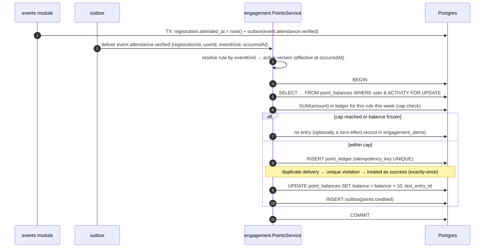
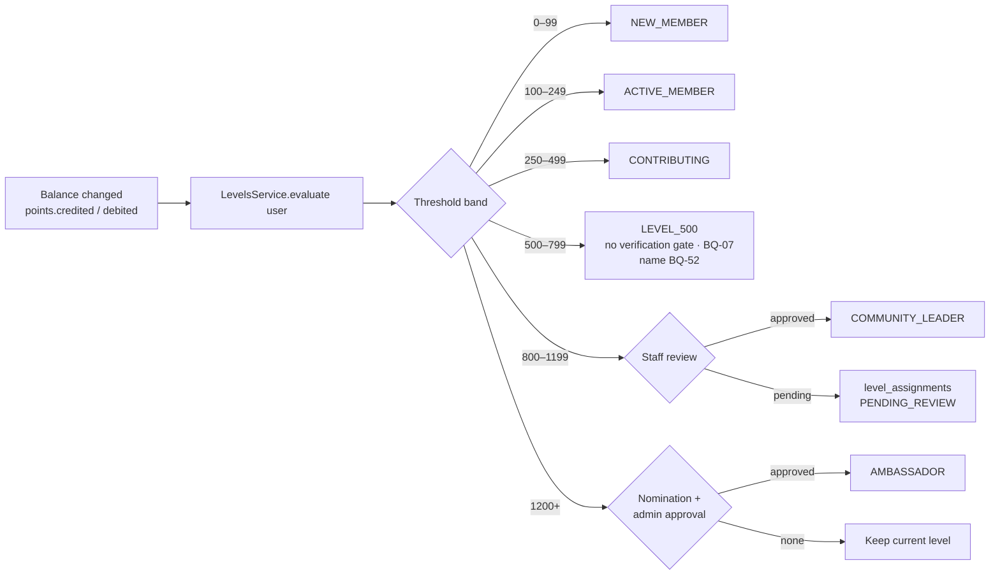

# Points, Levels, Badges & Visibility Architecture

> PRD sources: §7.3 (project points), §8.1–8.6 (points, trust, visibility, decay, anti-abuse), §9.1 (levels), §13 (admin: rules, versions, ledger, reversal, alerts), §14 (`point_rules`, `point_ledger`, `badges`, `badge_awards`, `visibility_snapshots`), §20.2 ("a movement happens once, can be explained and can be reversed"; "no points for booking without attendance"), §24 (manipulation risk).
> Module: `engagement` (Phase 2). Decisions: ADR-014. Decided: BQ-07 (verification independent of points and levels), BQ-08 (points are not a currency). Open: BQ-09..13, BQ-40, BQ-52, RG-16, RG-22..24, TQ-13, TQ-14.

---

## 1. Points are not trust, verification, visibility or membership

```text
 VERIFICATION ─────────────►  facts: "this evidence was checked"          (verification module)
      │ approved case
      ▼
 TRUST points  ─────────────►  PRD §8.1: trust is its OWN balance         (engagement · category TRUST)
 ACTIVITY / CONTRIBUTION /
 EXPERIENCE / PROJECTS /
 PROFILE_COMPLETION points ─►  engagement value                           (engagement · other categories)
      │ inputs (weighted, capped, decayed)
      ▼
 VISIBILITY score ──────────►  one ranking signal, never a guarantee      (engagement → search)

 MEMBERSHIP (paid) ─────────►  entitlements + a LABELLED partner badge    (billing/entitlements)
                               ✗ never a point · ✗ never trust · ✗ never organic score
```

| Rule | PRD |
|---|---|
| Activity does not equal trust; each has an independent balance | §8.1 |
| Sponsorship buys **declared visibility**, never credibility | §8.1, §7.5 |
| No points for signing in alone or for low-quality interaction | §8.1 |
| Every movement goes to a ledger that is not directly editable; corrections are reverse movements | §8.1, §29.2 |
| Rules and versions are kept so any historical result can be explained | §8.1 |
| Paid visibility is separate, clearly labelled, and excluded from trust | §8.3 |
| Verification is independent of points and levels: no level requires verification, and no amount of points means "verified" | Decision BQ-07 |
| Points are used for levels and benefits only. They are never spent, redeemed or exchanged | Decision BQ-08 |
| Points represent activity and engagement and **unlock** Levels, Rewards and Benefits without ever being deducted; they never grant verification, and paying or being featured never grants verification | Business rules §10, BQ-59 |

**Never model points as `users.points = 320`.** A balance is a *projection* of the ledger (§3).

---

## 2. Core flow

```text
Business fact (verified)          e.g. attendance verified for registration R
        │
        ▼
Point rule (active version)       MEMBER_MEETUP_ATTENDED v3 → +10, weekly cap 40
        │   + eligibility: requires verification? requires review? once-only?
        │   + cap check (daily/weekly/lifetime) under lock
        │   + idempotency key  "MEMBER_MEETUP_ATTENDED:R"
        ▼
Point ledger entry (append-only)  CREDIT +10  ACTIVITY  source=event_registration:R  rule_version=v3
        │
        ▼
Balance projection                point_balances(user, ACTIVITY) += 10   (same transaction)
        │
        ├──► Level evaluation      (§9.1 thresholds + gates)
        ├──► Badge evaluation      (criteria RG-16)
        └──► Visibility recompute  (§8.4 weights · §8.5 decay) → search ranking signal
```



---

## 3. Data model (owned by `engagement`)

| Table | Role | Mutability |
|---|---|---|
| `point_rules` | Named way to earn or lose points; subject type + category | Mutable metadata (`is_active`) |
| `point_rule_versions` | Values: points, caps, gates, effective period | **Immutable once effective** |
| `point_ledger` | **Source of truth**; every movement | **Append-only** (DB privileges revoked) |
| `point_balances` | Projection: balance per subject × category; freeze flag | Updated only with a ledger insert; rebuildable |
| `member_levels` | §9.1 thresholds and gates | Staff-managed |
| `level_assignments` | Level history per user, review status | Append-mostly |
| `badges` / `badge_awards` | Definitions; award and revoke history | Awards revoked, never deleted |
| `visibility_snapshots` | Score + component breakdown + formula version | Append-only; `is_current` flag |
| `engagement_alerts` | Anomalies and reconciliation mismatches | Status workflow |

Full field lists: `database-entities.md` §14.

---

## 4. Earning rules

### 4.1 Member points (§8.2)

| Category | PRD examples | Values (PRD) | Cap / control (PRD) | Trigger event | Rule codes (proposed) |
|---|---|---|---|---|---|
| `PROFILE_COMPLETION` | Photo, bio, skills, languages | ❓ not given | **Once** per item | `profile.completion_changed` | `MEMBER_PROFILE_PHOTO`, `MEMBER_PROFILE_BIO`, `MEMBER_PROFILE_SKILLS`, `MEMBER_PROFILE_LANGUAGES` (`max_per_subject = 1`) |
| `ACTIVITY` | Meetup attendance **10**, workshop **15**, accepted content **8** | 10 / 15 / 8 | **Weekly cap** (value ❓ BQ-10) | `event.attendance.verified`; accepted content ❓ BQ-34 | `MEMBER_MEETUP_ATTENDED`, `MEMBER_WORKSHOP_ATTENDED` |
| `TRUST` | Identity **20**, employer **25**, organization confirmation **20** | 20 / 25 / 20 | **After verification** | `verification.approved` (USER_IDENTITY), `experience.confirmed` (P3) | `MEMBER_IDENTITY_VERIFIED`, `MEMBER_EMPLOYER_VERIFIED`, `MEMBER_ORG_CONFIRMED` |
| `EXPERIENCE` | Previous experience **10**, documented project **15–30** | 10 / 15–30 | By quality of evidence (criteria ❓ BQ-10) | `verification.approved` (USER_EXPERIENCE), P3 profile projects | `MEMBER_EXPERIENCE_VERIFIED`, `MEMBER_DOCUMENTED_PROJECT` (amount chosen by reviewer within 15–30) |
| `CONTRIBUTION` | Volunteering, training, helpful answer, initiative | ❓ | **Review or confirmation** | ❓ RG-23, BQ-34 | Not seeded until defined |
| `PENALTY` | Misleading content, manipulation, repeated attendance cancellation | ❓ | **Deduction or freeze** | Admin decision; `event.registration.cancelled` pattern ❓ | `MEMBER_PENALTY_MISLEADING`, `MEMBER_PENALTY_MANIPULATION`, `MEMBER_PENALTY_REPEATED_CANCELLATION` |

**Explicitly never earns points:** signing in (§8.1), registering for an event without attending (§9.2), low-quality interaction (§8.1).

### 4.2 Company points (§8.3)

| Component (category) | Max | PRD notes | Mode |
|---|---|---|---|
| `PROFILE_COMPLETION` | **100** | From basic fields, verification and freshness | **Computed** |
| `PROJECTS` | **300** | Top **10** projects; each **≤ 50** (§7.3) | **Computed** |
| `TRUST` | **100** | Registration, domain, licenses, contact confirmation — **one rule per independent signal** (BQ-47): `ORG_REGISTRATION_VERIFIED`, `ORG_DOMAIN_VERIFIED`, `ORG_CREDENTIAL_VERIFIED`, `ORG_CONTACT_VERIFIED`; values BQ-10. Company **approval** earns nothing (BQ-46) | **Event** (signal approved or expired) with component cap |
| `RECENT_ACTIVITY` | **100** | Updates, opportunities, responsiveness within a time window (RG-24) | **Event** + time window |
| `CONTRIBUTION` | **100** | Training, jobs, data, hosting, support | **Event** with review (RG-23) |
| Paid visibility | **separate** | Clearly labelled; never part of trust | **Not points.** Entitlement only |

### 4.3 Two earning modes

**(A) Event mode.** A discrete fact produces one entry. The key is `RULE_CODE:source_id`.

**(B) Computed mode** (TQ-13). Some company components are *scores that can go up and down* (profile completeness, project quality). §8.1 still requires every movement in the ledger, so the engine **recomputes and writes the difference**:

```text
on organization.updated / project.score_changed / nightly:
    target  = min(cap, calculate(component, current data))        # e.g. PROJECTS = Σ top-10 project scores ≤ 300
    current = point_balances(org, component).balance
    delta   = target - current
    if delta ≠ 0:
        INSERT point_ledger(entry_type = delta > 0 ? CREDIT : DEBIT,
                            amount = delta,
                            rule_version = ORG_<COMPONENT>_SYNC vN,
                            source_type = 'score_sync',
                            idempotency_key = 'ORG_<COMPONENT>_SYNC:<org>:<input_hash>')
```

The history then shows *why* a company's project points went from 180 to 210 on a given date: the source is the input hash, and the snapshot of project scores is kept in the entry's metadata.

---

## 5. Deductions, freezes, reversals

| Operation | Ledger effect | Who | Transaction |
|---|---|---|---|
| **Penalty** (§8.2) | `DEBIT` with a negative amount, `rule_version` = penalty rule, `reason` required | `SYSTEM_ADMIN` / moderation decision | T-08 |
| **Freeze** (§8.2 "or freeze") | No entry. `point_balances.frozen_at` set on all subject categories; new credits are **skipped** while frozen (❓ whether frozen points also drop out of visibility: proposed **yes**) | `SYSTEM_ADMIN` | audited |
| **Reversal** (§8.1) | `REVERSAL` with `amount = -original.amount`, `reverses_entry_id = original.id` (unique → at most once) | System (verification expired, appeal upheld, attendance undone) or admin with reason | T-09 |
| **Manual adjustment** (§13 "correction") | `CREDIT`/`DEBIT` with no rule version, `reason` required, `created_by` = admin | `SYSTEM_ADMIN` + `Idempotency-Key` | T-08 |
| **Rule value change** | **No retroactive change.** A new `point_rule_versions` row applies from `effective_from`. Past entries keep their original version | `SYSTEM_ADMIN` | audited |

Automatic reversal triggers:

| Trigger | Reversed entries |
|---|---|
| `verification.expired` / trust evidence revoked | TRUST entries whose `source_id` = that verification |
| `appeal.upheld` on a `POINT_LEDGER_ENTRY` | That entry |
| Attendance cancelled by admin (check-in error) | ACTIVITY entry for that registration |
| Duplicate media or project confirmed (§8.6) | Entries sourced from the duplicate |

---

## 6. Balance calculation

```sql
-- Source of truth (used by reconciliation and explainability)
SELECT category, SUM(amount) AS balance
FROM point_ledger
WHERE subject_user_id = $1
GROUP BY category;

-- Fast path (used by APIs): point_balances, maintained in the SAME transaction as each insert.
```

| Concern | Approach |
|---|---|
| Concurrency | `SELECT … FOR UPDATE` on the `point_balances` row (created lazily with an `INSERT … ON CONFLICT DO NOTHING` first) |
| Exactly once | `UNIQUE (idempotency_key)` → a duplicate delivery is a no-op success |
| Drift | Nightly `ReconciliationJob` compares `SUM(ledger)` with the projection; a mismatch → `engagement_alerts(BALANCE_MISMATCH)` + rebuild |
| Total per member | Σ categories (**which categories count toward level → BQ-09**) |
| Negative balances | Allowed in `PENALTY`. Whether other categories may go below 0 → proposed **no** (DEBIT is clamped to the balance and the clamp is recorded in `reason`) |

---

## 7. Caps and windows

| Cap | Stored in | Enforcement |
|---|---|---|
| Once per subject | `point_rule_versions.max_per_subject = 1` | `COUNT` of non-reversed entries for the rule and subject under the balance lock |
| Daily / weekly (§8.6) | `daily_cap`, `weekly_cap` (points) | `SUM(amount)` for the rule (or category) within the window under the lock |
| Component maximum (company §8.3) | Rule metadata `component_cap` | Computed mode uses `min(cap, target)`; event mode clamps at the cap |
| Top-10 projects (§7.3) | Calculator | Only the 10 highest project scores (weighted by recency and verification, BQ-12) count |

Window boundaries use **Asia/Riyadh** calendar days and weeks (Saturday or Sunday week start → proposed Sunday; confirm).

---

## 8. Levels (§9.1)



- Automatic levels (1–4) are assigned by the system from points alone. §9.1's verification condition on the 500–799 level is **removed** by decision BQ-07; its name is pending BQ-52.
- **Upper levels require human review** (§8.6): COMMUNITY_LEADER needs review, AMBASSADOR needs nomination and admin approval, "administrative not automatic" (§9.1).
- **Downgrade policy** when points fall (penalty or reversal) → ❓ BQ-09. Proposed: automatic levels follow the balance; review-based levels are revoked only by a staff decision.
- Level **benefits** (RG-22) are expressed as entitlement-like eligibility checks (e.g. `event_ticket_types.min_level_id`), never as roles.

---

## 9. Badges

- Catalog and criteria: RG-16. `badges.is_manual` supports staff-awarded badges immediately. `criteria` (jsonb) supports automatic badges once they are defined.
- Awards and revocations are recorded (§14 "granting **and revoking** badges"), with a reason on revocation.
- The **paid partner badge is not a badge row**. It is rendered from the `directory.partner_badge` entitlement and **labelled as paid** (§7.5).

---

## 10. Visibility score (§8.4, §8.5)

### 10.1 Formulas

```text
Company visibility (0–100)  =  30% × ProfileCompletion/100
                             + 25% × Trust/100
                             + 20% × ProjectQuality/300
                             + 15% × RecentActivity_decayed/100
                             + 10% × Contribution/100

Professional visibility (0–100) = 30% × Trust
                                + 25% × ProfileCompletion
                                + 20% × VerifiedExperience
                                + 15% × Contribution
                                + 10% × RecentActivity_decayed
                                (each component normalised to 0–1; maximums for individuals → BQ-11)
```

### 10.2 Activity decay (§8.5)

| Age of activity | Weight |
|---|---|
| 0–30 days | 100% |
| 31–90 days | 70% |
| 91–180 days | 40% |
| > 180 days | 20% |

```sql
-- decayed recent activity for an organization (component input)
SELECT SUM(amount * CASE
          WHEN occurred_at >= now() - interval '30 days'  THEN 1.0
          WHEN occurred_at >= now() - interval '90 days'  THEN 0.7
          WHEN occurred_at >= now() - interval '180 days' THEN 0.4
          ELSE 0.2 END)
FROM point_ledger
WHERE subject_organization_id = $1 AND category = 'RECENT_ACTIVITY';
```

Decay is **applied at calculation time**. Ledger amounts are never mutated. Decay applies to the **activity** component only (§8.5 is titled "activity decay"); whether it also applies to contribution → ❓ (proposed no).

### 10.3 Worked example (company)

| Component | Raw | Max | Normalised | Weight | Contribution |
|---|---|---|---|---|---|
| Profile completion | 80 | 100 | 0.80 | 30% | 24.0 |
| Trust | 60 | 100 | 0.60 | 25% | 15.0 |
| Project quality (top 10) | 210 | 300 | 0.70 | 20% | 14.0 |
| Recent activity (decayed) | 50 | 100 | 0.50 | 15% | 7.5 |
| Contribution | 20 | 100 | 0.20 | 10% | 2.0 |
| **Visibility** | | | | | **62.5** |

### 10.4 Recompute and use

- **When** (TQ-14): after relevant events (debounced per subject, e.g. 5 minutes) + a **nightly** full recompute (decay changes daily).
- **Stored** as a `visibility_snapshots` row (components JSON + `formula_version = company-v1`), with the previous snapshot's `is_current` set to false, then copied to `search_documents.visibility_score` through `visibility.recomputed`.
- **Used** by search as one signal: `final_rank = f(text relevance, filter match on specialty/city/language/availability, visibility_score)`. A higher score **does not guarantee first place** (§8.4). Sponsored results are **labelled** and **not** blended into this score.
- **Explainable** to staff: `GET /admin/visibility/:subjectType/:subjectId` returns the snapshot components and the contributing ledger entries.

---

## 11. Rewards

> **Decisions BQ-08 (2026-09-15) and BQ-59 (2026-09-17):** points are **not a currency** and are **never deducted** when a Reward is used. Points **unlock** Levels, Rewards and Benefits.

- `rewards` is a **catalog of unlockable benefits** (`database-entities.md`). A reward is unlocked when the subject reaches `unlock_level_id` or `unlock_min_points`. Unlocking is **computed**; there is no redemption row, no spendable balance and no "spend points" endpoint.
- A `DEBIT` in the ledger only ever means a **penalty** or a **decrease of a computed score**. It never means spending.
- **Profile Highlight** (`PROFILE_HIGHLIGHT`) is a reward benefit. It is **separate from Verification** and from **Featured / Promoted** paid placement: the API exposes it as its own `highlight` field with its own label. Unlock level, activation, duration and whether it affects ranking → **BQ-71**.
- **Companies to Watch** is a discovery section, not a reward and not paid placement (criteria → BQ-70).
- Level **benefits** (§9.1, RG-22) are also delivered as eligibility checks (e.g. `event_ticket_types.min_level_id`), without consuming points.
- "Coupons & perks" (§6) belong to deferred **billing** (rules §11), not to points.

## 12. Anti-abuse (§8.6)

| PRD control | Implementation |
|---|---|
| Daily and weekly limits | `daily_cap` / `weekly_cap` on rule versions, enforced under the balance lock (§7) |
| Unique events marked with a non-repeat key | `point_ledger.idempotency_key` UNIQUE; `reverses_entry_id` UNIQUE |
| Detect mutual recommendations and linked accounts | ❓ RG-06. No recommendation feature exists. Linked-account signals (shared verified phone or email domain patterns, same device or anonymous id across accounts) → `engagement_alerts(LINKED_ACCOUNTS)` for review. **No automatic penalty** |
| Fingerprints for images and projects | `media_assets.content_sha256` + `perceptual_hash`; `projects.fingerprint`. Duplicates across organizations → `engagement_alerts(DUPLICATE_MEDIA/DUPLICATE_PROJECT)`; points for the duplicate are held until reviewed |
| Human review for upper levels | `level_assignments.status = PENDING_REVIEW` (§8) |
| Alert on abnormal changes in points or visibility | Nightly `AnomalyDetectionJob`: z-score or threshold on daily delta per subject → `engagement_alerts` |
| Appeal with a decision record | `appeals` (moderation) → `appeal.upheld` → reversal (T-09) |
| Attendance-only points (§9.2, §20.2) | ACTIVITY event rules subscribe **only** to `event.attendance.verified` |
| Owner/staff activity not inflating metrics (§16.1) | `analytics_events.is_internal` excluded from RECENT_ACTIVITY inputs derived from analytics |

---

## 13. Explainability and audit

| Question | Answer from |
|---|---|
| "Why does member X have 340 points?" | `point_ledger` entries with rule code + version + source + reason |
| "Why did company Y's visibility drop last week?" | Two `visibility_snapshots` compared by component |
| "What was the rule value on 2026-11-02?" | `point_rule_versions` effective at that timestamp |
| "Who changed a rule, reversed an entry, froze a balance?" | `audit_logs` (every admin engagement mutation) |

---

## 14. Testing checklist (§20.1, §20.2)

- [ ] The same `event.attendance.verified` delivered twice → exactly one ledger entry
- [ ] Registration without attendance → zero entries
- [ ] Reversal of a reversal → rejected; reversing the same entry twice → rejected
- [ ] Weekly cap reached → no entry beyond the cap; the next week earns again
- [ ] Rule version changed → old entries keep their version; new entries use the new one
- [ ] Balance projection equals `SUM(ledger)` after concurrent awards (parallel test)
- [ ] Frozen subject → credits skipped
- [ ] Paid subscription change → zero TRUST entries and no visibility component change
- [ ] Level evaluation never reads verification state (BQ-07)
- [ ] Company approval (T-29) produces no ledger entry; each approved signal produces exactly one TRUST entry (BQ-46, BQ-47)
- [ ] No endpoint or service debits points for anything other than a penalty, reversal or score decrease (BQ-08)
- [ ] Visibility snapshot reproducible from its components and formula version
