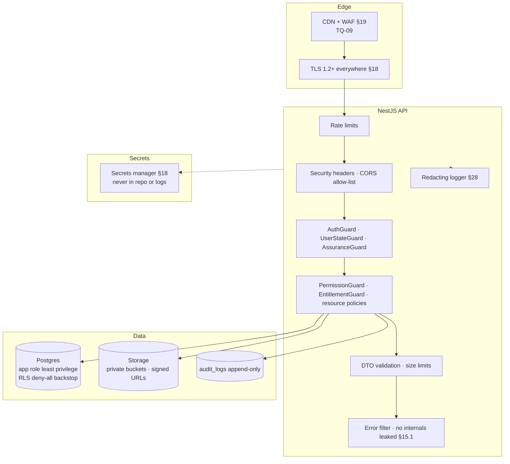
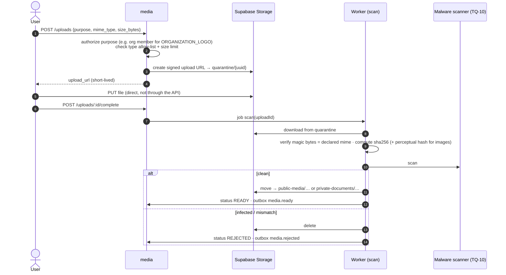

# Security & Audit Architecture

> PRD sources: §4 (server- and query-level enforcement), §12.3 (usage limits), §15.1 (errors, idempotency, signed webhooks), §17 (non-functional), §18 (security, privacy, PDPL), §18.1 (data classification), §20 (security tests), §23.1 (incident priorities), §28 (Definition of Done: no sensitive data in logs).
> This document **identifies** mechanisms and their phase. Mechanisms marked *later* are not built until needed.

---

## 1. Security layers

---

## 2. Authentication security

| Control | Mechanism | Phase | PRD |
|---|---|---|---|
| No active account without verification | Supabase OTP; the `users` row is created only from a verified token | 1 | AUTH-01 |
| OTP brute force | Supabase OTP rate limits + attempt limits; API throttles on `/me` bootstrap | 1 | AUTH-04 |
| Session theft | Short access-token lifetime (10 min recommended); refresh-token rotation with reuse detection (Supabase); `session_id` checked on each request | 1 | AUTH-02 |
| Terminate all sessions | `DELETE /me/sessions`; admin revocation | 1 | AUTH-02 |
| MFA for sensitive roles | `aal2` enforced for staff roles. "Entities" (AUTH-03) depend on BQ-51 | 1 | AUTH-03 |
| Password policy (passwords are used, BQ-30) | Minimum length, leaked-password protection, attempt limits (Supabase settings) | 1 | AUTH-04 |
| Password recovery | One-time code to the confirmed email or phone; all other sessions revoked after a reset; identical responses whether or not the account exists | 1 | AUTH-02, AUTH-04, BQ-30 |
| Token validation | Asymmetric JWT signing keys; JWKS cached; `iss`, `aud`, `exp` checked; HS256 shared secret not used | 1 | §18 |
| Account enumeration | OTP request responses are identical whether or not the account exists (Supabase behaviour; verify configuration) | 1 | OWASP |
| Sign-in logging | Supabase auth audit log + mirrored `audit_logs` entries for sign-in of staff users | 1 | §18 |

## 3. Authorization security

| Control | Mechanism |
|---|---|
| Deny by default | Startup check: every route has `@Public()` or `@AccountContext()` + `@RequirePermission()` where applicable |
| Account context separation (BQ-60, BQ-68) | `AccountContextGuard`: Individual tokens never reach company routes and Company tokens never reach individual routes. `CompanyAccountGuard`: company routes only for the company's own Company Account (`account_user_id`). Members (Individual accounts) never gain company permissions. Negative tests for all directions |
| Server- **and query-level** enforcement (§4) | Guards + repositories that require `organizationId` / owner id |
| No id probing | Cross-organization access returns 404 |
| Negative tests (§20.1) | `test/authz/` suite generated from the permission matrix: every role × every endpoint, **including the must-fail cases** |
| Periodic access review (§12.3, §18) | Report of staff roles and company memberships with `last_reviewed_at`; automatic expiry job (never expires an owner) |
| Conflict of interest | A reviewer cannot decide a case they requested or one about an organization they belong to |
| Least privilege for staff | Four separate staff roles; `AUDITOR` read-only |

---

## 4. Sensitive operations and audit requirements

Every row below writes `audit_logs` **in the same transaction**. "Reason" = the caller must supply a free-text reason.

| Area | Operation | Reason required | Extra | Phase |
|---|---|---|---|---|
| **Authentication** | Staff sign-in; sign-in failures above threshold | — | Mirrored from the auth provider | 1 |
| | Revoke all sessions (self/admin) | admin: ✅ | | 1 |
| **Accounts** | Suspend / reinstate user | ✅ | Sessions revoked | 1 |
| | Account deletion / anonymisation | ✅ | Later (AUTH-06) | Later |
| **Roles & permissions** (§18) | Grant / revoke staff role | ✅ | MFA of actor | 1 |
| | Membership created / removed / public visibility changed | admin: ✅ | Memberships grant no permissions (BQ-68) | 1 |
| | Permission grant / revoke (delegation) | — | | 1 |
| | Invitation created / revoked / accepted | — | Invitee contact **masked** in `changes` | 1 |
| **Company ownership** | Claim approved / rejected → owner granted | ✅ (reject) | Automated check results referenced | 1 |
| | Company approval decision: approve / request changes / reject (T-29) | changes, reject: ✅ | Approval sets no verification (BQ-46) | 1 |
| | Admin ownership flow (T-30) | ✅ | Old and new Company Account recorded; process BQ-56 | 1 |
| | Companies to Watch admin picks (add / remove) | ✅ | Neutral, not paid (BQ-70) | 1 |
| | Merge approved / executed | ✅ | Moved child counts | 1 |
| | Suspend / unsuspend / archive organization | ✅ | | 1 |
| **Verification** (§5.2) | Every decision (approve / request info / reject / expire) | reject, request-info: ✅ | `verification_decisions` also kept | 1 |
| | **Access to a sensitive document** (signed URL issued) | — | `action = document.access` | 1 |
| **Data changes** | Organization profile, contacts, credentials, visibility settings | — | Redacted before/after | 1 |
| | Project review decisions | changes/reject: ✅ | | 1 |
| | Taxonomy changes | — | | 1 |
| | Import commit / rollback | — | Batch counts | 1 |
| **Moderation** | Abuse report resolution; appeal decision | ✅ | | 1 |
| **Billing** ⏸ deferred | Plan / feature changes; coupon creation; exemptions and manual grants; manual subscription approval; refunds | ✅ (exemption, grant, refund) | Amounts | 2 |
| **Points** (§8.1, §13) | Rule version created; manual adjustment; reversal; freeze / unfreeze; level approval; ambassador assignment; badge award / revoke | ✅ (all manual) | Ledger itself is also immutable | 2 |
| **Events** | Manual check-in; attendance removal | ✅ (removal) | | 2 |
| **Opportunities** | Application status changes by the company; supplier response submit / withdraw; opportunity unpublish by staff | staff: ✅ | Company decides; platform never decides (rules §8) | 3 |
| **Exports & reports** (§12.3) | Every export (organization, user, date, purpose, format, row count, watermark) | purpose: ✅ | `data_exports` + audit | 4 |
| | Report regeneration | ✅ | | 4 |
| **Buyer access log** (§12.1, on hold BQ-51) | Buyer user views a company profile / runs advanced search / exports | — | Scope RG-18; high volume → may go to a partitioned log | 4 |
| **Admin** | Any `/admin/*` mutation not listed above | ✅ | | all |

### 4.1 Audit record rules

- **Immutable:** the app DB role has only `INSERT, SELECT` on `audit_logs`, `point_ledger`, `consents`, `verification_decisions` and `data_exports`. A trigger additionally raises on UPDATE or DELETE (defence in depth).
- **Redaction:** `changes` never contains document contents, full phone numbers, full emails of third parties, tokens, or secrets. A shared `redact()` helper has a field deny-list, and unit tests cover it.
- **Correlation:** `request_id` links the audit row to logs, the outbox event and the error response `trace_id`.
- **Access:** `AUDITOR` and `SYSTEM_ADMIN` only, through `/admin/audit-logs` (which itself logs `audit.search` for auditor queries on personal data).
- **Retention and scale:** monthly partitions once volume warrants; retention per BQ-33.

---

## 5. Rate limiting and abuse prevention

| Surface | Limit (initial proposal) | Key | Phase |
|---|---|---|---|
| Auth OTP send/verify | Supabase project limits (tighten from defaults) | phone / email / IP | 1 |
| Public search `GET /companies` | 60 / min | IP (+ anonymous id) | 1 |
| Public profile views | 120 / min | IP | 1 |
| `POST /analytics/events` | 30 batches / min, max 50 events per batch | anonymous id + IP | 1 |
| Authenticated writes | 60 / min | user | 1 |
| Claims, organization creation, abuse reports, appeals | 5 / hour | user | 1 |
| Uploads | 30 / hour, size limits per purpose | user | 1 |
| Document access URLs | 60 / hour | user | 1 |
| Invitations | 50 / day per organization | organization | 1 |
| Exports | Plan quota + monitoring (§4, BQ-38) | organization + user | 4 |
| Webhooks | Signature required; unsigned → 401, counted | provider | 2 |

**Anti-scraping (§2.2 "no bulk download of personal data", §12.3):** individuals' contact data is never in list responses; contact reveal is per profile, logged (`contact_clicked`) and rate-limited; cursor pagination with a maximum page size; no "export all companies" endpoint.

**Directory integrity abuse:** duplicate detection (ORG-09), claim checks (§5.2), perceptual hashes (§8.6), abuse reports with SLA (§23), impersonation reports handled within 24 h.

---

## 6. Input validation

| Layer | Rule |
|---|---|
| DTOs | `class-validator` with `whitelist: true, forbidNonWhitelisted: true` (unknown fields rejected); explicit max lengths on every string; UUID validation on ids |
| Body size | Global JSON limit (e.g. 256 KB); uploads never go through the API (signed direct upload) |
| Rich text (news/pages, descriptions) | Stored as Markdown or sanitised HTML allow-list; sanitised again on render by clients |
| JSONB fields (`capacity`, `field_visibility`, `section_visibility`, `agenda`, `answers`) | Validated against a schema (zod) before persistence |
| URLs (`website_url`, `official_url`, `external_url`) | `https` only; host validation; never fetched server-side without an SSRF guard (no server-side fetch planned) |
| Search input | Parameterised queries only; `q` length ≤ 200; normalisation before `to_tsquery` (escape operators) |
| Raw SQL | Only through Prisma tagged templates (`$queryRaw\`…\``); `$queryRawUnsafe` forbidden by lint |
| Errors | Validation → 422 with field map; never echo stack traces or SQL (§15.1) |

---

## 7. File and document handling (§18)

| Rule | Detail |
|---|---|
| Buckets | `quarantine` (private, 24 h lifecycle), `public-media` (public read: logos, covers, published project media), `private-documents` (**private**: CR, authorization letters, identity evidence, invoices), `reports` (private, Phase 4) |
| Type allow-lists | Images: JPEG, PNG, WebP. Documents: PDF, JPEG, PNG. Video: MP4 (or external links). SVG **not accepted** (script risk) |
| Size limits | Images ≤ 5 MB; documents ≤ 10 MB; video ≤ 100 MB (or external link only; decide) |
| Metadata stripping | EXIF removed from public images (location privacy) |
| Private access | Only through `GET /documents/:id/access-url`: authorization via `DocumentAccessPolicy`, URL lifetime ≤ 5 min, **audited** |
| Public media for unpublished entities | Stored in `public-media` under unguessable UUID paths. Stricter isolation would require private storage until publish (decide per purpose) |
| Encryption | At rest by the storage provider; app-level envelope encryption for identity documents → TQ-11 |
| Retention | `documents.retention_until`; purge job deletes the object and marks the row DELETED (BQ-33) |

---

## 8. Data privacy (PDPL, §18, §18.1)

### 8.1 Classification applied

| Class | Examples in this schema | Handling |
|---|---|---|
| **Public** | Organization names, services, coverage, published projects (without undisclosed client), public contacts, published content | May be indexed (`search_documents`), cached, shown to visitors |
| **Internal** | Detailed point entries, internal notes, verification internal notes, engagement alerts, admin dashboards | Staff with permission only; never in public DTOs |
| **Confidential** | Commercial registration documents, authorization letters, invoices, payment references | Private bucket, signed URLs, access audited, minimum staff |
| **Personal** | User email and phone, identity evidence, experiences, applications, messages, analytics linked to a user | Purpose + consent + data-subject rights; masked in logs; not bulk-exportable |
| **Aggregated** | Metric facts for benchmarks, market reports | Minimum sample 5 (§11.3), minimum event thresholds, no re-identification |

### 8.2 Privacy controls

| Requirement (§18) | Implementation |
|---|---|
| Legal basis and purpose per data category; minimisation | Data dictionary annotates each column's class and purpose (Phase 0 deliverable); DTOs expose only what the purpose needs |
| Consent and preferences (§5.1) | `consents` append-only with policy version; analytics linking only after consent (§16.1) |
| Encryption in transit and at rest | TLS; Supabase disk encryption; private storage |
| Short-lived access links for sensitive documents | ≤ 5 min signed URLs |
| Rights: access, correction, objection, deletion (§18 retention and rights policy) | AUTH-06 **later**: export and anonymisation workflows; correction through normal edits; objection through `appeals` / support |
| Individuals' contact data not shown without a legal basis or consent (§12.3) | Contact fields are not part of public or institution DTOs unless the user made them public |
| Unique visitors without aggressive fingerprinting (§16.1) | Random time-limited anonymous id; no device fingerprinting |
| No sale or bulk download of personal databases (§2.2) | No such endpoints; export API excludes personal data of individuals |
| Client names | Never exposed unless DISCLOSED/CONFIRMED (§7.3, §27) |
| Logs | Pino redaction paths: `authorization`, `cookie`, `password`, `token`, `email`, `phone`, `*.document*`; request bodies not logged by default (§28) |

---

## 9. Secrets and configuration

| Rule | Detail |
|---|---|
| Storage | Hosting platform secrets manager (TQ-09); local `.env` git-ignored; `.env.example` committed without values |
| Supabase `service_role` key | **Server only.** Used just for the admin auth API and storage admin operations; never sent to clients; never used for DB queries (Prisma uses the dedicated DB role) |
| Rotation | DB passwords, provider API keys and webhook secrets rotatable without a deploy (read at boot, restart) |
| Validation | Boot fails if a required secret is missing (config schema) |
| CI | Secret scanning (e.g. gitleaks) on every push |

---

## 10. Webhooks and idempotency (§15.1)

| Direction | Control |
|---|---|
| Inbound (payment gateway, SMS delivery receipts) | Verify signature and timestamp tolerance; store in `payment_provider_events` with a unique provider event id; process in a transaction; respond 2xx only after persisting |
| Outbound (Phase 5 partners) | HMAC-SHA256 signature + timestamp + event id; retries with backoff (TQ-24) |
| Client idempotency | `Idempotency-Key` required for payments, check-in and admin point adjustments; stored response replayed for 24 h (TQ-21) |

---

## 11. Security testing and operations

| Activity | When | PRD |
|---|---|---|
| Negative authorization tests | Every PR (CI) | §20.1 |
| Dependency and vulnerability scanning (`npm audit` / Dependabot / Snyk) | Every PR + weekly | §18 OWASP |
| Static analysis (ESLint security rules, no `$queryRawUnsafe`) | Every PR | §18 |
| Upload tests (malware sample EICAR, type spoofing, oversize) | Before Phase 1 launch | §20.1 |
| Rate-limit tests | Before Phase 1 launch | §20.1 |
| Penetration test | Before the institutional launch (Phase 4) and after major changes | §18 |
| Backup restore test | Quarterly | §17 |
| Incident response plan (P1 immediate + executive escalation; P2 1 h; P3 1 business day) | Before production | §18, §23.1 |
| Staff and institution account review | Periodic (cadence BQ-43) | §18 |

---

## 12. Deferred mechanisms (identified, not built yet)

| Mechanism | Trigger to build |
|---|---|
| Redis / shared rate-limit store | More than one API instance (TQ-16) |
| WAF rules beyond platform defaults | Public launch traffic patterns |
| App-level document encryption | Before identity verification goes live (TQ-11) |
| Institutional read-access logging at scale | Phase 4 (RG-18) |
| DLP / watermark service for exports | Phase 4 (RG-27) |
| Anomaly detection for points | Phase 2 |
| Data-subject request automation | AUTH-06 (later) |
