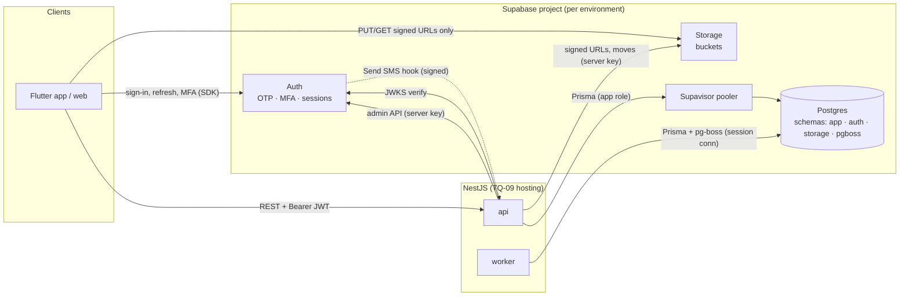

# Supabase Architecture

> Supabase provides **PostgreSQL**, **Auth** and **Storage** for Back Of House. **NestJS remains the application**: all business logic, authorization and data access go through the API.
> Decisions: ADR-002 (Prisma), ADR-003 (Supabase Auth), ADR-007 (schema + RLS), ADR-009 (storage). Open: TQ-09 (hosting), TQ-22/23 (versions), BQ-31 (region), BQ-32 (RPO/RTO).
>
> ⚠️ Supabase and Prisma move fast. Connection-string formats, pooler options, key formats and Prisma configuration **must be checked against current documentation when the project is set up**, and the chosen versions recorded in ADR-002.

---

## 1. What Supabase is used for (and not)

| Supabase capability | Used? | How |
|---|---|---|
| **Postgres** | ✅ | Primary transactional database. Prisma from NestJS |
| **Auth** | ✅ (recommended, ADR-003) | Identity, OTP, sessions, MFA. NestJS verifies JWTs and authorizes |
| **Storage** | ✅ | Public media + private documents; accessed by NestJS with the server key; clients use **signed** URLs only |
| **Data API (PostgREST / GraphQL)** | ❌ | Clients never query the DB directly. App tables live in a schema that is **not exposed** |
| **Realtime** | ❌ | No PRD requirement |
| **Edge Functions** | ❌ (optional) | Only if the *Send SMS* auth hook needs a lightweight endpoint. It can equally be a NestJS route |
| **Row Level Security** | ✅ as a **backstop** | Deny-all on app tables. Authorization is in NestJS (§6) |
| **Supabase Vault** | ❌ | Secrets live in the hosting platform's secrets manager |
| **pg_cron** | ❌ | Scheduling lives in the worker (pg-boss), under version control |



---

## 2. Database connection strategy

### 2.1 Connection types

| Connection | Typical endpoint (verify at setup) | Use |
|---|---|---|
| **Direct** | `db.<project-ref>.supabase.co:5432` | Migrations, admin tasks. Note: direct connections may be **IPv6-only** unless the IPv4 add-on is enabled → check the hosting platform (TQ-09) |
| **Supavisor, session mode** | `<pooler-host>:5432`, user `<role>.<project-ref>` | Long-running NestJS **api** and **worker** when a direct IPv6 connection is not available. Supports prepared statements, advisory locks and `LISTEN` (needed by pg-boss) |
| **Supavisor, transaction mode** | `<pooler-host>:6543` | Only for serverless or high-fan-out deployments. Requires disabling prepared statements (`pgbouncer=true` in the Prisma URL). **Not used for the worker** |

### 2.2 Recommendation

| Process | Connection | Pool size |
|---|---|---|
| `api` (long-running container) | Direct (if IPv6 is available) **or** session pooler | Prisma pool ≈ 5–10 per instance; the total across instances must stay below the plan's connection limit |
| `worker` | Direct **or** session pooler (pg-boss needs session features) | 3–5 |
| Migrations (CI) | **Direct** (or session pooler) | 1 |
| Local dev | Local Postgres from the Supabase CLI | — |

```text
DATABASE_URL          → runtime URL (api/worker), app role, schema=app
DIRECT_DATABASE_URL   → migrations URL, owner role (postgres), direct connection
```

### 2.3 Connection budget

`Σ(api instances × pool) + Σ(worker × pool) + pg-boss + migrations + Supabase internal services < max_connections` of the compute size. Check the plan's limits before scaling horizontally, and alert at 80% connection usage.

---

## 3. Schemas, roles and privileges

### 3.1 Schemas

| Schema | Owner | Contents | Exposed via Data API |
|---|---|---|---|
| `app` | `postgres` (migration owner) | **All Back Of House tables** (`database-entities.md`) | ❌ **No** (do not add it to exposed schemas) |
| `auth` | Supabase | Auth users, sessions, MFA factors | ❌ |
| `storage` | Supabase | Bucket and object metadata | via Storage API only |
| `pgboss` | `postgres` | Job queue tables (created by pg-boss) | ❌ |
| `extensions` | Supabase | `citext`, `pg_trgm`, `unaccent`, `btree_gist` | — |
| `public` | Supabase default | **Left empty** | Default exposed. Nothing sensitive may be placed here |

Why a dedicated `app` schema: even if the Data API is misconfigured, app tables are unreachable with the anon or authenticated keys. It also keeps Supabase-managed objects visibly separate from ours.

### 3.2 Database roles

| Role | Login | Privileges | Used by |
|---|---|---|---|
| `postgres` | ✅ (secret) | Owner; DDL | Migrations (CI) only |
| `boh_app` | ✅ (secret) | `USAGE` on `app`, `extensions`; `SELECT, INSERT, UPDATE, DELETE` on app tables **except** append-only tables (INSERT, SELECT only); `USAGE` on sequences; `BYPASSRLS` (RLS is a backstop against Data API roles, not against the app); `SELECT` on `auth.sessions` (session revocation check); `search_path = app, extensions` | api, worker |
| `boh_readonly` | ✅ (secret) | `SELECT` on app tables (excluding confidential columns through views, later) | Support and debugging, Phase 4 reporting jobs if split |
| `anon`, `authenticated`, `service_role` | Supabase-managed | **No grants on `app`** | — |

Append-only enforcement (`audit_logs`, `point_ledger`, `consents`, `verification_decisions`, `data_exports`, `analytics_events`):

```sql
REVOKE UPDATE, DELETE, TRUNCATE ON app.audit_logs FROM boh_app;
CREATE TRIGGER audit_logs_immutable BEFORE UPDATE OR DELETE ON app.audit_logs
  FOR EACH ROW EXECUTE FUNCTION app.raise_immutable();
```

Granting `SELECT` on `auth.sessions` touches a Supabase-managed schema. Confirm this is allowed and stable on the chosen plan. If not, the fallback is short token lifetimes + `users.status` checks (see `auth-architecture.md` §1.5).

---

## 4. Migrations

| Rule | Detail |
|---|---|
| **Single migration system for `app`** | **Prisma Migrate** owns the `app` schema. Supabase CLI migrations are **not** used for `app` objects (two tools on one schema cause drift) |
| Hand-written SQL | Features Prisma's schema language cannot express are added **inside Prisma migration files** (`prisma migrate dev --create-only`, then edit): CHECK constraints, partial unique indexes, GIN / trigram indexes, `tsvector` columns and triggers, exclusion constraints, RLS enablement, grants, immutability triggers, partitioning |
| Supabase-side configuration | Auth settings, SMS/Email hooks, storage buckets and bucket policies: kept as **code** (`supabase/config.toml` for local; a `scripts/supabase-provision.ts` idempotent script for staging/production using the management/admin APIs), reviewed like migrations |
| No cross-schema foreign keys | `app.users.id` is **not** a FK to `auth.users.id` (would break Prisma shadow databases and couple migrations to Supabase internals). Consistency is kept by the app (ADR-003) |
| Shadow database | `prisma migrate dev` uses a local shadow DB; never point it at a hosted project |
| Deploy | CI runs `prisma migrate deploy` with `DIRECT_DATABASE_URL` **before** deploying the new app version. Migrations must be **backward compatible** with the running version (expand → migrate → contract) |
| Destructive changes | Two-step (add column → backfill → switch code → drop in a later release). Never in the same deploy as the code that stops using the column |
| Data migrations | Separate idempotent scripts run as jobs, not inside schema migrations, when large |
| Extensions | Created in the first migration: `CREATE EXTENSION IF NOT EXISTS citext WITH SCHEMA extensions;` (+ `pg_trgm`, `unaccent`, `btree_gist`). Verify they are available on the Supabase Postgres version |

---

## 5. Environments

| Environment | Database | Auth | Storage | Purpose |
|---|---|---|---|---|
| **local** | Supabase CLI (`supabase start`, Docker): Postgres + Auth + Storage + local mail catcher | Local Auth (OTP codes visible in the mail catcher; test phone numbers configured) | Local | Development |
| **test / CI** | Ephemeral Postgres container (plain Postgres of the **same major version** as Supabase), created per CI run, `prisma migrate deploy` + seeds | **Mocked JWKS** (tests sign JWTs with a local key; AuthGuard is configured with the test JWKS) | Local storage adapter / MinIO | Unit, integration, e2e, authz |
| **staging** | Separate Supabase project | Separate Auth config (SMS test mode or a restricted sender) | Separate buckets | Pre-production, pilot, UAT (§28 "deploy to staging and product-owner acceptance") |
| **production** | Separate Supabase project, **region per BQ-31**, PITR per BQ-32 | Production SMS/email providers, MFA enforced | Separate buckets | Live |

Rules:
- **One Supabase project per environment**, never shared. Separate keys and secrets.
- Production data is **never** copied to lower environments without anonymisation (§18).
- Supabase **branching** may be used for preview environments later. It is not required.

---

## 6. Row Level Security: where and why

**Authorization is application-level** (NestJS guards + policies + query scoping). RLS is not the authorization mechanism, because:

- the PRD's rules are contextual (organization role, delegation, entitlements, record state, conflict of interest, MFA assurance), which is awkward and hard to test in SQL policies;
- NestJS connects with a single application role through a pooler, so per-user RLS would need `SET LOCAL` claims in every transaction, adding cost and risk with little extra protection given §3.1.

**Where RLS is still used:**

| Where | Policy | Purpose |
|---|---|---|
| All `app.*` tables | `ALTER TABLE … ENABLE ROW LEVEL SECURITY;` with **no policies** (= deny all for roles without `BYPASSRLS`) | Defence in depth: if the schema were ever exposed or a Supabase key leaked, nothing is readable |
| `storage.objects` for `public-media` | Public `SELECT` on the bucket; **no** client INSERT/UPDATE/DELETE | Public read of logos and published media |
| `storage.objects` for `private-documents`, `quarantine`, `reports` | **No** client policies | Access only via server-issued signed URLs |

**Where application-level authorization remains necessary:** everywhere else. Every API route.

---

## 7. Storage

| Bucket | Public | Contents | Access | Lifecycle |
|---|---|---|---|---|
| `quarantine` | ❌ | Freshly uploaded files | Signed **upload** URL issued by the API | Auto-delete after 24 h |
| `public-media` | ✅ read | Logos, covers, gallery, published project media, avatars | Public CDN URL (unguessable path) | Deleted by purge job when the asset is deleted |
| `private-documents` | ❌ | CR, authorization letters, identity evidence, invoices, certificates | Signed download URL ≤ 5 min, audited | Retention per BQ-33 |
| `reports` (Phase 4) | ❌ | Generated PDF/XLSX | Signed URL, export log first | `reports.expires_at` |

Upload flow and scanning: `security-and-audit.md` §7. Image transformations (thumbnails) can use Supabase image transformation if available on the plan, or pre-generated sizes in the worker. Decide at implementation.

**Backups:** Supabase database backups **do not include storage object contents** (verify for the chosen plan). Storage needs its own backup or replication strategy for `private-documents` (BQ-32).

---

## 8. Authentication integration (ADR-003)

### 8.1 NestJS validates Supabase tokens

```text
Issuer (iss):   https://<project-ref>.supabase.co/auth/v1
Audience (aud): authenticated
JWKS:           https://<project-ref>.supabase.co/auth/v1/.well-known/jwks.json
Algorithm:      asymmetric signing keys (enable in project; do not rely on the legacy shared HS256 secret)
```

```ts
// platform/supabase/jwt-verifier.ts (illustrative)
const jwks = createRemoteJWKSet(new URL(config.supabase.jwksUrl));   // cached, rotates automatically
const { payload } = await jwtVerify(token, jwks, {
  issuer: config.supabase.jwtIssuer,
  audience: 'authenticated',
});
// payload.sub → users.id · payload.session_id → revocation check · payload.aal → MFA
```

### 8.2 Supabase Auth configuration checklist (per environment)

| Setting | Value |
|---|---|
| Sign-in methods (BQ-30: OTP + password) | Email + password and phone + password sign-up; **email and phone confirmation by one-time code required**; password sign-in; password recovery by one-time code. OTP-only sign-in stays **disabled** until BQ-58. Social providers disabled |
| Signups | Enabled (public registration) |
| Email confirmation | Required |
| JWT expiry | ~600 s (10 min) |
| Refresh token rotation + reuse detection | Enabled |
| MFA | TOTP enabled (enforcement in NestJS) |
| Password policy | Minimum length and character requirements (AUTH-04) |
| Leaked-password protection | Enabled — passwords are used (BQ-30); plan-dependent |
| Rate limits | Reviewed and tightened for OTP send/verify |
| SMS | *Send SMS* hook → NestJS endpoint `POST /internal/auth-hooks/send-sms` (signature-verified) → Saudi SMS provider (TQ-04) |
| Email templates | Bilingual (AR/EN) OTP templates |
| Redirect URLs | Flutter deep links + web origins per environment (BQ-01) |
| Web sessions (BQ-01) | The web app keeps the Supabase session in secure HttpOnly cookies (Supabase SSR helpers) and sends the access token to the API; the Flutter app keeps tokens in secure storage. Both call the same API |
| Custom access-token hook | **Not used** (no roles or organization in the token, ADR-004) |

### 8.3 Admin operations via server key

Used only by `identity` (ban, sign-out, delete user) and `media` (storage admin). The key is loaded from the secrets manager and never logged.

---

## 9. Backups and recovery

| Requirement (§17) | Supabase capability | Plan |
|---|---|---|
| Daily backups | Automatic daily backups on paid plans (retention depends on plan) | ✅ Production on a paid plan |
| RPO/RTO defined before production | Point-in-time recovery (PITR) add-on gives recovery to within minutes | Decide with BQ-32; PITR recommended for production once billing launches (Phase 2) |
| Quarterly restore test | Restore into a scratch project → run smoke tests + row counts | Ops runbook |
| Storage backups | Not covered by DB backups | Scheduled copy of `private-documents` to separate storage (decide) |
| Logical exports | `pg_dump` of `app` schema to separate storage (weekly) | Independence from a single provider |

---

## 10. Extensions

| Extension | Why | PRD |
|---|---|---|
| `citext` | Case-insensitive unique emails, slugs, domains, coupon codes | §20.2 duplicate prevention |
| `pg_trgm` | Fuzzy name matching (duplicates), spelling-tolerant search | ORG-09, §7.4 |
| `unaccent` | Accent and diacritic normalisation (with custom Arabic normalisation function) | §7.4 |
| `btree_gist` | Exclusion constraints (no overlapping point rule versions) | §8.1 |
| `pgcrypto` / built-in `gen_random_uuid()` | UUID default fallback | §14.1 |
| `pg_stat_statements` | Query performance monitoring (enabled by default on Supabase) | §17 |

Not needed now: `postgis` (plain lat/lng suffices, §15.2 maps), `vector` (no semantic search requirement), `pg_cron`.

---

## 11. Environment variables

| Variable | Secret | Example / notes |
|---|---|---|
| `NODE_ENV` | — | `production` |
| `APP_ENV` | — | `local` \| `test` \| `staging` \| `production` |
| `PORT` | — | `3000` |
| `API_PUBLIC_URL` | — | `https://api.backofhouse.space` |
| `CORS_ALLOWED_ORIGINS` | — | Comma-separated |
| `DATABASE_URL` | ✅ | Runtime, role `boh_app`, `?schema=app` (+ pooler params) |
| `DIRECT_DATABASE_URL` | ✅ | Migrations, owner role, direct connection |
| `DATABASE_POOL_SIZE` | — | `10` |
| `SUPABASE_URL` | — | `https://<ref>.supabase.co` |
| `SUPABASE_JWT_ISSUER` | — | `https://<ref>.supabase.co/auth/v1` |
| `SUPABASE_JWKS_URL` | — | `…/auth/v1/.well-known/jwks.json` |
| `SUPABASE_SECRET_KEY` | ✅ | Server-side admin key (service role / secret key format per current Supabase) |
| `SUPABASE_AUTH_HOOK_SECRET` | ✅ | Verifies Send SMS hook calls |
| `STORAGE_BUCKET_PUBLIC` / `_PRIVATE` / `_QUARANTINE` / `_REPORTS` | — | Bucket names |
| `SIGNED_URL_TTL_SECONDS` | — | `300` |
| `EMAIL_PROVIDER` / `EMAIL_API_KEY` / `EMAIL_FROM` | key ✅ | §15.2 |
| `SMS_PROVIDER` / `SMS_API_KEY` / `SMS_SENDER_ID` | key ✅ | §15.2 |
| `MALWARE_SCANNER_URL` / `_TOKEN` | token ✅ | TQ-10 |
| `ANALYTICS_PROVIDER_KEY` | ✅ | §15.2 |
| `PAYMENT_PROVIDER` / `PAYMENT_API_KEY` / `PAYMENT_WEBHOOK_SECRET` | ✅ | ⏸ Deferred (business rules §11) |
| `EINVOICE_*` | ✅ | ⏸ Deferred (business rules §11) |
| `OUTBOX_POLL_INTERVAL_MS` | — | `1000` |
| `JOBS_ENABLED` | — | `true` on the worker, `false` on the api |
| `LOG_LEVEL` | — | `info` |
| `ERROR_TRACKING_DSN` | ✅ | Observability (TQ-09) |

A validated schema (`src/config/env.schema.ts`) fails boot on missing or invalid values. `.env.example` documents every variable without values.

---

## 12. Setup checklist (first implementation step)

- [ ] Create Supabase projects: staging, then production (region per BQ-31)
- [ ] Enable asymmetric JWT signing keys; note the JWKS URL
- [ ] Configure Auth (§8.2); test phone numbers for staging
- [ ] Create `app` schema, `boh_app` role, grants; confirm `app` is **not** in exposed schemas
- [ ] Local: `supabase init` + `supabase start`; `.env.local`
- [ ] Prisma: pin version; datasource URLs; first migration with extensions + `raise_immutable()` function
- [ ] Buckets: `quarantine`, `public-media`, `private-documents` with policies (§6)
- [ ] Verify pooler mode connectivity from the chosen hosting platform (IPv4/IPv6)
- [ ] Backups: confirm plan, enable PITR for production when decided
- [ ] Record all versions and settings in ADR-002 / ADR-003 / ADR-007
